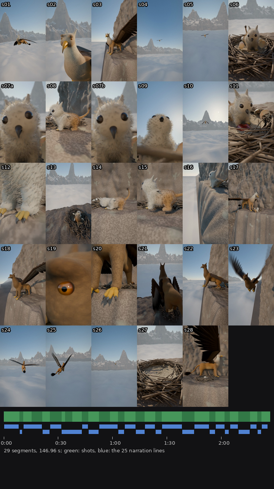

# baby-griffin-episode

The complete code behind the Wildlore baby griffin Short ("Meet the Griffins: A Baby Griffin's First Flight", Nov 2026; 2:26.96, 1080×1920, 24 fps), from narration to the upload file. It is built on `../griffin`, `../cliff-nest-set` and `../crop-plate-renderer`:
- **Shots:** 28 Blender shot scripts (`shots/s01.py` … `s28.py`); s07 is cut into two segments around s08, so the edit has 29.
- **Narration:** a 25-line script read by an older-sounding variant of the Wildlore voice (`tts.py`).
- **Soundtrack:** a synthesized string-pad score, wind ducked under the voice, and wing-beat whooshes and chick peeps cued to the animation (`audio_mix.py`), mastered to −14 LUFS.
- **Edit:** the composite and cut (`assemble.py`), the stacked adult/chick thumbnail (`thumbnail.py`), and the title and description as posted (`title_description.txt`).



The preview is `contact_sheet.py`: the middle frame of each segment, with the shot timeline (green) and the narration lines (blue).

**Used in:** the Baby Griffin episode of Wildlore. These are the scripts that made the delivered video, and `render_queue.txt` is the render order with the flags each shot's final version used. Checked before committing against the episode's own renders and audio, from a fresh clone of this branch (the full re-composite ran from the working copy of the same files):
- **Narration:** `tts.py` wrote `narration_raw.wav` and `timings.json` sample-identical to the shipped files.
- **Soundtrack:** from that narration, `audio_mix.py` wrote a `final_mix.wav` byte-identical to the shipped one.
- **Composite, cut and upload file:** from the episode's renders, `assemble.py all` re-composited all 29 segments and joined them with the mix into a `griffin_final.mp4` byte-identical to the episode's (about half an hour on 2 cores). `assemble.py upload` then re-made the uploaded `Baby_Griffin_Wildlore.mp4` byte for byte.
- **Thumbnails and sheet:** `thumbnail.py` matches the delivered thumbnails' adult half to within JPEG noise (mean difference 0.05/255 vertical, 0.08/255 16:9). The chick half differs by about 1.3/255, because s07b was re-composited for a blink fix after the thumbnails were made. `contact_sheet.py` re-made `preview.png` exactly.
- **Speech recognition:** `asr_check.py` (Whisper base.en) heard all 25 lines as written, apart from spelling ("chicks", "meters").
- **Shot scripts:** every shot script built its scene and rendered a preview frame (`quick`, or a small `test` render for s01 and the base for s27) in 13–43 s each, matching the delivered shots. `camonly` and `plate_cover.py` gave s24 the same plate coverage as its real render.
- **Queue and composite:** s24 and s26 went through `queue.sh` and `assemble.py` at 304×540 (`CPR_RES`, `CPR_OUT`, `EP_BUILD`).

The full render was not re-run for this commit. A fresh render of everything takes about 7 hours on a 2-core cloud CPU: in the episode's logs, the last render of every shot adds up to 6½ hours (`style.json` has the minutes per shot, and s11 alone took an hour), and many of those reused a plate from an earlier run, which adds roughly half an hour.

| Segment | Time (s) | Picture | Narration line |
|---|---|---|---|
| s01 | 0.00–8.71 | the adult glides over the cloud sea | 0 "High above the clouds…" |
| s02 | 8.71–10.83 | close-up of the flying adult's head | 1 "The griffin." |
| s03, s04 | 10.83–21.25 | on the ledge it spreads a wing and calls; it dives past the camera, talons out | 2 "With the powerful body of a lion…" |
| s05 | 21.25–25.50 | it flies off toward the peaks | 3 "But even the fiercest creatures…" |
| s06 | 25.50–31.92 | the hatchling rises in the nest among eggshells | 4 "Hidden within a nest…" |
| s07a, s08, s07b | 31.92–43.12 | the chick's face; side view; its face again, blinking | 5 "Covered in soft downy feathers…" |
| s09 | 43.12–46.67 | the chick calls up at the sky | 6 "For now, it is entirely dependent…" |
| s10 | 46.67–52.50 | a parent flies in with meat | 7 "Each morning, the adults return…" |
| s11, s12 | 52.50–63.04 | the chick pecks at the meat; its talons grip the nest | 8 "The chick's hooked beak…" |
| s13 | 63.04–66.58 | the nest on its ledge above the clouds | 9 "But growing up in the mountains…" |
| s14, s15 | 66.58–77.83 | the chick walks and stumbles; flapping hops | 10–11 |
| s16 | 77.83–83.62 | at the edge, a pebble falls | 12 "…plunging hundreds of metres…" |
| s17 | 83.62–87.25 | the mother lands beside it | 13 "Fortunately, its mother…" |
| s18 | 87.25–98.33 | dissolve to the juvenile exercising its wings | 14 "For nearly a year…" |
| s19, s20 | 98.33–113.50 | the eye; the talons | 15–16 |
| s21 | 113.50–116.79 | the juvenile looks out from the ledge | 17 "Eventually, the time comes…" |
| s22, s23 | 116.79–124.88 | it leaps and spreads its wings; it falls past the cliff | 18–19 "With an uncertain leap…", "For a moment, it falls." |
| s24, s25, s26 | 124.88–139.88 | it pulls out of the dive and soars toward the peaks | 20–22 |
| s27 | 139.88–142.21 | the empty nest | 23 "Not as a fledgling." |
| s28 | 142.21–146.96 | an adult guarding an egg, fade out | 24 "But as a guardian of the next generation." |

## Files
- **Paths:** `ep_paths.py` sets the work folder (`EP_BUILD`, default `build/`): renders in `build/shots/`, composited shots in `build/out/`, audio in `build/audio/`. It also puts the three sibling props on `sys.path`.
- **Shots:**
  - `shots/sNN.py`: one script per shot. Each builds its scene, keys the animation frame by frame and renders through `../crop-plate-renderer/drv.py`.
  - `sc_common.py`: `base_scene()` (the far scenery and sky), `look()`, `plate_camera()`, `flight_key()`.
  - `nest_common.py`: `nest_setup()` (the cliff, nest, shells and chick), `run()`, `quick()`, `sun_from_cam()`, `ledge_feet()` and `gait_feet()` (the chick's walk).
  - `flight_common.py`: `run_flight()`, for flying shots with a moving camera.
  - `props.py`: the meat and the pebble.
- **Render order:** `render_queue.txt`, for `../crop-plate-renderer/queue.sh`.
- **Narration:**
  - `script_lines.py`: the 25 lines, each with the pause after it.
  - `tts.py`: the narration (settings at the top).
  - `asr_check.py` and `get_asr_model.py`: the speech-recognition check this episode used (Whisper base.en) and its model download (pinned release, SHA-256 checked). For new narration, `../../shared/narration-check` is the repo's general checker, and it also finds phrase timings for cutting.
- **Soundtrack:**
  - `audio_mix.py`: the score, wind and effects, the ducking under the voice, and loudness normalisation to −14 LUFS and −1.5 dBTP.
  - `first_cut_timings.json`: the line times of the first, faster cut. The chord changes were written against it and are remapped to the final timing.
- **Edit:** `assemble.py` holds the cut (`SHOTS`, frames per segment) and each shot's composite settings (`P`: background blur, slow zoom, fades). It also makes the s17→s18 dissolve, joins the cut (`concat`) and writes the upload file (`upload`).
- **Thumbnails, sheet and copy:** `thumbnail.py`, `contact_sheet.py` and `title_description.txt`.
- `style.json`: the beat sheet, the narration with its timings, the voice and mix settings, every sound cue, the render queue with minutes per shot, the composite settings and the thumbnail settings.

Shot script flags (command line):
- `quick 1,60`: render those frames at 360×640 with everything visible, into `build/shots/<shot>/quick/`. Nest shots also take `hideobj=a+b` to hide objects in it.
- `noplate`: keep the existing plate.
- `keepbase`: keep the existing base.
- `test 5,7,9`: render only those frames and merge them into `meta.json`.
- `spp=N`: samples per frame.
- `mblur`: motion blur.
- `nodrop`: hide the cliff's drop face.
- `oldgeo` and `oldshells`: the first cliff geometry and shell placement (s14 and s15, so they match their base).
- `shaderB`: the earlier adult body shader (s20).
- Flying shots only: `camonly` writes the cameras to `cams_dry.json` without rendering, and `plateonly` renders the plate and stops.
- s01 is different: it renders its plate only with `plate`, its `test` renders frames 1, 60 and 120, and it has no `quick`.

## Reuse
```bash
cd animal-docs/baby-griffin-episode
../../setup.sh animal-docs --bpy               # bpy 5.3, scikit-image, OpenCV, sherpa-onnx, Kokoro + model, Cinzel; checks ffmpeg, rubberband
python3 tts.py                                 # build/audio/narration_raw.wav + timings.json (~2 min)
python3 get_asr_model.py && python3 asr_check.py   # optional: does speech recognition hear the script?
python3 audio_mix.py                           # build/audio/final_mix.wav (~40 s)
python3 shots/s13.py quick 1,40                # look at a shot before rendering it
mkdir -p build/queue && cp render_queue.txt build/queue/queue.txt
ONCE=1 ../crop-plate-renderer/queue.sh shots build/queue   # every shot, ~7 h on 2 cores; logs in build/queue/
python3 assemble.py all                        # build/out/*.mp4, then build/griffin_final.mp4
python3 assemble.py upload                     # build/Baby_Griffin_Wildlore.mp4
python3 thumbnail.py && python3 contact_sheet.py
```
- **Before rendering a flying shot:** `python3 shots/s24.py camonly`, then `python3 ../crop-plate-renderer/plate_cover.py build/shots`. Every value must be negative, or the plate doesn't cover the frame.
- **Re-rendering one shot:** add a line to `build/queue/queue.txt` while the queue runs. A line that's already in `done.txt` is skipped, so add any extra word (`s12.py redo`) to run it again.
- **Upload file:** `upload()` converts comp.py's untagged BT.601 video to BT.709 and tags it, because YouTube treats HD video as BT.709:
  ```bash
  ffmpeg -i griffin_final.mp4 -i final_mix.wav -map 0:v -map 1:a \
    -vf "scale=in_color_matrix=bt601:out_color_matrix=bt709:in_range=tv:out_range=tv,format=yuv420p" \
    -c:v libx264 -preset slow -crf 23 -profile:v high -level 4.2 \
    -colorspace bt709 -color_primaries bt709 -color_trc bt709 -color_range tv \
    -c:a aac -b:a 256k -ar 48000 -shortest -movflags +faststart Baby_Griffin_Wildlore.mp4
  ```
- **A new species on this pipeline:** copy the folder, then rewrite `script_lines.py`, the shot scripts, and the cut in `assemble.py` and `audio_mix.py` (`SHOTS` and the cue lists).
- **Cut on pauses:** every segment boundary sits in a pause between lines, except the deliberate mid-line cuts inside line 5 (s07a, s08, s07b) and lines 2 and 8, which each span two shots.

## Gotchas
- **Pacing:** the first cut sped the narration up to fit 2:00 (119.5 s, some lines at 1.3×). GJ said length didn't matter, so the final reads at a natural pace (Kokoro speed 1.08, pauses × 1.15) and runs 2:27. The score's chord times were kept by remapping them from `first_cut_timings.json`.
- **Render order matters:**
  - s27 copies s06's plate, so render s06 first.
  - s18 opens with a 14-frame dissolve from s17's last frame, so composite s17 first (`assemble.py all` does).
- **Sound on picture:**
  - Wing-flap whooshes are placed at `period × (k + 0.5)` seconds into the shot, minus 0.12 s, with the flap period keyed in that shot's script. Change a shot's flap period and you must change its `flaps()` line too.
  - Peeps go only where the chick's beak opens on screen (s06, s07b, s09). The reviewer caught peeps over closed beaks in s14, s15 and s17, and they were removed.
  - Effects duck 60 % under the voice, peeps 20 %, wind 62 % and music 45 %. The reviewer found the s04 fly-by whoosh covering "its own size", so it's quieter and earlier than first written.
- **Moving cameras:** each flying shot is composited onto one still plate, so its camera must stay inside the plate's view (see `../crop-plate-renderer`). The shot sets its own plate size (`plate_res`), so `CPR_RES` doesn't shrink it: s24's 2160×3840 plate takes about 7 minutes even in a low-resolution test. s24's first camera tilted through about 40° and ran off its plate. Its flight and camera now follow Hermite splines, because the earlier straight segments snapped the body's pitch at a key and flipped the tail tuft in two frames.
- **Wingbeats strobe at 24 fps:** s22 and s23 render with motion blur, which needs at least 10 samples on transparent film. s22 re-renders frames 60–123 at 12 samples.
- **Blinks:** optical-flow in-betweens ghost on a blink, so the even frames around each blink are rendered for real (the second s03, s07 and s19 lines in the queue).
- **Cliff face:** the drop face shows a black blade-shaped hole in ledge-level views, so s03, s18 and s22 use `nodrop` (see `../cliff-nest-set`).
- **Description credit line:** only descriptions that use the kit's asset pack end with the credit line from `../wildlore-blender-kit/ASSET_LICENSES.md`. This episode uses none of it (everything is procedural), so it has no credit line.
- **Peter Griffin:** GJ asked for a Peter Griffin reference. It's in the title ("Meet the Griffins") and the would-you-rather question, and nowhere in the picture. The reviewer called it off-tone for the channel. Dropping it is GJ's call; the plain title would be "A Baby Griffin's First Flight".
- **Left as delivered** (the reviewer's notes):
  - The meat reads as a glossy red lump, and no piece is torn off.
  - s16, s22 and s23 show the cliff's receding drop face as a flat, untextured band at the frame edge.

## What it can't do
- It's one episode, not a generator: a new story means new shot scripts. The creature, set, renderer, narration and mix code carry over.
- Shots render at 608×1080 and are upscaled to 1080×1920 in compositing.
- It has only run on CPU: `../griffin/blib.py`'s `render_settings` sets `cycles.device = 'CPU'`. On GJ's Mac, switching it to `'GPU'` (Metal) and raising `CPR_RES` should help, but that's untested.
- s21 was rendered before the last change to the tail tuft (`TUFT` in `../griffin/adult.py`), so a fresh render differs at the tail tip, which is mostly out of frame.

## Dependencies (tested)
- Python 3.13.18; bpy 5.3.0 (Cycles CPU), numpy 2.5.3, scipy 1.18.1, scikit-image 0.26.0, opencv-python 5.0.0, Pillow 12.3.0, soundfile 0.14.0, librosa 1.0.1, kokoro-onnx 0.6.1 (onnxruntime 1.29.0), sherpa-onnx 2.0.2
- Command-line tools: ffmpeg 6.1.1 with libx264, Rubber Band 3.3.0 (`-3`, the R3 engine)
- Models, downloaded and not stored here: Kokoro v1.0 (`../wildlore-narrator/get_models.py`) and Whisper base.en for sherpa-onnx (`get_asr_model.py`, 209 MB)
- Font: Cinzel[wght] (`../wildlore-title/get_fonts.py`)
- Sibling props: `../griffin`, `../cliff-nest-set`, `../crop-plate-renderer`
