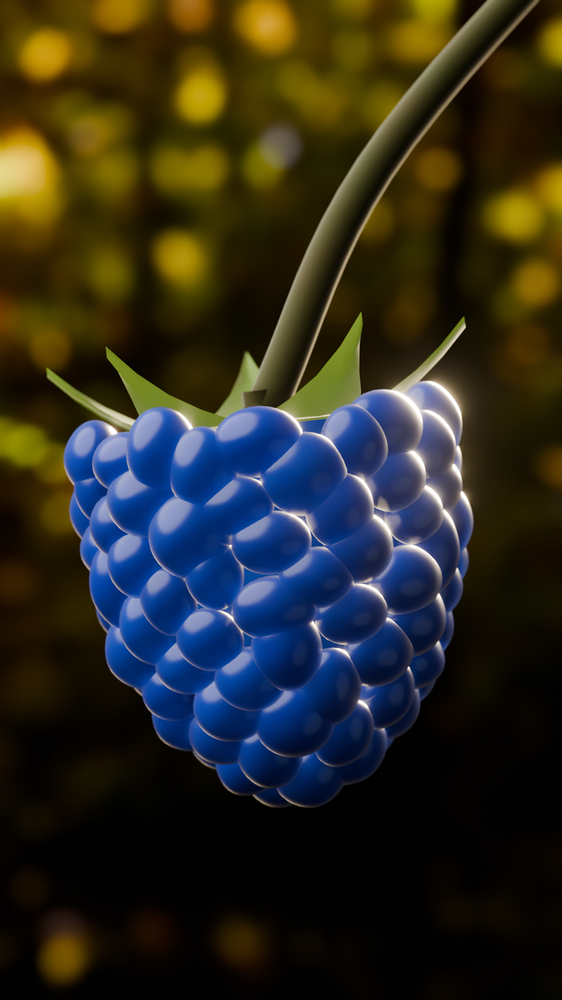
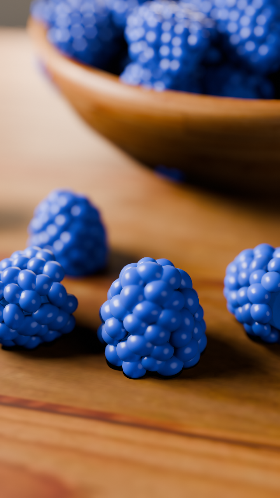

# blue-raspberry

Two close-up stills of the Wildlore blue raspberry (Rubus cyanocarpus), built on `../wildlore-blender-kit`:
- **`berry_macro.py`:** a single hero berry hanging from a curved stalk with its five green sepals.
  - Light: a soft key from the upper left and a warm rim from behind on the right.
  - Background: dark, sun-flecked forest bokeh.
  - Its 110 drupelets are deep cobalt with soft coat highlights, and the berry fills two thirds of the width.
- **`board_scene.py`:** food photography of six picked berries on an edge-glued wooden cutting board.
  - Each berry has a soft contact shadow, some stand on their open bases and some lie on their sides.
  - Light: a window from the back left, a bounce card front right and a warm rim behind.
  - At f/3.2 on a 70 mm lens, a bowl of about 70 berries further back melts into blue bokeh.

Both frames are 1080×1920 and leave the top third calm for a title (`../wildlore-title`).



The board scene:



**Used in:** The Blue Raspberry (Wildlore, Nov 2026). The two stills behind the macro and cutting-board thumbnail options, delivered alongside the robin version (`../robin`). With the shipped settings and `../wildlore-title --preset macro` or `--preset board`, these scripts made the delivered thumbnails. Both scripts were re-run from this folder at 540×960 before committing. The berry itself is the one in the episode's macro shots F and IJ.

## Files
- `berry_macro.py`: the macro still. All knobs are in `SETTINGS` at the top, grouped by render, backdrop, stalk, berry, leaves, lights and camera. Each can be overridden as `TM_<KEY>`. Two optional extras ship switched off:
  - emissive bokeh orbs: `ORBS=30`
  - dew drops with screen-space refraction: `DROPS=10`
- `board_scene.py`: the cutting-board still. Its knobs are in `SETTINGS`, overridable as `TB_<KEY>`.
  - The berry layout is a list of (x, y, 'up' or 'side', scale, yaw).
  - The bowl and two optional leaves are toggled by their settings. The leaves lie flat on the board, and berries resting on them are lifted onto the leaf surface by ray casts.
- `make_board_texture.py`: builds `build/board_strips.jpg`, the edge-glued strip board. It takes five seamless plank lengths from `hardwood2_diffuse.jpg`, mirrors two and varies their brightness. `board_scene.py` calls it if the file is missing.
- `style.json`: lights, camera, materials and where the berry lands in the frame.
- `preview.png` and `preview-board.png`: the two shipped stills, downscaled to 720×1280.

## Reuse
```bash
xvfb-run -a blender -b -noaudio --python berry_macro.py                     # out/berry_macro.png, ~3 min on 2 cores
RES=540x960 TM_SAMP=8 xvfb-run -a blender -b -noaudio --python berry_macro.py   # quick look, ~15 s
MODE=dry xvfb-run -a blender -b -noaudio --python berry_macro.py            # just print where the berry lands (px)
TM_BGU=0.30 TM_WCAM=0.6 TM_BGGAM=1.4 xvfb-run -a blender -b -noaudio --python berry_macro.py   # warmer, brighter bokeh
xvfb-run -a blender -b -noaudio --python board_scene.py                     # out/board_scene.png, ~5 min
python ../wildlore-title/wildlore_title.py out/berry_macro.png thumb.jpg --preset macro
```
- **Backdrop:** the camera sees its own patch of the forest HDRI. `BGU` is longitude (0–1) and `BGA` tilts it up in degrees, which you can tune without touching the light on the berry.
  - Golden canopy with sky flecks: `BGU` about 0.42–0.46 with `BGA` 20–30.
  - Dark trunks and green: `BGA` about 0.
  - `BGGAM` above 1 crushes the mid-tones so only bright flecks become bokeh.
- **Framing:** `DIST` sets the berry's size and `TZ` moves it up or down. Run with `MODE=dry` to read the berry's pixel box before rendering.
- **Other species:** for a different berry, change `make_berry`'s ripeness (0 = green, 0.6 = teal, 1 = cobalt) or the drupelet ramp in `bblib.mat_drupelet`.
- **New board layout:** keep berry centres at least 1.85 × radius × scale apart. The script prints `OVERLAP` if two are closer.

## Gotchas
- **Depth of field:** at 0.15 m the macro uses an 8 mm lens with a 2.88 mm sensor, the framing of a 100 mm lens. A real 100 mm at that distance puts focus too close to the focal length, and EEVEE's blur explodes.
- **Hairs:** the hero berry's fine hairs read as white scratches at this size, so `NOHAIR=1` hides them. The board scene hides them too.
- **Core:** `CORE_FACTOR=0.93` and a blue, slightly emissive core keep the gaps between drupelets from going black. At the default 0.76, the macro shows dark pits.
- **Hollows:** a picked berry's hollow facing the camera reads either as a black hole (dark core) or as a flat blue lid (blue core). The shipped board turns every hollow away from the camera.
- **Floating berries:** without contact shadows on the window light, berries on the board looked like they floated. Contact shadows on all three lights plus GTAO at 0.015 m fixed it.
- **Leaves on the board:** a compound leaf's arch dips under the board, and berries placed blindly sink into it. `flatten_onto_board()` clamps the leaf onto the surface, and `surface_z()` rests each berry on whatever is under its footprint.
- **Board grain:** the plank texture has joints at x ≈ 598 and 1563 px in its odd rows, and `make_board_texture.py` crops inside them. A procedural wave grain was tried first and read as stair-stepped ledges.

## What it can't do
- Under the same window light the drupelets all get identical round highlights, so the board berries look a little like candy. The macro hides this better with one berry and soft, directional light.
- There's no stem or calyx on the board berries (picked raspberries leave the calyx on the plant). For berries with sepals, use `calyx=True`.
- The dew drops (`DROPS`) use EEVEE screen-space refraction. They're tiny at thumbnail size, so they were left off.
- No juice, cut berries or a cross-section.

## Dependencies (tested)
- Blender 4.0.2 (EEVEE Legacy) under `xvfb-run`
- `../wildlore-blender-kit`, plus its `babylon_forest.hdr`. The board scene also needs `tex/hardwood2_diffuse.jpg` from three.js examples (MIT), in `WILDLORE_ASSETS`.
- Pillow 12.3.0 for `make_board_texture.py`. Ubuntu's Blender package uses the system Python, so `board_scene.py` can build the texture itself. With an official Blender build, which has no Pillow, run `python make_board_texture.py` once first.

No photos of real people. The only third-party image is the three.js wood texture, which `make_board_texture.py` reads at build time; neither it nor the strip board built from it is in the repo.
