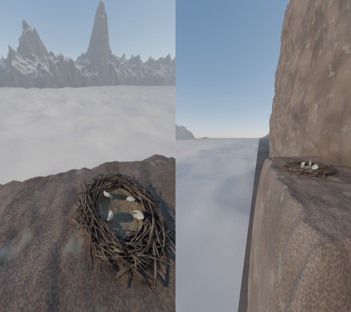

# cliff-nest-set

A mountain-cliff nest set for Blender 5.3 (bpy, Cycles): a rocky ledge on a sheer cliff, a lined stick nest with broken eggshells, and a cloud sea and jagged peaks under a physical sky.
- **`nest_scene.py`:** the near set, built from three noise heightfield sheets: the ledge top (5.6 × 3.3 m at 3.5 cm spacing), the back wall rising behind it, and the drop face falling away below. `NEST_C` is the nest centre and `height_at(ob, x, y)` drops a ray onto any sheet, for feet and props.
- **`env.py`:** the procedural rock material (with lichen), the nest (420 bent sticks around a lining bowl), stick, lining and eggshell materials, and `egg_shell_pieces`.
- **`far.py`:** `build_far(...)`, which returns the sky, a matching sun lamp, a 26 km terrain heightfield with distance haze, and a 36 km cloud-sea mesh 360 m below the ledge.



Left: the `nest` view (behind the nest, over the ledge to the cloud sea and peaks). Right: the `cliff` view (out over the drop, along the cliff to the ledge). Each is 360×640 at 16 samples from `demo.py both`.

**Used in:** the Baby Griffin episode of Wildlore (Nov 2026). It is the set of every nest, ledge and cliff shot (s03, s06–s09, s11–s23, s27 and s28), and the far scenery behind every shot. Verified from this folder: `demo.py both` renders both views in about 45 s on 2 cores.

## Files
- `nest_scene.py`: `build(coll=None, with_nest=True, res=0.035, wide=False, drop=None)` returns `{'ledge', 'wall', 'drop', 'sticks', 'lining', 'nest_z', 'rock_mat'}`.
  - `wide=True` widens and deepens the wall and drop for shots that see far along the cliff.
  - `drop=False` hides the drop face.
  - `ledge_top_fn(X, Y)` is the ledge height function.
- `env.py`: `mat_rock`, `nest`, `bowl`, `mat_sticks`, `mat_lining`, `mat_shell`, `egg_shell_pieces(name, loc, size, n, seed)`, `rock_from_cube` (displaced boulders), `heightmap_sheet`, and noise helpers `fbm2` and `_vnoise`.
- `far.py`: `build_far(sun_elev, sun_rot, sun_strength, sky_strength, clouds, sun_color, haze)` returns `{'world', 'sky', 'sun', 'terrain', 'clouds', 'to_sun'}`. It also has `height_field`, `mat_terrain`, `build_terrain`, `mat_clouds` and `build_clouds`.
- `demo.py`: the two views. `SETTINGS` (resolution, samples, sun and sky strength, shells) and `VIEWS` (sun, camera, lens, drop face per view) are at the top; `RES`, `SPP`, `OUT` and the others come from the environment.
- `style.json`: dimensions, noise layers, materials, the far scenery and both demo views.
- `preview.png`: the two views side by side.

## Reuse
```bash
python3 demo.py both                      # out/nest.png, out/cliff.png, out/sheet.png
RES=540x960 SPP=32 python3 demo.py nest
SHELLS=0 python3 demo.py cliff            # empty nest
```
```python
import sys; sys.path[:0] = [".../animal-docs/cliff-nest-set", ".../animal-docs/griffin"]
import blib, far, nest_scene
sc = blib.reset()
F = far.build_far(sun_elev=24, sun_rot=70, sun_strength=3.8, sky_strength=0.22, sun_color=(1.0, 0.78, 0.55))
N = nest_scene.build(wide=True, drop=False)
lz = nest_scene.height_at(N['lining'], nest_scene.NEST_C.x, nest_scene.NEST_C.y)   # stand a chick here
```
- **Placing creatures:** put the root at `height_at(N['ledge'], x, y)` and pin each foot to the height under it. The ledge's usable top runs about from y = −1.25 (the lip) to y = 0.8 (the wall foot), and x = ±1.9.
- **Lighting a subject:** the episode aimed the sun relative to each camera with `sun_from_cam(cam_xy, subject_xy, side)` (in `demo.py`). The sky's sun direction follows the lamp, because `blib.sky_world` negates the rotation for the sky texture.
- **Far scenery as a plate:** for long shots, render `F['terrain']` and `F['clouds']` once as a background plate and the near set separately (`../crop-plate-renderer`).

## Gotchas
- **Black blade-shaped hole:** the drop face's noise folds in places. From the ledge-level views (s03, s18, s22) that fold shows as a black, blade-shaped hole below the lip. Hide the drop face there (`drop=False`, or `nodrop` on the command line). Only keep it when the camera falls past the cliff (s23) or looks down it.
- **Flat band at the cliff's edge:** the ledge's front falloff is a smooth, steep part of a heightfield. Seen edge-on from out over the drop, it reads as a flat, untextured vertical band at the left of the cliff (s16, s22, s23). Choose camera angles that face the cliff more squarely, or accept it as the shadowed edge.
- **Steep falloff from straight above:** looking straight down at the lip shows the falloff's long faces as a fan of streaks. The episode's first vertigo shot looked wrong and was replaced by the view in `demo.py nest`.
- **`oldgeo` flag:** this restores the first geometry, with the ledge clamped at −2.5 m, no deep wall, and a drop face that doesn't curve back at the sides. It was used for s14 and s15, which were rendered before the change. It leaves a flat shelf 2.5 m below the ledge that shows from above.
- **Black crescent in the nest:** in close-ups a gap shows between the lining's rim and the sticks. The empty-nest shot (s27) scales the lining 1.09× in x and y around `NEST_C` to close it.
- **Eggshells:** place them on the lining with `height_at` (see `place_shells` in `demo.py`), not at a fixed height, or they sink and leave a dark crescent.

## What it can't do
- One set: the ledge, nest position and cliff shape are fixed by the noise seeds. Change the seeds and `ledge_top_fn` for a new location.
- No vegetation, snow, water or birds; the cloud sea is a static displaced mesh with a shader, not a volume.
- The far terrain is a heightfield seen from one side. Turning the camera around shows its edge and empty sky.

## Dependencies (tested)
- Python 3.13 with bpy 5.3.0 (Cycles, CPU), numpy 2.5.3, Pillow 12.3.0 (the sheet)
- `../griffin/blib.py` (scene, material, sky, sun and camera helpers)
