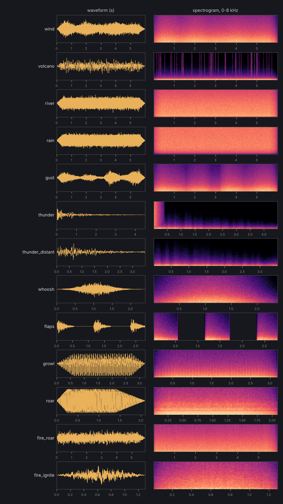

# creature-sfx

Synthesized creature, fire and weather sound effects for Wildlore, made from noise, oscillators and filters with numpy and scipy (no samples, so no licences to track). This is the whole effects track of "The Two Dragons":
- **Creatures:**
  - a big roar with vocal formants
  - a low throat growl
  - leathery wingbeats, timed to a looping flight sprite
  - air whooshes for pass-bys and wings opening
- **Fire:** a rushing, fluttering fire-breath roar with crackle, and a slower-attack version for the moment of ignition.
- **Weather and places:** a wind bed, a volcanic rumble with rock cracks, a river with bubbling, rain with drop ticks, storm gusts, and thunder with or without the close crack.
- **`Track`:** lays beds and one-shot events on a timeline, with fades, and writes the WAV.



The preview shows the waveform and 0–8 kHz spectrogram of each sound from `python demo.py --sheet`, rendered from this folder.

**Used in:** The Two Dragons (Wildlore, Nov 2026, 2:53). `../two-dragons-episode/sfx.py` is the cue sheet, built on this module. Run from that folder, it rebuilt the episode's 173 s effects stem sample for sample (8,306,000 stereo samples, all identical).

## Files
- `sfx_lib.py`: the module. `SR = 48000`. Every generator returns float stereo `(n, 2)`.
  - **Beds:** `wind_bed`, `volcano_bed(cracks=)`, `river_bed(bubbles=)`, `rain_bed(ticks=)`, `gust_bed`. Each is `(rng, n)` at full film length; place them with `Track.bed`.
  - **Events:**
    - `thunder(rng, dur, crack, seed)`
    - `whoosh(rng, dur, lo, hi, peak)`
    - `flap(rng, gain)`
    - `growl(dur, f0, seed, gain)`
    - `roar(dur, f0, seed, gain)`
    - `fire_roar(rng, dur, seed, gain, attack)`
  - **Building blocks:** `pink`, `brown`, `slow_mod`, `bp`, `lp`, `hp`.
  - **`Track(dur, seed)`:**
    - `.rng`, `.N`
    - `.env(t0, t1, fade)`, `.bed(sig, t0, t1, gain, fade)`, `.add(sig, t0, gain)`
    - `.flaps(start_frame, n_frames, gain, phase_frame=7, period=28)`
    - `.write(path, peak=0.9)`
- `demo.py`: writes one WAV per sound to `out/` with the episode's settings, normalised to −1 dBFS for auditioning. `--sheet` draws the preview.
- `style.json`: every sound's parameters and its level in the episode.
- `preview.png`: the sheet.

## Reuse
```bash
pip install numpy scipy soundfile matplotlib
python demo.py --sheet        # out/*.wav and out/sheet.png in a few seconds
python demo.py roar flaps     # just those
```
```python
import sys; sys.path.insert(0, ".../animal-docs/creature-sfx")
from sfx_lib import *
T = Track(dur=60.0, seed=11)
wind = wind_bed(T.rng, T.N)                          # make every bed first, in a fixed order ...
T.bed(wind, 0.0, 12.0, gain=1.0, fade=0.6)
T.flaps(start_frame=0, n_frames=144, gain=0.35)      # a flying sprite on screen for frames 0-143 of the film
T.add(roar(2.1, f0=92, seed=3, gain=0.34), 31.2)    # ... then the events
T.add(fire_roar(T.rng, 5.9, seed=1, gain=0.34), 40.0)
T.write("out/sfx.wav")
```
Placement used in the film:
- **Thunder:** 0.12 s after the lightning frame.
- **Roar:** at the frame the jaw is fully open.
- **Whoosh:** its peak (`peak × dur`) on the frame of fastest motion, such as wings snapping open or a body passing the lens.
- **Fire roar:** from the first fire frame, lasting until 0.08 s after the picture's fire has faded.
- **Flaps:** phase frame 7 of a 28-frame wingbeat loop, 0.1 s early, which lands on the downstroke.

## Gotchas
- **One noise stream:** every function that takes `rng` draws from it. Changing the order of calls, or inserting one, changes every sound after it. Make the beds first and append new events at the end if you need an old track to stay identical.
- **Density for short tracks:** cracks, bubbles and rain ticks default to a rate per second. The film passes its exact counts (1,600 / 5,000 / 20,000 over 173 s), which is what reproduces its stem.
- **Under narration:** in the episode mix (`../two-dragons-episode/mix.py`) the effects are normalised to −24 LUFS and ducked 45 % under the voice. Even so, the roar came within 2.4 dB of the narrator on "aggression", so it was lowered from 0.42 to 0.34. Whooshes in speech gaps sit 4–6 dB under it.
- **Water under fire:** a river or rain bed left running under a fire shot sounds wrong even when quiet. The episode carves the beds out of fire shots and fades them back in about 0.4 s before the next water shot.
- **Peaks:** `Track.write` scales the whole track down only if it peaks above 0.9. The film's stem peaked at 0.82.

## What it can't do
- No pitched creature calls besides the roar and growl: no chirps, screeches or birdsong. For birds, see the generators in `../wildlore-episode-pipeline/mix.py`.
- Everything is mono-centred or randomly left/right. There's no panning that follows a creature across the frame, and no Doppler.
- The fire roar has no ignition "whump" of its own. The film layers a short whoosh under the first 0.5 s.

## Dependencies (tested)
- Python 3.13: numpy 2.5.3, scipy 1.18.1, soundfile 0.14.0
- matplotlib 3.11.2 (only for `demo.py --sheet`)
