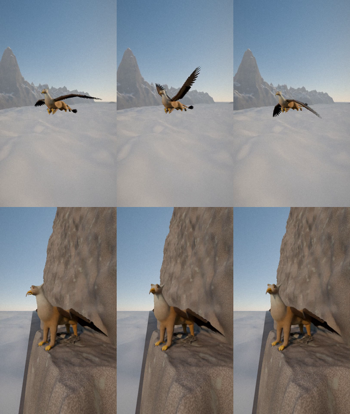

# crop-plate-renderer

A way to render Cycles shots on a 2-core cloud CPU fast enough for a 2½-minute Short. The far scenery is rendered once as a plate, the static set once as a base, and then each frame renders only the box around the moving animal. `comp.py` puts it back together in numpy and OpenCV:
- **Moving cameras:** the plate is warped per frame by a homography from the camera records.
- **Crops:** each crop is laid over the base with feathered edges.
- **Every-2nd-frame shots:** the missing frames are filled with optical-flow in-betweens.
- **Finish:** a zoom and pan, sharpening, a grade and grain, and fades, streamed to ffmpeg.



Top row, `demo.py flight` (moving camera): the plate is rendered once from a wider camera and warped every frame, and the griffin is a transparent crop. Bottom row, `demo.py perch` (static camera): plate, base and crops, rendered every 2nd frame with flow in-betweens. Both use the defaults below: 304×540 renders composited to 540×960.

**Used in:** the Baby Griffin episode of Wildlore (Nov 2026), all 28 shots. Verified from this folder before committing:
- With the episode's renders, `comp.py` re-composites s24 (moving camera, plate warp) and s13 (static camera, base and crops, zoom) to files byte-identical to the shipped shot files.
- `demo.py flight` and `demo.py perch` each run in under a minute on 2 cores. At full size (608×1080 composited to 1080×1920, 48 frames), `demo.py perch` rendered its plate in 24 s and its 25 frames in 130 s.
- `plate_cover.py` and `seamcheck.py` run on the episode's shot folders and on the demo's. On the episode's flying shots, the camera dry runs (`cams_dry.json`) give the same coverage as the finished renders.

## Files
- `drv.py` (render side, needs bpy):
  - `render_plate(name, F, hide, cam, spp, res)` renders only the far objects (`F['terrain']`, `F['clouds']`, the sky).
  - `render_frames(name, f0, f1, spp, dynamic, static, crop, to_sun, ground_z, base_spp, margin_px, step, only, motion_blur)`:
    - with `crop` and `static`: renders `base.png` without the animal, then each frame's box around the `dynamic` objects and their shadow
    - without `static`: renders the box on transparent film
    - writes `fg/NNNN.png` and `meta.json` (camera record and box per frame)
  - Also `save_plate_cam`, `cam_record`, `obj_screen_bbox`, `shadow_pts`, `set_visible` and `far_objects`.
- `comp.py` (no Blender needed):
  - `compose_shot(name, f0, f1, out_path, bg_blur, zoom, pan, fade_in, fade_out, warmth, grain, shake, hold_last, prepend, prepend_dissolve)`
  - `make_frame`, `finish`, `interp` (DIS optical flow), `homography` and `preview(name, frames, png)`.
- `queue.sh SCRIPT_DIR [STATE_DIR]`: runs the lines of `queue.txt` (`s07.py noplate keepbase test 26,28`) one at a time and logs each. Lines already in `done.txt` are skipped, so you can append and reorder while it runs. With `ONCE=1` it exits when the queue is empty.
- `plate_cover.py [SHOTS_DIR]`: for every moving-camera shot, how far the frame corners land outside the plate. It must be negative everywhere, or the composite smears edge pixels. It checks rendered shots (`plate_cam.json`, `meta.json`, `plate.png`) and camera dry runs made before rendering (`cams_dry.json`: `res`, `frames` with a `cam` record each, `plate`, `plate_res`).
- `seamcheck.py [SHOTS_DIR] s06 s08 ...`: how much each crop's border differs from the base. Above 7.5/255 shows as a seam.
- `demo.py`: the two demo shots plus `sheet`. The settings at the top: `CPR_RES`, `CPR_OUT`, `N`, `SPP`, `PLATE_SPP`, `OUT`.
- `style.json`: the episode's render, plate, crop and finish settings and timings.

Settings shared by `drv.py` and `comp.py`:
- `CPR_SHOTS`: the shots folder, default `./build/shots`.
- `CPR_RES`: the render size, default 608x1080.
- `CPR_OUT`: the composite size, default 1080x1920.

## Reuse
```bash
python3 demo.py both                                  # build/shots/{flight,perch}/..., out/flight.mp4, out/perch.mp4, out/sheet.png
CPR_RES=608x1080 CPR_OUT=1080x1920 N=48 python3 demo.py perch
python3 plate_cover.py build/shots; python3 seamcheck.py build/shots perch
mkdir -p build/q && printf 'demo.py flight\ndemo.py perch\n' > build/q/queue.txt && ONCE=1 ./queue.sh . build/q   # logs in build/q/
```
```python
# inside a scene script, after building the scene (see shot_perch in demo.py for the complete version)
import drv, comp            # with ../griffin on sys.path for blib
far_objs = drv.far_objects(F)
hide = [o for o in bpy.data.objects if o.type == 'MESH' and o not in far_objs and not o.hide_render]
drv.render_plate('s99', F, hide, cam=cam, spp=12, res=drv.RES)          # static camera: plate from the shot camera
drv.set_visible(far_objs, False)
drv.render_frames('s99', 1, 96, spp=4, dynamic=creature_meshes, static=True, crop=True,
                  to_sun=F['to_sun'], ground_z=gz, margin_px=60, step=2)
comp.compose_shot('s99', 1, 96, 'build/out/s99.mp4', bg_blur=2.0, zoom=(1.0, 1.05))
```
- **Moving camera:** render the plate from a separate wider camera (`sensor_fit='HORIZONTAL'`) and call `drv.save_plate_cam(name, plate_cam)`. Before rendering, write the cameras to `cams_dry.json` (`drv.cam_record` per frame; the episode's `flight_common.py` does it with `camonly`) and run `plate_cover.py`.
- **Fast motion:** pass `motion_blur=True` (or put `mblur` on the command line) and use at least 10 samples.
- **Re-rendering a few frames** (blinks, fixes): `only=[...]` renders exactly those frames and merges them into `meta.json`. Pass `static=None` to keep the existing base.

## Gotchas
- **A plate only covers so much rotation:** the homography only accounts for camera rotation. A 9:16 frame with `sensor_fit='HORIZONTAL'` at 34 mm covers ±28° horizontally and ±43° vertically. Tilting the camera through 40° or more (s24's first version) runs off any single perspective plate and smears polygon-shaped patches. Keep a moving camera's rotation within about ±15° of the plate's axis, or widen the plate (s24 ended at 14 mm, 2160×3840).
- **Translation is ignored:** that's fine for scenery hundreds of metres away. Anything near (cliffs, nests) has to be in the base or rendered per frame.
- **Hair isn't in the box:** the box comes from mesh vertices, so a hair tail tuft can poke out and be sliced flat (s04, s25). `render_frames` grows a box and re-renders when:
  - on a base: the box's border strips differ from the base (98th percentile of the blurred difference above 0.03)
  - on transparent film: the alpha touches the box's edge
- **Growth can false-trigger:** noise differences between 4-sample crops and the 16-sample base in busy textures can trigger growth and re-render a frame up to 3 times. s11, a hair close-up, took about an hour for 147 frames.
- **`render_plate` un-hides everything in `hide` afterwards:** filter out objects you hid on purpose (`not o.hide_render`), or they come back.
- **In-betweens ghost on blinks and fast moves:** render the even frames around a blink with `only=` (the episode did this for s03, s07 and s19).
- **Motion blur on transparent film:** at 3–4 samples the blurred wings' alpha speckles, and the denoiser doesn't clean alpha. Use at least 10 samples on those frames only (s22 frames 60–123 at 12, s23 at 10).
- **Colour metadata:** ffmpeg converts RGB to yuv420p with BT.601 and leaves the file untagged. For YouTube, convert to BT.709 and tag it in the final encode (the command is in `../baby-griffin-episode/README.md`).
- **Grain is seeded:** `default_rng(1)` per shot, so re-composites are byte-identical. Change the seed per shot if you need different grain.

## What it can't do
- No parallax for near objects on a moving camera, and no camera moves at all over a base: base shots need a locked-off camera.
- No transparency or refraction across the crop boundary. Glass, water and smoke in front of the animal have to be in every frame or in the base.
- `comp.py` grades the whole frame alike; there's no per-layer colour or depth of field (the plate's blur is a flat `bg_blur`).

## Dependencies (tested)
- Render side: Python 3.13 with bpy 5.3.0 (Cycles, CPU), numpy 2.5.3; `../griffin/blib.py`. The demo also uses `../griffin` and `../cliff-nest-set`.
- Composite side: numpy 2.5.3, opencv-python 5.0.0 (DIS optical flow), ffmpeg with libx264
