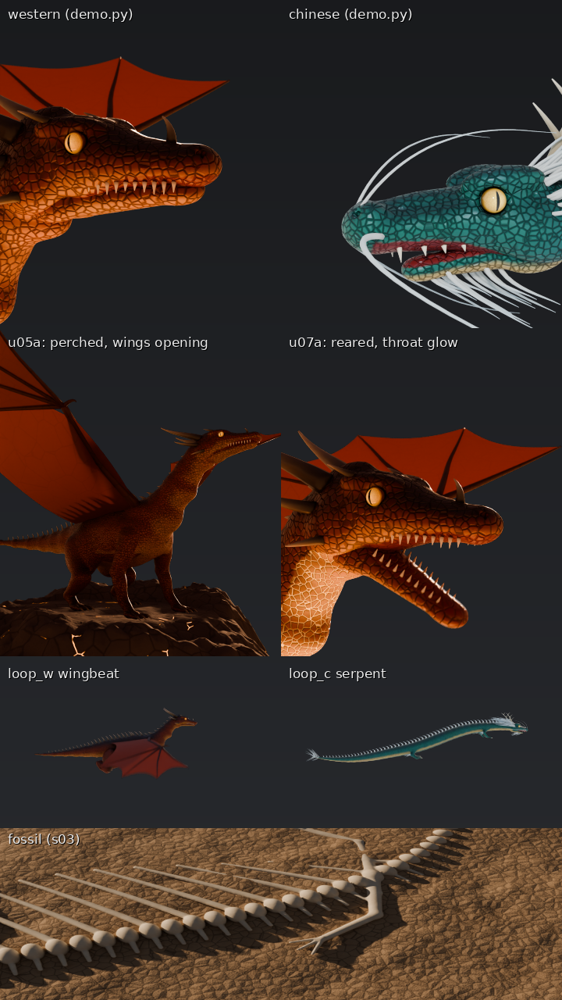

# dragons

Two procedural, rigged dragons for Blender's Python module (bpy 5.3, Cycles), built for the Wildlore episode "The Two Dragons":
- **Western dragon (*Draco ignivomus*):** a 13 m long, 17 m wingspan, four-legged, bat-winged dragon in ember red with a gold belly. It has a 50-bone rig (spine, neck, tail, jaw, legs and wing fingers) and pose helpers for perching, rearing, roaring, wingbeats and folding the wings. A keyable throat glow sells the fire-breathing build-up.
- **Chinese dragon (*Draco nubivagus*):** a 17.6 m serpent in teal with a gold belly. It has four short legs, branching horns, a white mane and beard, and long whiskers that wave on their own. It has no bones: it flies by sliding along any Bezier path through a Curve modifier.
- **The common ancestor:** a fossil skeleton lying on a 12 × 12 m sandstone slab.

Shared parts:
- **Modelling:** signed-distance primitives blended with smooth-min, meshed with marching cubes. Bone weights are generated automatically from the same primitives.
- **Materials:** procedural Voronoi-scale skin, horn, wing membrane and slit-pupil eye materials.
- **Lighting:** six presets: VOLC, GOLD, MIST, STORM, RAIN and FOSSIL.
- **Rendering:** a render loop that resumes, crops each frame to the dragon, and writes the mouth and sun screen positions for 2D effects.



The preview shows renders from this folder and from the episode:
- the Western head still (`demo.py western`)
- the Chinese head still (`demo.py chinese`)
- the Western dragon on the volcanic perch with its wings opening (episode shot u05a)
- the Western dragon reared with its throat glowing (u07a)
- both wingbeat and serpent flight loops
- the fossil (s03)

**Used in:** The Two Dragons (Wildlore, Nov 2026, 2:53). Every 3D shot, sprite loop and still of the episode was built from these modules through `../two-dragons-episode/shots3d.py`.

Verified from this folder before committing:
- **Mesh caches:** rebuilt from scratch in an empty `cache/`. Both are identical, array for array, to the ones the episode rendered with: Western 130,002 vertices and 260,000 faces, Chinese 100,002 vertices and 200,000 faces.
- **Western head still:** `demo.py western` matches the episode's shipped s02a render, apart from a 1/255 difference on fewer than 100 of 921,600 pixels (denoiser rounding). This held in two runs, one of them from a fresh clone.
- **Other scenes:** `demo.py chinese` and, at PREVIEW size, `perched`, `flying`, `serpent` and `fossil` all rendered without errors and were looked at.

## Files
- `sdf.py`: signed-distance modelling with numpy:
  - `Prim` (round cone, ellipsoid, sphere, box; `neg=True` carves)
  - `build_field`, `mesh_from_field` (marching cubes plus decimation)
  - `bone_weights` (soft nearest-primitive weights)
  - `tube`, `bezier`
- `bl.py`: Blender helpers:
  - `reset()`: Cycles, AgX Medium High Contrast
  - `mesh_obj`, `add_attr`, `store_rest`, `make_armature`, `bind`, `set_weights_fast`
  - node helpers `new_mat` and `N`
  - `render_settings`: adaptive sampling, OIDN with the FAST prefilter, persistent data
  - `camera(fit=...)`, `sun`, `point`, `area`, `sun_dir`, `key_obj`, `linear_interp`
  - `auto_border` (crops each frame's render region to the objects' screen bounds)
- `wdragon.py`: the Western dragon's shape. Settings at the top:
  - `SP`: the spine, as name, x, z, radius
  - `WING` and `LEG` joint positions
  - `build_cache()` meshes it into `cache/wdragon.npz`. `ensure_cache()` builds it only if missing.
- `wd_build.py`: the Western dragon in Blender:
  - `build(prefix, palette)` returns a dict with:
    - `rig`, `body`, `jaw`, `details` (horns, spikes, claws, teeth), `wings`, `eyes`
    - `mouth`: an empty at the snout tip, parented to the head bone
    - `parts`
  - Materials: `scale_material`, `horn_material`, `membrane_material`, `eye_material`.
  - Posing: `R(rig, bone, pitch, yaw, roll)`, `pose_wings`, `pose_legs_flight`, `pose_tail`, `pose_neck`, `key_all`.
- `cdragon.py`: the Chinese dragon's shape:
  - the radius profile `PROF_X`/`PROF_R` along +x, from the tail tip at 0 to the snout at about 17.6
  - legs at x = 8.2 and 14.0, head and jaw
  - `build_cache()` and `ensure_cache()`
- `cd_build.py`: the Chinese dragon in Blender:
  - `build(prefix, palette)` returns `root`, `body`, `jaw`, `hair` (mane, beard, whiskers), `fins`, `horns`, `eyes` and `parts`.
  - Path tools: `make_path(name, pts)`, `attach_path(D, curve)`, `path_length`, `head_frame(D)` (world head centre and forward vector after deformation), `body_point(D, x0, x1)`.
- `fossil.py`: `build()` makes the ancestor skeleton on its sandstone slab, with bone and stone materials, and returns `(bones, slab)`.
- `envs.py`: world, terrain and material helpers. The episode used three of them:
  - `world_color` (behind every lighting preset)
  - `rock_mat` with optional glowing lava cracks
  - `fbm2` and `grid_mesh` (the perch rock)
  
  The 3D sky, cloud, water and peak builders were early drafts that `../wildlore-2d-comp` replaced. They still run, but no finished shot uses them.
- `scene.py`: shot building blocks:
  - lighting presets `light(s, "VOLC" | "GOLD" | "MIST" | "STORM" | "RAIN" | "FOSSIL")`
  - `perch_rock()`, `setup_render`
  - `render_frames(name, frames, border_objs, cam, meta_fn)`: skips frames that exist and writes `meta.json`
  - `screen()` and `sun_screen()`: screen positions for 2D work
  - `rock_plate()`: renders the static rock once, then holds it out
  - `w_idle`, `w_flap`, `key_rig`, `build_w`
  - `still_w`, `still_c` with `head_cam()`
  - `loop_w` and `loop_c` (seamless sprite loops)
- `demo.py`: six ready scenes. See Reuse.
- `style.json`: sizes, palettes, rig, lighting presets, render settings and timings.
- `preview.png`: the contact sheet above.

## Reuse
```bash
pip install bpy==5.3.0 numpy scipy scikit-image fast-simplification   # or ./setup.sh animal-docs --bpy
python demo.py western        # out/renders/western/0000.png, ~30 s (the first run also builds cache/, ~10 s)
python demo.py all            # western, chinese, perched, flying (28-frame loop), serpent (48-frame loop), fossil
PREVIEW=1 python demo.py serpent   # first/middle/last frame at 34 % size, 4 samples: a few seconds
RENDERS=/path/to/renders python demo.py perched
```
A shot of your own:
```python
import sys; sys.path.insert(0, ".../animal-docs/dragons")
from scene import *                      # bl, WB (wd_build), CB (cd_build), light, render_frames, w_idle, ...
s = bl.reset(); info = light(s, "VOLC")
D = build_w(); rig = D["rig"]; rock = perch_rock()
for f in range(1, 49):
    t = (f - 1) / FPS
    w_idle(rig, t, fold=0.3, lift=0.5)                       # breathing, tail sway, half-folded wings
    WB.pose_neck(rig, pitch=0.3, head_pitch=0.1, jaw=0.6 * ease((f - 20) / 10))
    key_rig(rig, f)
cam = bl.camera("cam", (10.5, -7.5, 3.8), (2.4, 0, 4.7), lens=40, fstop=4.0)
setup_render(s, 720, 1280, 6)
rock_plate("myshot", rock, D["parts"])                      # plate.png once; the rock becomes a holdout
render_frames("myshot", range(1, 49), D["parts"], cam,
              meta_fn=lambda: {"mouth": screen(D["mouth"].matrix_world.translation), "sun": sun_screen(info)})
```
The Chinese dragon on a path. Its `root` x is the distance along the path, and the path must start at x = 0:
```python
s, info, C, path = c_setup("MIST", [(0, 0, 0), (18, 0, 0), (25, 2.6, 1.0), (32, -2.6, -0.8), (39, 2.6, 1.0), (60, 0, 0)])
for f in range(1, 96):
    bl.key_obj(C["root"], f, loc=(11 + 16 * (f - 1) / 94, 0, 0))      # slides 16 units along the path
bl.linear_interp(C["root"])
h, fwd = CB.head_frame(C)                                           # aim or track a camera at the head
```
The renders are RGBA on transparent film: composite them over backgrounds with `../wildlore-2d-comp`. The fire breath is 2D too, placed from the `mouth` and `mouth_fwd` points in `meta.json`.

## Gotchas
- **Never mix model versions inside a shot.**
  - In the episode, frames rendered before and after a change to `wd_build.py` were spliced into one shot. The eye's lid and pupil visibly changed mid-shot.
  - When you extend or patch a shot after changing a model file, re-render every frame of it.
  - `render_frames` skips existing frames, so delete the old ones first.
- **Extending a shot:** add frames before or after by shifting the frame index (see the `*_n` shots in `../two-dragons-episode/shots3d.py`). Keep the motion formulas unchanged for the original frames, so they come out identical.
- **The Chinese dragon's path:**
  - Distance along the curve is measured from its first point. Start paths at x = 0.
  - `use_stretch` and `use_deform_bounds` stay off, so the body slides instead of stretching.
  - With `root` x below the body length (about 17.6), the tail runs off the start of the curve and is extrapolated straight. Keep a straight first section.
  - The body bends only as much as the path does: wiggle the path, not the dragon.
- **Seamless loops:** `loop_c` sizes the path's wavelength (`lam`) so that 48 frames travel exactly one wave. `loop_w` keys 29 frames for a 28-frame wingbeat, so frame 28 joins frame 0.
- **Landscape renders:** use `camera(fit='HORIZONTAL')`, which `loop_w`/`loop_c` already do. The default vertical sensor fit crops wide frames.
- **Eyes:**
  - They are separate meshes parented to the head bone (Western) or the path deform (Chinese).
  - `make_eye` calls `view_layer.update()` before parenting. Without it, the eyes land at the origin.
- **Speed:** on 2 CPU cores, full-body Western frames at 720×1280 with 6–8 samples and motion blur took 8–13 s, and Chinese frames 5–9 s. That needs `auto_border`, which renders only the dragon's screen box, plus `rock_plate` holdouts.
- **Harmless warning:** `CUEW initialization failed` on machines without CUDA.

## What it can't do
- The Western dragon can't walk or run: its legs pose for perching and tuck for flight, but there's no gait cycle. There's no takeoff or landing animation.
- The Chinese dragon has no skeleton. Only the jaw, the path slide and the whisker wave move, so its legs never paddle.
- No fire, smoke or breath in 3D, and no rain or dust interaction. Those are 2D effects in `../wildlore-2d-comp`.
- **Extreme close-ups:** the eye is a sphere with a shader slit, and the scales are a procedural Voronoi bump. Past the episode's eye macro (s18a: eye about 300 px tall), they start to look procedural.
- Cycles only. EEVEE wasn't tried, and the Wildlore kit's Blender 4.0 EEVEE setup (`../wildlore-blender-kit`) isn't used here.

## Dependencies (tested)
- Python 3.13
- bpy 5.3.0 (Blender as a Python module, Cycles on CPU)
- numpy 2.5.3, scipy 1.18.1, scikit-image 0.26.0, fast-simplification 0.2.0
