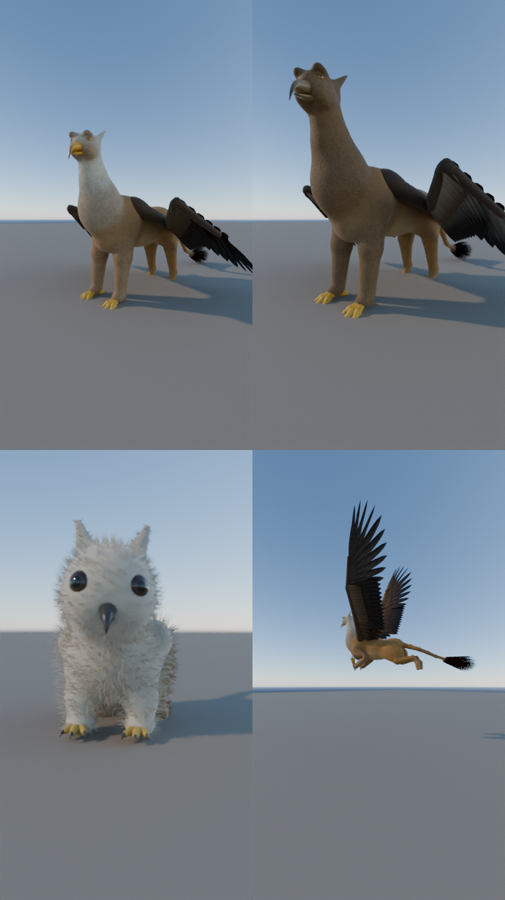

# griffin

A procedural griffin for Blender 5.3 (bpy as a Python module, Cycles on the CPU) at three ages: a downy chick, a juvenile and an adult.
- **Chick (about 0.44 m tall):** an implicit-surface body with cat ears, oversized paws, stubby wings, a lion tail with a tuft, big glossy eyes with lids, a hooked beak that opens, curling toes and claws, and particle-hair down over a spotted cream/tawny skin shader.
- **Adult (2.0 m to the ear tips, 3.2 m beak to tail tip):** a white eagle head with ear tufts and a yellow hooked beak, eagle forelegs with talons, a tawny lion body and hind legs, a tufted tail, and two wings of individual feather cards (primaries, secondaries, tertials, coverts, scapulars, underwing) that fold and spread with the arm bones.
- **Juvenile:** the adult mesh at 0.8 scale with a plain brown head and flight feathers pale at the base.
- **Rig and poses:** a 33-bone (adult) and 24-bone (chick) armature driven by `anim.py` pose functions (perch, flight cycle, chick behaviour, eye saccades) with two-bone IK feet.



The preview is `demo.py sheet`: adult, juvenile, chick and the adult mid-flap, each 360×640 at 24 samples.

**Used in:** the Baby Griffin episode of Wildlore (Nov 2026, "Meet the Griffins: A Baby Griffin's First Flight", 2:27), every creature shot. See `../baby-griffin-episode` for the shots.

Verified from this folder before committing:
- `build_chick.py` and `build_adult.py` rebuild the episode's mesh and rig caches identically (every array in the `.npz` files and both rig JSON files match).
- `demo.py sheet` renders all four stills and the preview: about 25 s to build the adult mesh the first time, then about 1 min 15 s for the four stills on 2 cores.

## Files
- `sdf.py`: a small signed-distance modelling kit with no Blender dependency. `Prim` (ellipsoids and round cones bound to bones, with blend radius and colour attributes), `build_mesh` (marching cubes), `taubin` smoothing, and `weights` (skin weights from the primitives).
- `build_chick.py`, `build_adult.py`: the two creatures as lists of primitives, plus the bone list and the eye, beak and foot anchors. Each writes a mesh `.npz` and a rig `.json` into `build/` (or `GRIFFIN_CACHE`).
- `blib.py`: the Blender helpers shared by every griffin-episode prop: scene reset, mesh objects and attributes, node-tree materials (down skin and hair, eyes, beaks, claws, toes), the `Rig` class (creature-space FK and analytic two-bone IK), armature build and bind, sky world, sun, camera and Cycles settings. `ensure_assets(kind)` builds the cache on first use.
- `feathers.py`: feather card geometry (curve, bend, asymmetric vane, emargination) and the feather material.
- `chick.py`: `Chick(name, hair, hair_parents, hair_children, scale)` with `key_lids(frame, closed)` and `key_toes(frame, curl)`.
- `adult.py`: `Griffin(name, variant='adult'|'juvenile', scale, tuft_hair)` with `key_feathers(frame, fold)`, `key_lids` and `key_toes`. `PAL` holds both palettes.
- `anim.py`: `obj_matrix`, `key_object`, `pose_creature` (FK plus IK feet), `rest_feet_world`, `flight_rots` (flap and glide cycle), `perch_rots`, `chick_rots`, `saccade_track`, and the easing helpers `ease`, `lerp`, `wob` and `keyed`.
- `demo.py`: the four stills and the sheet. The `SETTINGS` block at the top is overridable from the environment (`RES`, `SPP`, `OUT`, sun, exposure, hair counts).
- `style.json`: sizes, rig conventions, palettes, pose settings and the render look.
- `preview.png`: the sheet.

## Reuse
```bash
pip install bpy==5.3.0 scikit-image scipy pillow      # or: ./setup.sh animal-docs --bpy
python3 demo.py sheet                                  # out/adult.png, juvenile.png, chick.png, flight.png, sheet.png
RES=540x960 SPP=12 python3 demo.py chick
TUFT=1.0,0.8,0.45,420,0.0022,0.5,5 python3 demo.py adult   # the original, broom-like tail tuft
```
```python
import os, sys, math
sys.path.insert(0, ".../animal-docs/griffin")
import blib, anim
from adult import Griffin
from chick import Chick
from mathutils import Vector

sc = blib.reset()
g = Griffin("adult", variant="adult")                 # name prefix for every object: adult_body, adult_rig ...
for f in range(1, 49):
    t = (f - 1) / 24
    M = anim.obj_matrix((0, 0, 3.0), yaw=30)            # root: +Z up, the creature faces -Y at yaw 0
    anim.key_object(g.arm, f, M)
    rots, fold, bob = anim.flight_rots(t, period=1.1, amp=42, glide=0.3)
    anim.pose_creature(g.rig, f, M, rots, root_off=Vector((0, 0, bob)))
    g.key_feathers(f, fold)                           # feathers follow the wing fold
```
- **Standing:** use `perch_rots(t, fold=0.6)` and pin the feet with `feet = anim.rest_feet_world(g.rig, M, anim.ADULT_LEGS)` (set each `z` to the ground plus 0.06 × scale), then `pose_creature(..., feet=feet, legs=anim.ADULT_LEGS)`. The chick uses `CHICK_LEGS` and a 0.012 m lift.
- **Wing display:** `perch_rots(wing_spread=0..1, wing_raise=deg)` opens the wings; tweak single bones afterwards (`rots['w_hum_L'] = ...`). Feather folding is a separate call: `key_feathers(f, {'L': 0.5 * (1 - spread), 'R': 0.5})`.
- **Eyes and beak:** `json.load(open(blib.ASSETS + 'adult_rig.json'))['acc']` gives the eye centres and directions and the beak base and direction in rest space. Use them for close-ups and for placing food at the beak tip.
- **New creatures:** `sdf.py` plus a builder like `build_chick.py` and a class like `chick.py` is the pattern: primitives per bone, attributes for colour masks, skin weights from the primitives.

## Gotchas
- **Pitch sign:** in `obj_matrix`, positive pitch is nose down and negative is nose up. A leap needs negative pitch, a dive positive.
- **Folded wings look like planks:** `perch_rots` with `fold` 0.85–1.0 hangs the hand straight down, which reads as a flat board from the side. Use `fold` about 0.6–0.66 with `wing_raise` about 9, so the wing sweeps back along the body and the tip clears the ground.
- **Horn on the head:** in a 3/4 view with both wings raised, the far wing seen edge-on reads as a horn. Keep the far wing folded by copying its three wing bones from a `perch_rots(..., wing_spread=0)`.
- **Colours:** palette values are sRGB-like and go through `lin()` (c^2.2). Passing them straight to the shader washed everything out.
- **Tail tuft is hair:** it isn't in the mesh, so screen-space bounding boxes miss it; give crop renders a margin (`../crop-plate-renderer` grows crops whose alpha touches the edge). Its shape is the `TUFT` environment variable: velocity scale, clump, clump shape, count, radius, tip threshold, children. The shipped value is `0.5,0.9,-0.3,300,0.0022,0.75,8`. The first version, `1.0,0.8,0.45,420,0.0022,0.5,5`, looked like a broom in rear views.
- **Chick hair is the slow part:** the episode used `hair_parents=2600, hair_children=3`. The class default (4200/6) is denser and slower. Turning on `factor_random` with advanced hair made a huge blob.
- **Eyelids:** the lids have no UVs, so they use a plain material (`m_lid`). A UV-based material rendered them black.
- **`shaderB` flag:** if `shaderB` is on the command line, `adult.py` builds the earlier body shader. The episode used it only for s20, to match frames rendered before the shader changed.
- **Motion blur:** fast wing beats strobe without it. With Cycles motion blur on transparent film, the blurred wings need at least 10 samples or the alpha speckles.

## What it can't do
- No walk or run cycle for the adult or juvenile; they perch, display, land, leap and fly. The chick has a simple gait (see `../baby-griffin-episode/nest_common.py`, `gait_feet`).
- The adult's fur is a shader on a smooth mesh. Only the chick's down and the tail tuft are hair, so the adult body looks smooth up close.
- Feathers are single cards with a vane shader, without barbs. In extreme close-ups their edges look like paper.
- Cycles only: the materials use Cycles nodes and haven't been tried in EEVEE.

## Dependencies (tested)
- Python 3.13 with bpy 5.3.0 (Blender as a Python module; Cycles, CPU), numpy 2.5.3, scipy 1.18.1, scikit-image 0.26.0, Pillow 12.3.0
- No Blender install, fonts or downloads needed
