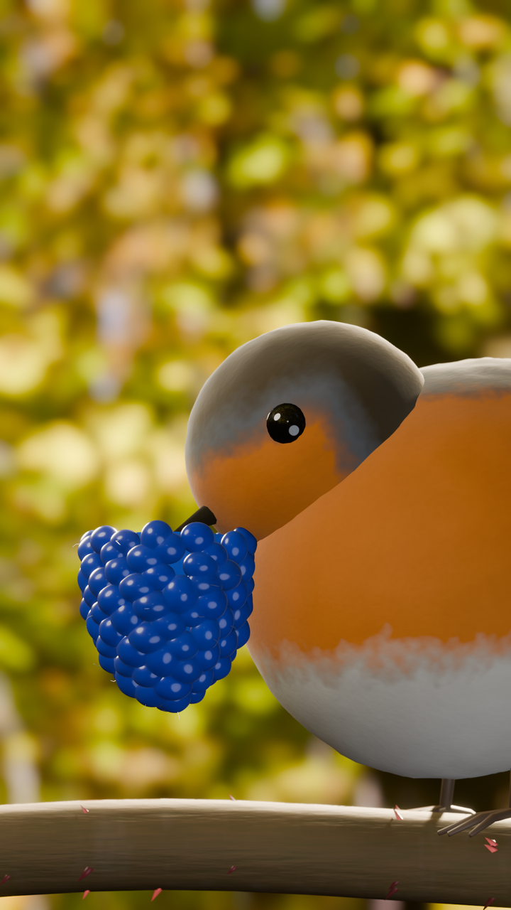

# robin

A procedural European robin for Blender 4.0 (EEVEE Legacy), about 8 cm tall:
- **Plumage:** soft-edged colour masks (olive-brown crown and back, blue-grey border, orange face and breast, white belly) over a fine feather relief.
- **Wings and tail:** each folded wing and the tail are laid feather by feather on the body.
- **Rig:** a small rig (root, hip, neck) is enough to pose and key it.

The prop ships the bird and two scenes:
- **`robin_scene.py`:** the close-up still behind the robin thumbnail. The robin holds a big blue raspberry, backlit against golden canopy bokeh.
- **`pluck_shot.py`:** shot D of the episode, where the robin plucks a berry from the cane and turns to the camera holding it.



**Used in:** The Blue Raspberry (Wildlore, Nov 2026):
- **Shot D (16.5–23.3 s):** the robin plucks a berry, made by `pluck_shot.py`.
- **The robin thumbnail option:** `robin_scene.py`, then `../wildlore-title` with its default layout.

Both scripts were re-run from this folder before committing: the still at 540×960, the pluck as single frames.

## Files
- `bird.py`: `build_robin(name="Robin", s=1.0)`. The docstring at the top documents the rig. Helpers:
  - `mat_feather()`: the body and head plumage
  - `mat_flight()`: wing and tail feathers
  - `_wing_feathers()` and `_tail_feathers()`
- `robin_scene.py`: the thumbnail still. The `SETTINGS` block at the top covers pose, held berry, lights, backdrop and camera, overridable as `TH_<KEY>`.
- `pluck_shot.py`: the animated pluck, shipped as it was rendered (163 frames). The pose keys, slide solver and berry swap are in the body. `RTB` sets the neck retraction.
- `style.json`: sizes, rig pivots, mask settings, scene lights and camera, and where the eye, beak and berry land in the frame.
- `preview.png`: the shipped robin still, downscaled to 720×1280.

## Reuse
```python
import os, sys
sys.path.insert(0, ".../animal-docs/wildlore-blender-kit"); sys.path.insert(0, ".../animal-docs/robin")
import bblib as B, bird, math
R = bird.build_robin("robin", s=1.0)
R["root"].location = (0, 0, 0.0)                         # feet on the perch
R["root"].rotation_euler = (0, 0, math.radians(90 + 30))  # face -X, turned 30 deg toward a camera at -Y
R["hip"].rotation_euler.x = math.radians(-3)               # body pitch
R["neck"].rotation_euler = (math.radians(-26), 0, math.radians(-14))   # nod down, turn head back toward profile
tip = R["neck"].matrix_world @ R["beak_tip"]               # world beak tip, after bpy.context.view_layer.update()
```
```bash
xvfb-run -a blender -b -noaudio --python robin_scene.py              # out/robin_with_berry.png, ~5 min at 64 samples
RES=540x960 TH_SAMP=6 xvfb-run -a blender -b -noaudio --python robin_scene.py
TH_NY=0 TH_NP=6 xvfb-run -a blender -b -noaudio --python robin_scene.py   # head up, turned 30 deg to camera
xvfb-run -a blender -b -noaudio --python pluck_shot.py -- anim       # out/pluck.mp4, ~12 min at 3 samples
```
- **Eye contact:** a bird looks at you with one eye, so turn the head toward profile (`NY` ≈ −`BYAW`) and keep the body turned to show the breast.
- **Keying:** animate the neck's rotation for pecks, looks and the pluck (`B.keys(neck, "rotation_euler", ...)`). In the episode the body only breathes: a driver on the body's z scale, `1+0.015*sin(frame*0.35)`.
- **Holding a berry:** parent it to the neck and place it from `beak_tip`. Keep the berry centre at least 0.0195 + 0.0098 × berry scale from the head centre, or it pokes into the head.

## Gotchas
- **Hidden beak:** a berry as big as the head hides the short beak whenever the berry sits beyond the tip along the beak axis and the head faces the camera. That happened in shot D.
  - For the still, the head is pitched down 26° and the berry hangs 11.7 mm below the tip, so the tip enters the berry's top and about 6 mm of beak shows.
  - Only about 6–7 mm of the 12.9 mm beak sticks out of the head anyway.
- **Face mask:** at close range the orange mask needs to reach up around the eye, as on a real robin. `robin_scene.py` raises the mask top from 0.0135 to 0.0165, a material tweak for the thumbnail only. The episode's bird keeps 0.0135.
- **Black feathers:** custom split normals copied from the smooth body must be multiplied by each feather's winding sign, or whole feathers render black.
- **Pluck poses:** after the pluck, a free inverse-kinematics solve for pulling back gave absurd poses (neck at −106°). `pluck_shot.py` uses keyed neck retraction instead.
- **Catchlights:** square area lights make square catchlights in the glossy eye and square highlights on every drupelet. The scene's lights are `DISK`.

## What it can't do
- The robin can't fly, hop or walk. The wings only fold, the legs are static and the beak doesn't open.
- Up close (head larger than about 500 px), the head reads as a ball on a ball with a visible seam over the breast, and the folded wing feathers look a bit like clay.
- No other species. The colour masks are robin-specific, though the body function and feather layout could be re-tinted for other small songbirds.

## Dependencies (tested)
- Blender 4.0.2 (EEVEE Legacy) under `xvfb-run`
- `../wildlore-blender-kit` and its `babylon_forest.hdr`
