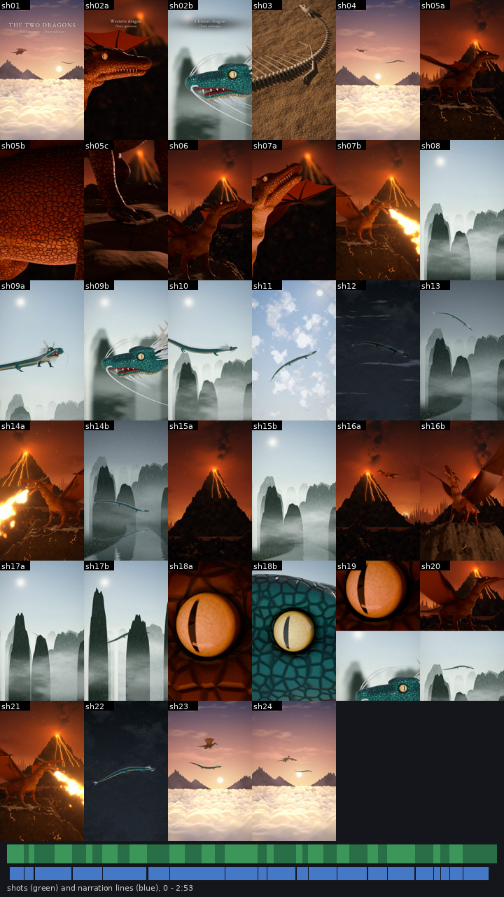

# two-dragons-episode

The complete code behind the Wildlore Short "The Two Dragons" (Nov 2026; 2:53, 4,153 frames, 1080×1920, 24 fps). It's a nature documentary comparing the Western dragon (*Draco ignivomus*) and the Chinese dragon (*Draco nubivagus*) as two branches of one ancestor. Each stage below is one script, run in order:
- **Narration:** 24 lines read by Kokoro's bm_george at natural speed, written with a line timeline (`narrate.py`).
- **3D renders:** 7 animated shots, 9 stills, 7 sprite loops, the fossil and 2 thumbnail renders, all on `../dragons` (`shots3d.py`).
- **2D edit:** 34 shots composited over painted backdrops with `../wildlore-2d-comp`, and cut to the narration's phrases (`shots2d.py`).
- **Score:** an orchestral MIDI score, time-warped to the edit (`music.py`).
- **Effects:** from `../creature-sfx` (`sfx.py`).
- **Mix:** to −14 LUFS (`mix.py`).
- **Assembly:** the master and the upload encode (`assemble.py`).
- **Extras:** thumbnails (`thumb.py`), the YouTube copy (`copy.md`) and the brief for the independent review (`review_brief.md`).



The preview shows one frame from every shot of the delivered video, with the shots (green) and narration lines (blue) laid along the 2:53 timeline.

**Used in:** The Two Dragons (Wildlore, Nov 2026). These are the scripts that made the delivered video, after GJ asked for the narration at normal speed and after both review passes.

Each stage was re-run from this folder and compared with the delivered files:

| Script | Re-run | Result |
|---|---|---|
| `narrate.py` | whole narration | identical to the sample (8,306,861 samples), same `timeline.json` |
| `music.py` | whole score | MIDI byte-identical; FluidSynth render sample-identical on the same machine |
| `sfx.py` | whole effects stem | sample-identical |
| `mix.py` | whole mix | final mix sample-identical (24-bit) |
| `shots3d.py` | s18b still; u16b_n frames 40 and 100 | within 1/255 on under 0.3 % of pixels (denoiser rounding); `meta.json` identical |
| `shots2d.py` | 17 frames from 16 shots; the whole of sh02a | the frames byte-identical to the original project's; sh02a's decoded frames identical |
| `assemble.py` | master | video and audio streams packet-identical to the delivered master |
| `thumb.py` | both thumbnails | byte-identical to the delivered JPEGs |

## Files
- **Narration:**
  - `script.txt`: the 24 lines.
  - `narrate.py`: Kokoro v1.0 bm_george, en-gb, speed 1.0, with these settings at the top:
    - "... " prefix (stops the first word being swallowed)
    - per-line text fixes
    - trim
    - inner pauses capped at 0.32 s
    - `PAUSE_AFTER` per line, `INTRO` 1.0 s, `OUTRO` 3.2 s

    Writes `$WORK/vo/vo_raw.wav` and `timeline.json`.
- **`shots3d.py`:** every Blender render (`--list`). Its docstring lists each shot's frame count and content.
  - The `*_n` shots are the first cut's animations with pre-roll and post-roll for the slower read: the motion runs on `fo = f - D`, so the original frames come out identical.
  - Writes `$RENDERS/<shot>/`.
- **`shots2d.py`:** the edit:
  - `CUTS` (each shot's first frame) and `TOTAL`
  - one `f_<shot>(i, t, n)` per shot
  - `FLASHES` (lightning frames in sh12), `PAIRS` and `SEGS19` (the four split-screen comparisons)
  - `render()`

  Writes `$WORK/shots/<shot>.mp4`, or JPEG stills with `prev`.
- **`music.py`:** the score:
  - eight sections, 72 BPM as written, General MIDI instruments
  - `W()` maps the first cut's cue times onto the final cut through anchors at section boundaries and three hits: the fire cut, the roar and the end title
  - writes `music.mid` and `music_raw.wav` (FluidSynth, FluidR3_GM, gain 0.55)
- **`sfx.py`:** the effects cue sheet. Beds are mapped by shot, and effects tied to animation are placed from render frames.
- **`mix.py`:** voice chain, loudness targets, ducking, fades, −14 LUFS and the limiter. Its docstring has the numbers.
- **`assemble.py`:** concatenates the shots without re-encoding, adds AAC 256k, then makes the upload copy (x264 medium CRF 19, max 16 Mb/s). `--master` skips the upload copy.
- **`thumb.py`:** the 9:16 and 16:9 thumbnails, from the `t_w` and `t_c` renders.
- **`review_brief.md`:** the reviewer subagent's brief as a template, with what each of the three passes found.
- **`copy.md`:** title, description and thumbnail notes, following the Wildlore rules.
- **`style.json`:** every cut, the runtime, render, compositing and audio numbers, and the timings.
- **`preview.png`:** the shot sheet above.

## Reuse
Everything goes to `$TWO_DRAGONS_WORK`, default `build/` here:
- `vo/`
- `renders/`: set `RENDERS` to use renders elsewhere
- `shots/`
- `audio/`
- `prev/`
- the final MP4s and thumbnails

```bash
./setup.sh animal-docs --bpy                          # from the repo root: packages, fonts, Kokoro, Whisper, Blender module
python narrate.py                                     # ~3 min
python ../../shared/narration-check/check.py words script.txt build/vo/vo_raw.wav --timeline build/vo/timeline.json
python ../../shared/narration-check/check.py phrases build/vo/vo_raw.wav --timeline build/vo/timeline.json --out build/vo/phrases.json
for s in $(python shots3d.py --list); do python shots3d.py $s; done     # ~3 h on 2 CPU cores; resumable
PREVIEW=1 python shots3d.py u07b_n                    # 3 low-res frames to check a shot first
python shots2d.py prev sh07b 0,60,140                 # look at single frames
python shots2d.py all                                 # ~40 min
python music.py && python sfx.py && python mix.py     # ~1 min
python assemble.py                                    # master in ~30 s, upload copy ~8 min
python thumb.py
```
**For a new episode in this style** (two creatures compared, or a sequel):
1. **Narration:** write `script.txt`, run `narrate.py`, and check it with `words` until there are 0 errors.
2. **Phrases:** run `phrases` to get the cut points.
3. **Shots:** copy the shot functions you need from `shots3d.py`. Cameras, poses and lighting presets come from `../dragons/scene.py`, and the new creatures go in their own prop.
4. **Edit:** write `CUTS` from the phrase list. Shots start 2–5 frames before the phrase they illustrate, or in the pause before it.
5. **Shot functions:** write `f_<shot>` functions using the `../wildlore-2d-comp/layers.py` recipes.
6. **Sound:** rewrite the score's cue sheet and `sfx.py`'s cues against the new `CUTS`. Drop `W()` (the identity map) until you re-time an existing cut.
7. **Copy:** fill in `review_brief.md` and hand it to a separate reviewer subagent. Fix what it finds, then resume the same reviewer for a verification pass.

## Gotchas
- **Narration speed:** the first cut read the script at 1.34× to fit 2:00. GJ found it "too sped up", and normal speed is the house speed now.
  - At normal speed this script runs 2:53, about 124 words a minute overall.
  - Shorts allow 3:00, so budget about 330 words.
- **Re-pacing a finished cut:**
  - Map every old cut onto the new phrase times.
  - Stills and sprite shots just get longer.
  - Fixed-length animations need more frames, never a freeze or slow motion: add pre-roll or post-roll by shifting the frame index (see the `*_n` shots). That rendered 330 extra frames in about 1 h.
  - Effects tied to an animation are placed from the render's frames, not warped.
- **Warp the score per section, not per cut.** The first re-timed score anchored every cut, and the river ostinato lurched by 12 % at one cut. Anchor only at section changes and big hits.
- **Model versions:** the review's blocker was an eye that changed shape mid-shot. The extended shots mixed frames rendered before and after a change to `../dragons/wd_build.py`. All 402 reused frames were re-rendered (1.3 h). Re-render whole shots after any model change.
- **Lightning:**
  - Composite bolts behind the dragon.
  - Keep strike points off its path: the second strike moved from x 0.30 to 0.16.
- **Water under fire:** the river and rain beds once ran under the fire shot sh14a. Carve beds out of shots that don't show their source.
- **Labels:** "Chinese dragon" over the pale mist sky needs the label band at 0.6, not 0.34. That raised contrast from 2.2:1 to 3.1:1.
- **Kokoro:**
  - The "... " prefix stops it swallowing first words.
  - "mist-covered" was read as one smeared word: line 16 is fed as "mist covered".
  - Check every new script with `../../shared/narration-check`.
- **Render times:**
  - About 9–13 s a frame for the animated Western shots, 5–9 s for the Chinese, and 25–65 s for stills (see `../dragons/style.json`).
  - Run long renders in the background, and check in the same turn.

## What it can't do
- It's one episode's code, not a template engine. Shot functions hard-code cameras, poses, timings and backdrop choices.
- The sound and music cue sheets are in seconds of the final cut. Changing `CUTS` means moving cues by hand, or through a `W()` map like the one used for the re-pacing.
- No captions or subtitles. Titles and labels are burnt into the picture.

## Dependencies (tested)
- Python 3.13 with numpy 2.5.3, scipy 1.18.1, opencv-python-headless 5.0.0.93, pillow 12.3.0, soundfile 0.14.0, mido 1.3.3 and pyloudnorm 0.2.0
- kokoro-onnx 0.6.1 with onnxruntime 1.29.0, and the Kokoro v1.0 model (`../wildlore-narrator/get_models.py`)
- bpy 5.3.0 (Cycles CPU), scikit-image 0.26.0, fast-simplification 0.2.0
- FluidSynth 2.3.4 with FluidR3_GM.sf2, and ffmpeg 6.1.1
- `../dragons`, `../wildlore-2d-comp`, `../creature-sfx`, `../../shared/narration-check`
