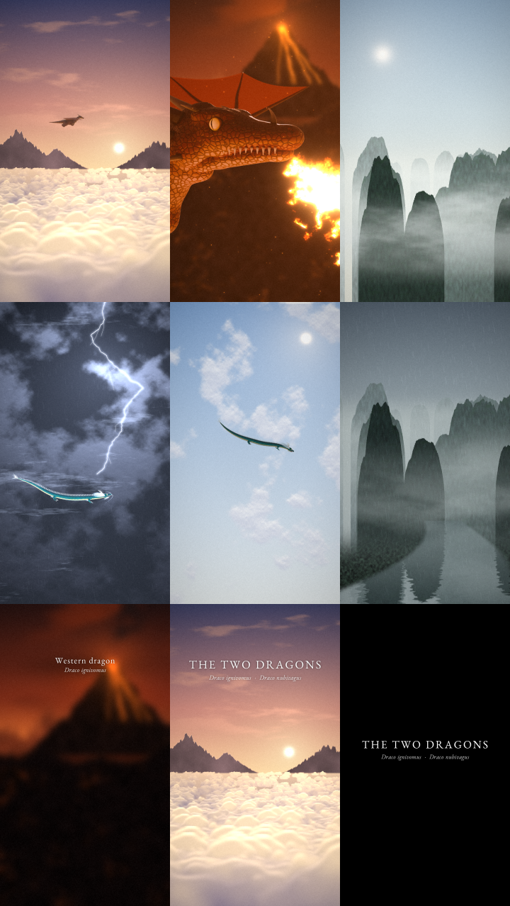

# wildlore-2d-comp

The numpy and OpenCV compositor behind every frame of the Wildlore episode "The Two Dragons". It paints whole environments in 2D and puts transparent Blender renders of the creatures over them, which is much faster than modelling 3D sets on a 2-core CPU. It covers:
- **Painted backdrops:**
  - golden sky with a sun, cirrus, peaks and a sea of puffy clouds
  - erupting volcano with lava glow and smoke
  - Guilin-style karst mountains in ink-wash mist, optionally with a river
  - storm sky with lightning
  - bright blue sky with drifting clouds
- **Weather and particles:** rain, drifting mist bands, rising embers, lightning bolts.
- **Fire breath:** a turbulent jet with smoke, glow and sparks. It's aimed from the mouth points that `../dragons` writes into each render's `meta.json`.
- **Creature layers:** render sequences and sprite loops placed, graded and hazed into the scene. Static rock plates, contact shadows and light wrap are included.
- **Text:** species labels, the title card and the end card in EB Garamond.
- **Finishing:** slow zoom or pan, vignette and per-frame grain, then an ffmpeg writer that only keeps finished files.



The preview is `python demo.py` run from this folder: one frame of each look at 1080×1920. The dragons in it are `../dragons/demo.py` renders.
- **Top row:** golden cloud sea with the Western dragon in flight; the volcano with the Western dragon breathing fire; karst mist.
- **Middle row:** the storm with a bolt behind the Chinese dragon; bright sky; karst river in rain.
- **Bottom row:** a species label; the title card; the end card.

**Used in:** The Two Dragons (Wildlore, Nov 2026, 2:53, 4,153 frames). All 34 shots were composited with these three modules by `../two-dragons-episode/shots2d.py`.

Verified from this folder:
- **Same output as the episode:** frames rendered with the copy of `shots2d.py` in `../two-dragons-episode`, using these modules, were compared pixel for pixel with the frames the original project rendered. That copy imports `layers.py` instead of defining the helpers itself. See that README for the frame list.
- **Demo:** `demo.py` (all panels and `--clip storm`) and `get_fonts.py` ran, both with `dpkg-deb` and with only the Python `zstandard` package.

## Files
- `comp.py`, the core:
  - `W`, `H`, `FPS`: 1080, 1920, 24
  - `R`: the renders folder, env `RENDERS`
  - Easing: `ss` and `ssf` (smoothstep for arrays and scalars)
  - Noise: `noise`, `fft_noise` (tileable, can be anisotropic), `scroll` (padded, seam-free scrolling noise), `tex2`/`rolled` (for tileable textures)
  - Compositing: `over` (premultiplied), `screen`, `place` (warp a layer to a position, scale and angle), `full_frame` (upscales 720×1280 renders), `haze_layer`, `grade_layer`, `light_wrap`
  - `finish(img, f, grain, vig, zoom, pan, contrast, sat)`
  - Text: `text_layer([(text, y, size, italic, tracking, alpha)])` (centred lines with a soft shadow) and `add_text`
  - `Writer(path)`: pipes RGB frames to ffmpeg x264 CRF 17 and renames the `.tmp.mp4` only if ffmpeg succeeds
- `bgs.py`, backdrops and effects:
  - Skies: `sky_gradient`, `sun_glow`, `cirrus`, `cloud_sea`, `cloud_sea_puffs` with `puff_sprites`, `peak_layer`
  - Volcano: `volcano_bg(t, hz, vx, vh, vw, ...)` and `Embers`
  - Karst: `karst_layer`, `karst_bg(t, hz, sun, river, mood="mist" | "rain")`, `add_river`, `Mist` with `apply_mist`
  - Storm: `storm_bg(t, flash, flash_xy)`, `bolt(seed, x0, y0, x1, y1)`, `Rain`
  - Fire: `fire_jet(img, ox, oy, ang_deg, L, t, intensity, w0, w1, grow, smoke)` and `sparks`
- `layers.py`, the shot-level helpers the episode's shots call. Its docstring lists them:
  - Creatures: `dragon`, `sprite` with `SPRITE_RES`, `plate`, `west_frame`, `fire_for` with `mouth_gap`
  - Backdrops: `gold_sky`, `volc`, `mist_bg`, `bright_sky`, kept by `cached`
  - Overlays: `embers`, `mist_over`, `rain_over`, `label_layer`
  - Split screens: `panel`
  - Small helpers: `push`, `fade`, `hz_from`, `mpos`
- `get_fonts.py`: downloads `EBGaramond12-Regular.otf` and `EBGaramond12-Italic.otf` (SIL OFL, Georg Duffner) into `fonts/`.
  - The files come out of the exact Ubuntu `fonts-ebgaramond` package the episode used, and every hash is checked.
  - `comp.py` falls back to the system copies in `/usr/share/fonts/opentype/ebgaramond/`.
- `demo.py`: the nine panels and a `--clip` mode.
- `style.json`: every backdrop's colours and parameters, the fire, text, finish and encode settings, and timings.
- `preview.png`: the demo sheet.

## Reuse
```bash
pip install numpy opencv-python-headless pillow
python get_fonts.py                                     # once
python ../dragons/demo.py western flying serpent        # optional: creatures for the demo (bpy), ~7 min
python demo.py                                          # out/*.png and out/sheet.png in ~30 s
python demo.py --clip storm                             # out/storm.mp4 (2 s)
```
A shot is a function of the frame index `i`, time `t` and length `n` that returns an RGB float frame:
```python
import os, sys, math
os.environ.setdefault("RENDERS", "/path/to/renders")    # before the import: comp.R is read once
sys.path.insert(0, ".../animal-docs/wildlore-2d-comp")
from layers import *

def my_shot(i, t, n):                                    # the episode's sh07b, simplified
    hz = hz_from(cam=(11.0, -10.5, 2.2), tgt=(3.0, 0, 3.8), lens=26)     # horizon height from the Blender camera
    fire = fire_for("u07b", i, t, start=0, end=n - 4)                    # aimed from renders/u07b/meta.json
    img = west_frame("u07b", i, t, hz, fire=fire, plate_name="u07b")     # volcano + rock plate + dragon + embers
    return finish(img, i, zoom=push(i, n, 1.0, 1.06))

w = Writer("out/my_shot.mp4")
for i in range(96):
    w.write(my_shot(i, i / FPS, 96))
w.close()
```
Other recipes, from the episode:
- **Sprite flight:** `over(gold_sky(t), sprite("l_w_side_gold", i, x, y, 0.3, haze=(0.95, 0.7, 0.55), k=0.3))`, with `x` moving across the frame.
  - Loops rendered at half size need `SPRITE_RES[name] = 2.0`.
  - Wingbeats stay in sync because the loop index is `i % len`.
- **Labels:** `add_text(img, label_layer("Chinese dragon", "Draco nubivagus", 0.6), fade(i, n, 3, 3))`. Use a band strength of 0.6 over pale skies.
- **Split screen:** `panel(name, focus, zoom, backdrop, i, n)` twice, stacked with a 4 px light divider. See `f_sh19` in the episode.

## Gotchas
- **Draw lightning before the creature.** Bolts composited after the sprite ran across the dragon's neck in the first cut. Also keep strike points clear of the creature's path.
- **Scrolling noise:** use `scroll()`, which slices a padded field. Wrapping a non-tileable field with `np.roll` showed hard seams. `rolled()` is only for the tileable `fft_noise` textures.
- **Anisotropic `fft_noise`:** `aniso` stretches along x (`kx * aniso`). That's what makes rain streaks and wind-blown mist run the right way.
- **Memory:** unbounded caches ran a 2-core, 1080×1920 session out of memory mid-episode.
  - `cached()` keeps about 10 backdrops, and the image cache in `comp.py` clears at 400 entries.
  - The episode clears both between shots.
- **Cloud sea:** scrolling the puffy sea showed repeating stripes. The episode keeps one seed (5) and only applies a slow zoom drift (`gold_sky`'s `z = 1 + 0.0025 t`).
- **Fire aim:** `fire_for` gets its scale (pixels per metre) from the distance between the `mouth` and `mouth_fwd` points.
  - `mouth_gap` pulls the jet's origin 0.15 m back and 0.28 m down, so it starts inside the jaws.
  - `bias=-22` tilts it down to match the Blender firelight.
  - With no meta, it returns `None` and nothing is drawn.
- **Fonts:** `comp.py` reads the font paths once at import. Run `get_fonts.py` first. The variable EB Garamond from Google Fonts also works through `WILDLORE_SERIF`/`WILDLORE_SERIF_ITALIC`, but letter shapes and spacing differ slightly from the shipped video.
- **Determinism:** grain is seeded by the frame index and particles by their key, so re-rendering a shot reproduces it exactly.
- **Speed on 2 cores:** 0.2–0.8 s per 1080×1920 frame for most shots, and 1–1.7 s for shots with a dragon render, a rock plate and fire. The whole episode composited in about 40 minutes.

## What it can't do
- No true parallax or 3D camera moves: backdrops are flat layers with drift and zoom. Big camera moves give the trick away.
- The fire doesn't light the scene. Only its own glow and the firelight baked into the Blender render brighten the creature.
- No depth of field or motion blur on 2D layers, beyond blurring a whole backdrop (`blur_px`).
- Only the 1080×1920 Shorts format was used. `W`/`H` are module constants, and the backdrop layouts assume a portrait frame.

## Dependencies (tested)
- Python 3.13: numpy 2.5.3, opencv-python-headless 5.0.0.93, pillow 12.3.0
- ffmpeg 6.1.1 (for `Writer`)
- `get_fonts.py`: `dpkg-deb`, or `zstandard` 0.25.0 (`pip install zstandard`)
