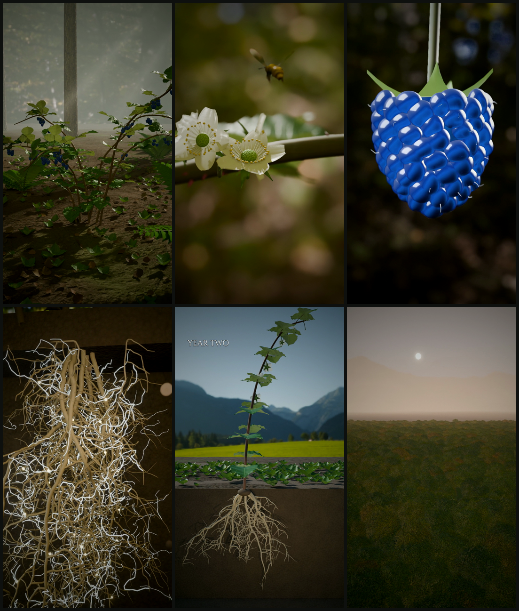

# wildlore-blender-kit

The Blender toolkit behind every shot of the Wildlore episode "The Blue Raspberry". It's one Python module, `bblib.py`, built for Blender 4.0 with EEVEE (Legacy), and it covers:
- **The house look:** AgX Medium High Contrast, soft shadows, GTAO, optional bloom, 7-blade bokeh, and a compositor with vignette, fog and grain.
- **Worlds:** HDRI worlds where the backdrop the camera sees can be brighter or darker than the light the world casts.
- **Camera, light and animation helpers.**
- **Mesh and node builders.**
- **The whole blue-raspberry bramble:** berries made of individual drupelets, canes with prickles, compound serrated leaves, five-petal flowers, clusters and whole plants.
- **Forest set dressing:** ground with leaf litter, ferns, trunks, rocks, ground cover and light rays.



The preview shows frames from the finished episode, all made with this module: the forest bramble (B), blossoms with the bee (C), the macro berry (F), the root cutaway (K), the two-year growth cycle (N) and the closing field (S).

**Used in:** The Blue Raspberry (Wildlore, Nov 2026). All 21 shots and the three thumbnail options import this file. The prop folders that build on it are:
- `../blue-raspberry`: the berry macro and cutting-board stills
- `../robin`: the robin, whose `bird.py` imports this module
- `../wildlore-episode-pipeline`: timeline, music, mix and assembly for the episode

The asset pack was checked against the episode's asset folder by SHA-256 (all 12 files identical). A trunk-and-mossy-rock close-up, `../blue-raspberry`'s berry macro and board scene, and `../robin`'s robin scene all render pixel-identical from a pack downloaded by `get_assets.py` into an empty folder.

## Files
- `bblib.py`: the module. A docstring at the top lists its sections. The settings at the top are:
  - `ASSETS`: the asset folder, set with env `WILDLORE_ASSETS`, default `/home/claude/assets`
  - `FPS = 24`
  - `RES`: set with env `RES`, default `1080x1920`. Set `RES=540x960` for quick looks.
  - `LEAF_RES`
  - `BERRY_LOD`
  - `CORE_FACTOR`
- `get_assets.py`: downloads the asset pack into `ASSETS` (see Assets below). `--check` only reports.
- `ASSET_LICENSES.md`: where each asset comes from, its licence, and the credit line for video descriptions.
- `style.json`: render settings, colours and sizes.
- `preview.png`: six frames from the episode.

## Reuse
Shot scripts start like this:
```python
import os, sys
sys.path.insert(0, os.path.join(os.path.dirname(os.path.abspath(__file__)), "..", "wildlore-blender-kit"))
import bblib as B
OUT = os.path.abspath("out"); os.makedirs(OUT, exist_ok=True)
sc = B.reset()
B.setup_render(sc, frames=120, out=os.path.join(OUT, "shot.mp4"), samples=3, gtao_dist=0.2)
B.world_hdri(sc, "babylon_forest.hdr", strength=0.9, cam_strength=1.0, rot=3.4)
plant = B.make_plant("bramble", loc=(0, 0, 0), seed=4, stage='fruit', hero_berries=2)
cam = B.camera((0.0, -1.2, 0.5), (0, 0, 0.45), lens=60, fstop=4.0)
B.compositor(sc, vignette=0.25, grain=0.02)
B.render(sc, os.path.join(OUT, "shot.mp4"))      # or B.render_still(sc, 1, os.path.join(OUT, "still.png"))
```
This exact script (at `frames=2`) was run against the committed `bblib.py`. Paths passed to `render` should be absolute.
Run it with Blender. On a machine without a display, EEVEE needs `xvfb-run`:
```bash
xvfb-run -a blender -b -noaudio --python shot.py
FRANGE=40-60 RES=540x960 xvfb-run -a blender -b -noaudio --python shot.py   # part of a shot, half size
```

Useful pieces:
- `make_berry(name, ripeness, scale, hero, seed, calyx=True, stem_len, N, seg, rings)`
  - Returns `(root, fruit)`. The root carries the calyx (or nothing, with `calyx=False`), and +z runs from the attachment to the tip. Hang a berry with a rotation of `(pi, 0, 0)`.
  - Hero berries have 95 drupelets and fine hairs. Background ones have 70.
  - The fruit's object colour R is ripeness: 0 is green, 0.6 teal, 1 cobalt.
- `make_cane(name, ctrl, r0, r1, prickles=True)` returns `(obj, P, radii)`. `P` and `radii` are the sampled centreline, so they work as attach points for `make_cluster(...)` and `attach_leaf(...)`.
- `make_plant(name, loc, seed, n_canes, height, stage, hero_berries, ...)` builds a whole arching bramble. `stage` is 'leaf', 'flower', 'fruit' or 'mixed'.
- `world_hdri(sc, name, strength, cam_strength, rot, tint, sat, clamp_bg)`: the world as the camera sees it gets its own strength and is clamped to `clamp_bg`. Lighting and backdrop can then be tuned separately.
- `camera(loc, target, lens, fstop, focus)` and `camera_path(cam, f0, f1, pos_fn, tgt_fn, focus_fn)` key a camera move from functions of time.
- `forest_env(sc, ...)` builds the whole forest floor set in one call: HDRI, ground, litter, ferns, rocks and trunks, with a clearing kept empty for the subject.
- `load_bee(...)` imports Bee.glb with its skeletal hover action. `bee_land_switch` blends it into a landing.

## Assets (downloaded, not stored here)
`./setup.sh animal-docs` (or `python get_assets.py`) downloads the asset pack into `ASSETS`: 12 files, 56 MB, in about 3 s. Each file comes from a public GitHub repository at a pinned commit and is checked by SHA-256. They're the exact files the episode was rendered with. `ASSET_LICENSES.md` has the commits and licences.

| file | used by | source (licence) |
|---|---|---|
| `hdri/babylon_forest.hdr` | forest shots, thumbnails (`world_hdri`, `forest_env`) | Babylon.js playground `forest.hdr` (Apache 2.0) |
| `hdri/babylon_country.hdr` | farm and table shots | Babylon.js playground `country.hdr` (Apache 2.0) |
| `hdri/noon_grass_2k.hdr`, `hdri/kiara_1_dawn_1k.hdr` | episode shots P (the pluck) and S (the closing field) | Poly Haven (CC0), via google/filament and pmndrs/drei-assets |
| `tex/rockyGround_basecolor.png`, `tex/rockyGround_normal.png` | `mat_forest_floor` | Babylon.js playground textures (Apache 2.0) |
| `tex/BroadleafBark.jpg` + `_Normal.png` | `make_trunk` | BabylonJS/Assets `meshes/Trees/` (CC BY 4.0) |
| `tex/Moss_01_Color.png` + `_Normal.png` | `mat_moss` | cgbookcase (CC0), via google/filament |
| `models/Bee.glb` | `load_bee` | BabylonJS/Assets `meshes/Bee.glb` (CC BY 4.0) |
| `tex/hardwood2_diffuse.jpg` | table, bowl, board texture | three.js `examples/textures/` (MIT) |

**Credit:** the bee and the bark are CC BY 4.0. End every video description with the credit line in `ASSET_LICENSES.md`.

## Gotchas
- **Macro depth of field:**
  - EEVEE's circle of confusion blows up when the focus distance gets near the focal length. For close-ups, use a short lens with a matching small sensor, e.g. `lens=8` and `sensor_width = 36 * 8 / 100` for a 100 mm-equivalent framing (see `../blue-raspberry/berry_macro.py`).
  - Raise `sc.eevee.bokeh_max_size` for big background bokeh, e.g. 220 × width / 1080.
- **Hollows and gaps in picked berries:**
  - The berry's core is its own material slot, `BerryCore`, which is matte and pitted. Without it, picked berries' hollows read as glass.
  - `CORE_FACTOR` sets the core's radius relative to the berry: 0.76 by default. Macro shots raise it to 0.93 and tint the core blue with a little emission, so the gaps between drupelets aren't black.
  - `berry_mesh` caches by its parameters, including `CORE_FACTOR`.
- **White band on leaves:** a bright band along leaves and fern fronds is Fresnel specular at grazing angles, not the bump. The fern fronds (`FernLeaf` in `make_fern`) use `spec=0.06, rough=0.8`.
- **Hairs:** hero berries' hairs read as scratches at macro scale. Hide `BerryHair` (alpha 0, `CLIP`) for close stills.
- **Temp files:** `render()` writes `<name>_tmp.mp4` and renames it when Blender finishes. Never let a post pass use a temp name another job might be writing. This once corrupted a shot mid-render.
- **Bark and moss without the pack:** if the bark or moss files are missing, `make_trunk` and `mat_moss` fall back to procedural materials (`mat_bark_procedural`, `mat_moss_procedural`). These read fine at forest distance but look smooth and plain in close-ups. Run `get_assets.py` to get the real textures.
- **Render times:** on a 2-core CPU, llvmpipe EEVEE at native 1080×1920 with 3 TAA samples takes about 10–25 s a frame for forest shots. Stills at 64 samples take 3–5 min.

## What it can't do
- It runs on EEVEE Legacy only, so Blender 4.0 or 4.1. Blender 4.2's EEVEE Next renamed or removed `use_gtao`, `use_bloom`, `use_ssr`, the shadow cube sizes and more, so `setup_render` would need porting.
- There's no physics: berry drops, bounces and plucks in the episode are hand-keyed in the shot scripts.
- Picking hands: the hand in the episode was a GLB with a custom pose and looked like clay up close, so it isn't included.
- Up close, the drupelets look glossy and bead-like, more like candy than fruit, especially when many berries share the same highlights.

## Dependencies (tested)
- Blender 4.0.2, with its bundled Python and numpy
- xvfb-run on headless Linux
- ffmpeg 6.1 for `render()`'s mp4 output
