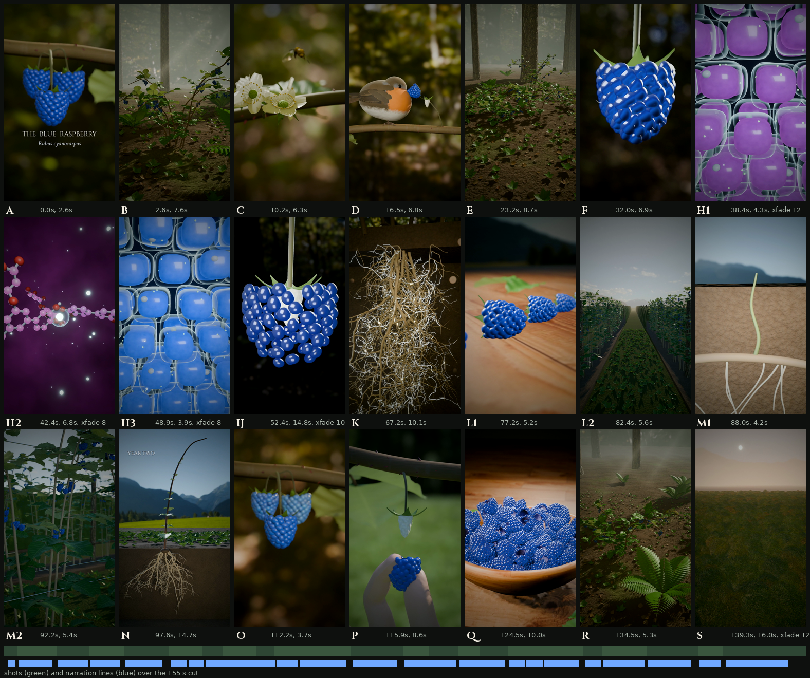

# wildlore-episode-pipeline

Everything after the shot renders for a Wildlore episode, as used for "The Blue Raspberry":
- **`timeline.py`:** the shot order and lengths, crossfades, and where each narration line starts.
- **`score.py` + `render_score.sh`:** a gentle orchestral score written as MIDI and rendered with FluidSynth and the FluidR3 General MIDI soundfont.
  - Strings, harp arpeggios, flute and oboe melodies, celesta, choir and timpani at 72 BPM, cued to the shots.
- **`mix.py`:** the soundtrack.
  - Synthesized forest ambience and shot-cued effects (bee buzz, berry thuds, whooshes, bells).
  - The narration through the Wildlore voice chain, with the music ducked 55 % under speech.
  - A look-ahead limiter.
- **`assemble.py`:** the ffmpeg edit.
  - Crossfades, vignette, fine grain, the Cinzel title card with the italic species name, top-left chapter captions and the WILDLORE end card.
  - Two-pass loudness to −14 LUFS.



The preview shows one frame from each of the 21 shots, with the timeline of shots (green) and narration lines (blue) underneath.

**Used in:** The Blue Raspberry (Wildlore, Nov 2026, 2:36). These are the scripts that made the delivered video.

Before committing, each was re-run from this folder against the episode's own renders and voice files. The results matched the shipped files as follows:
- **MIDI:** byte-identical.
- **Voice and effects stems:** sample-identical.
- **ffmpeg filter graph:** identical apart from font paths.
- **Music stem:** close but not bit-identical, because the FluidSynth render isn't deterministic.

## Files
- `timeline.py`:
  - `SEGS`: shot name, file, frames, crossfade-in frames.
  - `VO`: which shot each line starts in, and its offset in seconds.
  - Run it to list each line's start and end and flag overlaps.
  - `WORK` is the episode folder: env `WILDLORE_WORK`, default `build/`.
- `score.py`: helpers (`pad`, `arp`, `melody`, `ramp`) and the cue sheet in six sections, from forest wonder to finale. Cues were written against the first cut. `warp()` keeps each note in place inside its shot when shots were lengthened later, so the score followed the re-pacing without being rewritten.
- `render_score.sh`: FluidSynth 2.3.4, 48 kHz, gain 0.5, FluidR3_GM.sf2. Set `SF2=` if the soundfont lives elsewhere.
- `mix.py`:
  - Sound generators: chirp, bird phrases, wind, rustle, FM bell, thud, whoosh, buzz.
  - Per-shot cues built with `span(shot)` and `T(shot, frame)`.
  - The voice chain, music ducking and limiter.
  - Writes `mix.wav` plus the `vo_only`, `music_only` and `fx_only` stems.
- `assemble.py`:
  - Upscales any 720p shot with lanczos and light unsharp, and holds the last frame of renders shorter than their slot.
  - Writes `audio/filter.txt` and encodes with x264 slow, CRF 18, max 16 Mb/s, AAC 256k and faststart.
  - `--dry` writes only the filter. `PRESET=veryfast` gives a quick check encode.
- `style.json`: music, mix and assembly numbers.
- `preview.png`: the shot sheet.

## Reuse
Episode folder layout (`WILDLORE_WORK`):
```
out/<shot>.mp4          shot renders, 1080x1920 (or 720x1280) at 24 fps, named as in SEGS
vo/line_XX.wav          narration from ../wildlore-narrator (python narrate.py script.txt --out $WILDLORE_WORK/vo)
vo/lines_info.json      written by narrate.py
audio/                  score.mid, score_raw.wav, mix.wav, stems, filter.txt (all generated)
final/episode.mp4       the result
```
```bash
export WILDLORE_WORK=~/wildlore/jackalope
python timeline.py                 # check line placement: every gap >= 0.3 s, no OVERLAP
python score.py && ./render_score.sh
python mix.py
python assemble.py --dry           # check the filter graph
python assemble.py                 # final/episode.mp4 (PRESET=veryfast for a quick look)
```
**For a new episode:**
1. Replace `SEGS` and `VO` in `timeline.py`.
2. Rewrite the cue sheet in `score.py`: the sections and their chords and melodies. Set `_OLD = [(n, f, x) for n, _, f, x in SEGS]` so `warp()` does nothing until you re-time shots.
3. Rewrite the per-shot ambience and effect cues in `mix.py`, between the generators and `# ---- voice`.
4. Change the title, species, captions and end-card texts at the bottom of `assemble.py`.

The voice chain, ducking, limiter, grain, vignette, fonts and loudness are the series look, so keep them.

## Gotchas
- **Lengthening a shot:** change its frames in `SEGS` and re-render the shot. `score.py`'s `warp()` moves the music with it, but `mix.py` cues placed with `T(shot, frame)` follow automatically only when they're relative to their shot.
- **Fonts:** the title card needs Cormorant Garamond Italic as a static weight-560 file. ffmpeg's drawtext can't choose a weight in a variable font. `../wildlore-title/get_fonts.py` writes it, and `assemble.py` finds it with `wildlore_title.find_font`.
- **Captions:** keep them in the top 15 % and the title at 64.5 % of the height, above where YouTube's Shorts overlay covers the bottom of the frame.
- **Loudness:** `assemble.py` measures the mix first, then applies `loudnorm` with the measured values (`linear=true`), which avoids pumping.
- **Encode size:** the first encode with heavy grain came out at 702 MB. Grain at `alls=2` and a 16 Mb/s cap brought the 2:36 episode to 185 MB.
- **Score render:** `render_score.sh` with gain 0.5 lands within about 3 % of the shipped music's level. `mix.py` normalises the music to RMS 0.042 anyway, so the gain doesn't matter.

## What it can't do
- It doesn't render shots: the shot scripts are episode-specific. The reusable scene parts are in `../wildlore-blender-kit`, `../blue-raspberry` and `../robin`.
- The episode's one-off numpy fixes on finished shots aren't included: a berry colour grade, a canopy-gap fill and a camera-seam smoothing pass.
- There's no automatic sync from narration to picture. You place lines by hand in `VO`, and `timeline.py` flags overlaps.

## Dependencies (tested)
- Python 3.13: numpy 2.5.3, scipy 1.18.1, soundfile 0.14.0, librosa 1.0.1, pedalboard 0.9.26, mido
- FluidSynth 2.3.4 with FluidR3_GM.sf2 (the `fluid-soundfont-gm` package, MIT)
- ffmpeg 6.1.1
- `../wildlore-title` for fonts, `../wildlore-narrator` for the voice
