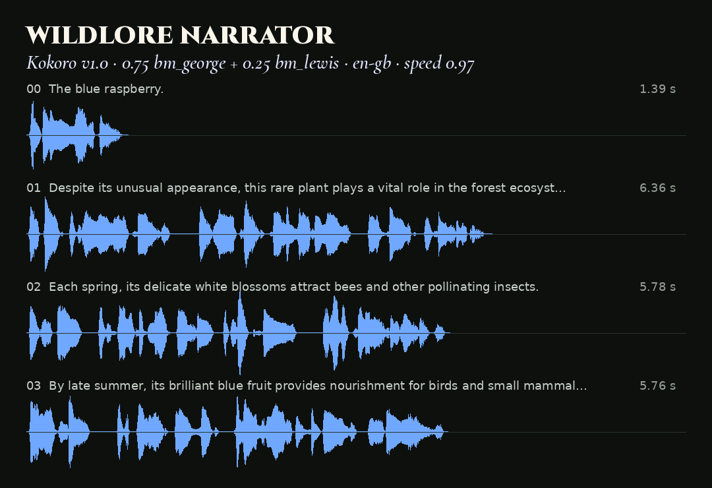

# wildlore-narrator

The Wildlore documentary voice: an older British male narrator, unhurried and warm, made offline with Kokoro v1.0 (ONNX).
- **Voice:** a 75/25 blend of Kokoro's British male voices bm_george and bm_lewis, read in en-gb at 0.97 speed with 0.16 s clause pauses.
- **Pronunciation:** words Kokoro gets wrong are fixed at the phoneme level (drupelets, anthocyanins, trellises, cobalt-blue).
- **Trimming:** each line is cut to 30 ms before its first sound and 80 ms after its last.
- **`--polish`:** also runs every line through the same voice chain the episode mix uses (EQ, gentle compression, small room), giving 48 kHz stereo files ready for a timeline.



**Used in:** The Blue Raspberry (Wildlore, Nov 2026), all 21 narration lines. `lines.txt` is that script. Re-running line 00 from this folder gave the same length to the sample as the shipped file, with only tiny waveform differences across onnxruntime versions.

## Files
- `narrate.py`: the CLI and the settings at the top: voice blend, language, speed, clause pause, phoneme fixes, trim and polish rate. `speak()` and `polish()` can be imported.
- `get_models.py`: downloads `kokoro-v1.0.onnx` (325 MB) and `voices-v1.0.bin` (28 MB) from the kokoro-onnx GitHub release `model-files-v1.0` into `models/`.
- `lines.txt`: the Blue Raspberry narration, one line per row, as a sample input.
- `style.json`: the voice, fixes, chain and mix levels.
- `preview.png`: waveforms of the first four shipped lines.

## Reuse
```bash
pip install kokoro-onnx soundfile librosa pedalboard
python get_models.py                                  # once; or set KOKORO_DIR to a folder that has both files
python narrate.py --say "The jackalope."              # audition one sentence -> out/say.wav
python narrate.py my_episode.txt --polish             # out/line_XX.wav (24 kHz) + out/polished/line_XX.wav (48 kHz stereo) + out/lines_info.json
```
`lines_info.json` has each line's duration and phonemes. `../wildlore-episode-pipeline/timeline.py` uses it to place lines on shots and flag overlaps.

**Writing for this voice:**
- The episode's lines run from 3 to 27 words. A single short line like "The blue raspberry." makes a good title beat.
- The episode reads at 131 words a minute while the narrator speaks, and 112 over the whole 2:35 cut.
- Hook the opening shot with a question line ("But what gives this fruit its extraordinary colour?"), then answer it two shots later.

## Gotchas
- **Mispronunciations:** check new scientific or unusual words with `--say` and look at the printed phonemes. Add a fix to `PHONEME_FIXES` (Kokoro phonemes → wanted phonemes) when they're wrong. Hyphenated compounds can run together, as "cobalt-blue" did.
- **Lead-ins:** trimming with `top_db=40` can clip a soft breathy start, which is why 30 ms is kept before each line. The mix then places lines 0.25–0.75 s after each shot starts.
- **Loudness:** the polish chain doesn't normalise. The episode mix sets the voice to RMS 0.06 and ducks the music 55 % under speech, and `assemble.py` brings the result to −14 LUFS.

## What it can't do
- Only British English male voices were blended. Other Kokoro voices or languages work through `VOICES` and `LANG`, but they haven't been tuned for this channel.
- No emotional direction, emphasis marks or whispering beyond what punctuation gives Kokoro.

## Dependencies (tested)
- Python 3.13, kokoro-onnx with onnxruntime 1.29.0, soundfile 0.14.0, librosa 1.0.1, pedalboard 0.9.26, numpy 2.5.3
- Kokoro v1.0 model files (Apache-2.0), downloaded by `get_models.py` and not stored in the repo
