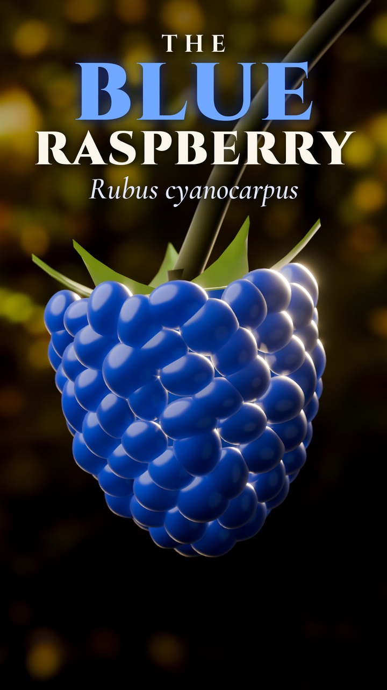
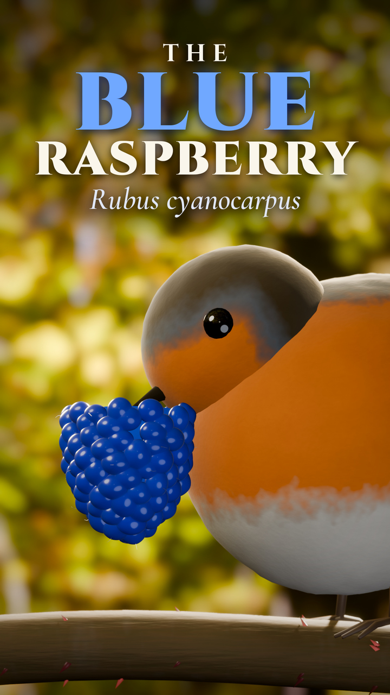

# wildlore-title

The Wildlore Shorts thumbnail title, drawn over any 1080×1920 still. It's four centred lines in the top third:
- a small tracked **THE** in Cinzel Bold
- a huge key word (**BLUE**) in Cinzel Black, light blue with a soft blue glow
- the rest of the name (**RASPBERRY**) in warm white Cinzel Black
- the Latin species name directly under the title in Cormorant Garamond Medium Italic

The still under the text gets a gentle grade (+12 % saturation, +6 % contrast), a dark gradient behind the title, a lighter one along the bottom, a soft vignette and a faint shade behind the thin italic line. The text ends around y = 600, so YouTube's title and view count on the bottom ~20 % of a Shorts card never cover it.



With the robin still (the default layout):



**Used in:** The Blue Raspberry (Wildlore, Nov 2026), all three thumbnail options:
- macro: `--preset macro` on `../blue-raspberry`'s `berry_macro.py` still
- board: `--preset board` on its `board_scene.py` still
- robin: the default layout on `../robin`'s `robin_scene.py` still

With fonts from `get_fonts.py`, running these presets on the three shipped stills reproduces the delivered JPEGs pixel for pixel (checked before committing).

## Files
- `wildlore_title.py`: the module and CLI. The settings at the top cover texts, sizes, weights, tracking, gaps, colours, glow, shadow, grade and gradients. `PRESETS` holds the three shipped variants. `make(src, dst, ...)` can be imported.
- `get_fonts.py`: downloads Cinzel[wght] and CormorantGaramond-Italic[wght] from google/fonts. With fontTools, it also writes a static Cormorant Garamond Italic at weight 560, which ffmpeg drawtext needs for the in-video title.
- `style.json`: every size, colour and offset, plus the in-video title card, captions and end card used by `../wildlore-episode-pipeline/assemble.py`.
- `preview.png` and `preview-robin.png`: two of the delivered thumbnails, downscaled to 720×1280.

## Reuse
```bash
python get_fonts.py                       # once (or --local to keep them in fonts/ here)
python wildlore_title.py still.png thumb.jpg --preset macro
python wildlore_title.py still.png thumb.jpg --word JACK --name ALOPE --species "Lepus cornutus"
python wildlore_title.py still.png thumb.jpg --top "" --word PHOENIX --name "" --species "Phoenix ignis" --white-word
python wildlore_title.py bright.png thumb.jpg --title-band 0.5 --top-dark 0.75   # bright backdrop
```
- Pick the key word for the line that carries the hook, such as the colour or the odd feature. Leave `--top` or `--name` empty to drop a line.
- **Dark backdrops** (like the macro): use less top gradient (`--top-dark 0.45`) and move the block up (`--title-y 95`) if the subject comes close to the species line.
- **Bright or busy backdrops** (like the board's tan wall): add `--title-band 0.4–0.5`. The shipped board version measures 5:1 or better for white text against the area around it.
- **Blue key word over blue:** use `--white-word`, or keep the blue and rely on the glow and shadow. The board version keeps the blue.
- **Uploading:** custom Shorts thumbnails are uploaded in YouTube Studio on a computer, with a verified account, at the recommended 9:16. The shipped JPEGs are about 0.4 MB.

**What we shipped:**
- **Title:** "What Makes the Blue Raspberry Blue?" It's a question the video answers about 30 s in. It complements the thumbnail, which already says THE BLUE RASPBERRY, instead of repeating it.
- **Description:**
  - a short in-character hook paragraph
  - `Species: Rubus cyanocarpus`
  - a would-you-rather question
  - `#blueraspberry #mythicalcreatures #naturedocumentary`
- **Style:** no emoji, and no "doesn't exist" disclaimers. The series is played straight.

## Gotchas
- **Species line weight:** the delivered thumbnails used a static Cormorant Garamond Italic instance at weight 560, not 500. At 500 the line comes out about 3 px narrower, and it no longer matches the video's title card. The script prefers the static 560 file and falls back to the variable font set to 560.
- **ffmpeg drawtext** uses a variable font's default instance: Cinzel 400 for the video title, and Cormorant Italic 300, which is wrong. That's why `get_fonts.py` writes the static 560 file.
- **Phone size:** the species line is the weakest text, a thin italic. Check the result at 180×320 before shipping.

## What it can't do
- It has no outlines, stickers, arrows or emoji, on purpose, because Wildlore thumbnails stay restrained.
- Text is always centred on one line per row. A word wider than 940 px is shrunk to fit, which can leave a long key word smaller than the name under it. Split long names across the key-word and name lines, as with JACK / ALOPE.

## Dependencies (tested)
- Python 3.13, Pillow 12.3.0, numpy 2.5.3
- fontTools 4.67.0 (optional, for the static font instance)
- Fonts (not in the repo, SIL OFL): Cinzel and Cormorant Garamond from google/fonts, via `get_fonts.py`

No photos or third-party images are used. The previews are Wildlore renders.
