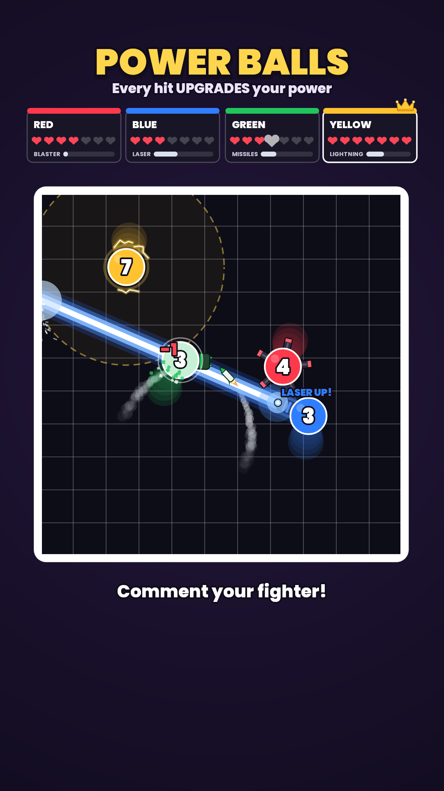

# ability-battle-template: POWER BALLS game template

The full generator for the **POWER BALLS** Short. Four balls, each with a different ability, bounce around a grid arena. Every hit you land upgrades your ability, and the last ball standing wins. One command turns `settings.py` into a finished 1080x1920, 30 fps MP4 with synthesized music and sound effects.



**Used in:** POWER BALLS (Marble Pop, Nov 2026), "Every hit UPGRADES your power", 51.7 s. RED has a 360° blaster, BLUE a laser, GREEN homing missiles and YELLOW lightning. With seed 1774, GREEN is out at 26.6 s and BLUE at 33.4 s. YELLOW goes down on a slow-motion final blow at 45.2 s, so RED wins with 1 HP left. The layout follows the earlier Sword Balls Short.

## Quick start

```bash
pip install skia-python==144.1 numpy==2.5.3 scipy==1.18.1 fonttools==4.67.0 brotli==1.2.1
python drawkit.py --fetch-fonts      # Poppins into ./fonts (don't commit it)
python make_video.py                 # -> out/power_balls.mp4, about 1 minute on 2 cores
```

More commands:

```bash
python make_video.py --seed 4512 --jobs 4 --out out/yellow_wins.mp4
python render.py preview thumb.png --frame 0          # any single frame (frame 0 = PICK YOUR FIGHTER)
python render.py frames 0,633,1450 out/frames         # several frames
python render.py style style.json                     # rewrite style.json from the code
python search.py balance --n 600                      # win rate per ability
python search.py seeds --from 1000 --to 7000          # find dramatic fights (out/top_seeds.json)
python search.py show 1774                            # hit-by-hit story of a seed
```

## Files

| file | role |
|---|---|
| `settings.py` | every knob: seed, names, colors, abilities, all on-screen text, timing, simulation and ability tuning, audio mix |
| `sim.py` | deterministic physics + the 4 abilities (fixed 1/240 s step, one RNG per seed) |
| `search.py` | balance stats and the drama score used to pick seed 1774 |
| `render.py` | replays the sim against the video clock (intro, slow-mo, zoom, winner), maps events to effects, draws frames |
| `make_video.py` | timeline → parallel render → join → audio → loudness-normalized mux |
| `audio.py` | soundtrack from `out/timeline.json` (music bed, one sound per event, slow-mo layer, fanfare, limiter) |
| `drawkit.py` | fonts (finder + fetcher), outlined text, paints, easing, crown |
| `layout.py` | background, title, arena frame + grid, caption (same file as `../battle-screen-layout`) |
| `cards.py` | scoreboard cards (same as `../fighter-cards`) |
| `fighters.py` | balls, weapons, bullets, beam, missiles, bolts (same as `../ability-fighters`) |
| `fx.py` | particles, rings, damage numbers, shake, flash (same as `../impact-fx`) |
| `overlays.py` | intro panel, FIGHT!, OUT banner, FINAL BLOW, winner panel, confetti (same as `../battle-overlays`) |
| `sfx.py` | synthesized sound effects + DSP helpers (same as `../ability-sfx`) |
| `music.py` | 128 BPM bed, tape stop, fanfare (same as `../edm-battle-bed`) |
| `style.json` | every exact value: colors (hex), fonts, sizes, canvas, fps, timing, ability tuning, mix |

The prop modules are copied into the sibling folders unchanged, so this folder runs on its own. `render.py` overrides their top-of-file settings from `settings.py`.

## Reusing it

- **New look or text:** edit `NAMES`, `COLORS`, `TITLE`, the captions and the timing in `settings.py`. The fight itself stays the same.
- **New fight:** run `python search.py seeds`, pick a seed from the top of the list, then set `SEED` (or pass `--seed`). The renderer finds the final blow by itself and stages the slow-mo, zoom and winner screen around it. A seed that ends in a draw is refused.
- **Different abilities:** `ABILITIES` takes any mix of `blaster`, `laser`, `missiles` and `lightning`, repeats included. For example, four `blaster`s give an all-360-blaster video. The ~22–27% balance only holds for the default mix, so run `search.py balance`, then retune `ABILITY` and search for a new seed.
- **New ability:** add a `do_<name>` method to `sim.py` that emits events, a branch in `fighters.draw_weapon`, its event-to-effect mapping in `render.GameFX.on_event`, and a sound in `audio.build`.
- Changing anything under SIMULATION or ABILITY TUNING changes what a seed plays out, while text, colors and timing never do.

## Not in this folder (and where they go)

- **Fonts:** Poppins SemiBold, Bold, ExtraBold and Black. Fetch them with `python drawkit.py --fetch-fonts`, or download them from <https://fonts.google.com/specimen/Poppins> into `fonts/`, or set `PROPS_FONT_DIR`. The video used the `@fontsource/poppins@5.3.0` latin subset, which is what `--fetch-fonts` downloads first. On macOS, a certificate error means you need to run Python's "Install Certificates.command" or download the fonts by hand.
- **Finished video and intermediates:** these go to `out/` (timeline.json, audio.wav, power_balls.mp4), which is local only. The posted video lives on the channel.
- **The Sword Balls reference video** this layout copies lives on the channel, not here.

## Dependencies (tested)

Python 3.13.18 · skia-python 144.1 · numpy 2.5.3 · scipy 1.18.1 · ffmpeg 6.1.1 with libx264 and the native AAC encoder · fonttools 4.67.0 + brotli 1.2.1 (only for `--fetch-fonts`) · matplotlib 3.11.2 (only for the sfx/music previews)

## Exactness

I checked this in the environment where the video was made. `python make_video.py` with these files rebuilt the posted video bit-for-bit: the H.264 and AAC streams were identical, 25 sampled frames matched pixel for pixel, and `out/audio.wav` was byte-identical. On another machine, frames and audio should match given skia-python 144.1 and the same Poppins build. The MP4 bytes can differ under another ffmpeg/x264 build.
