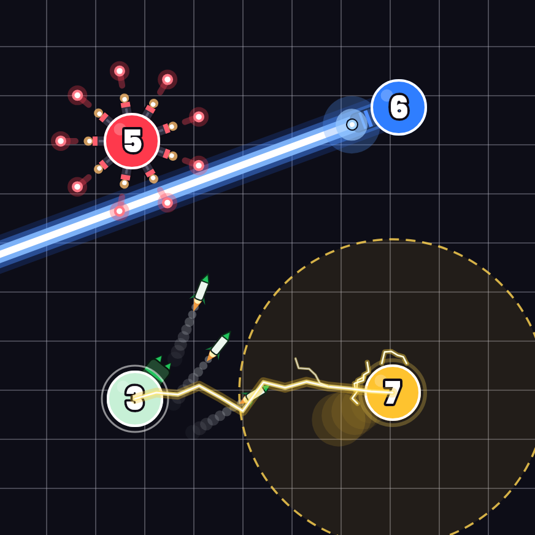

# ability-fighters: POWER BALLS fighters and ability visuals

The four fighters from POWER BALLS. Each is a colored ball with a white rim, a soft highlight and its HP number, plus weapon hardware. The module also draws every ability visual: bullets, the laser aim line and beam, homing missiles, lightning bolts, the lightning range ring and motion trails.



**Used in:** POWER BALLS (Marble Pop, Nov 2026). `fighters.py` is the same file the game template draws with (`../ability-battle-template/fighters.py`).

| ability | hardware on the ball | attack visual |
|---|---|---|
| `blaster` | ring of gun barrels (one more per level), recoil and a muzzle flash on each volley | red glowing bullets with short trails |
| `laser` | turret with a lens that glows while charging, and a fading laser sight while idle | dashed aim line, then a blinking red "locked" line, then a 4-layer wall-to-wall beam with an end glow |
| `missiles` | launcher pod with two missiles that slide out as the next volley reloads | white missiles with green noses, fins and a flickering flame (add smoke from `../impact-fx`) |
| `lightning` | yellow aura ring with three crackling sparks | jagged 3-layer bolt with a side branch, plus a dashed range ring |

## Use

```bash
python fighters.py --preview preview.png     # the image above
python fighters.py --style style.json        # rewrite style.json from the code
```

```python
import random, drawkit as dk, fighters as F
surf = dk.new_surface(872, 872); c = surf.getCanvas()
F.draw_weapon(c, 'blaster', 300, 300, n=8, rot=0.4, since_fire=0.05)   # weapons first...
F.draw_ball(c, 0, 300, 300, hp=5)                                        # ...then the ball on top
F.draw_weapon(c, 'laser', 600, 300, aim=2.4, charge=0.6)
F.draw_ball(c, 1, 600, 300, 7, flash=0.75, shield=0.9)                   # just hit: whitened + i-frame ring
F.draw_bolt(c, (600, 600), (300, 300), 230, random.Random(5))
dk.save_png(surf, 'fighters.png')
```

- `draw_ball(c, i, x, y, hp, scale=1, flash=0..1, shield=0..1, alpha=255)`: `i` picks the color from `COLORS`.
- `draw_weapon(c, ability, x, y, scale=1, n=, rot=, since_fire=, aim=, sight=, charge=, ready=, rng=)` takes only the keywords its ability uses (see the docstring). With none of them you get the static pose from the PICK YOUR FIGHTER panel.
- `draw_range_ring`, `draw_laser_aim`, `draw_laser_beam`, `draw_bullet`, `draw_missile`, `draw_bolt`, `lightning_path` and `draw_trail` draw the attack visuals. For flicker, reseed the bolt `rng` every 2 frames.
- The video draws in this order: range ring, smoke, rings, laser aim/beam, bullets, missiles, trails, weapons, balls, bolts, then particles and damage numbers.
- Settings at the top of `fighters.py`: `COLORS`, `ABILITIES`, `BALL_R`, plus one palette dict per part. Every color is hex.
- Coordinates are arena pixels (872 x 872 in the video, ball radius 46). Use `scale` for bigger versions; the intro uses 1.3 and the winner panel 1.7.

## Not in this folder

The Poppins font files (for the HP number) aren't here: run `python drawkit.py --fetch-fonts`, or see `drawkit.py` for where it looks. The physics and ability logic that decide where things are live in `../ability-battle-template/sim.py`.

## Dependencies (tested)

Python 3.13.18 · skia-python 144.1 · fonttools 4.67.0 + brotli 1.2.1 (only for `--fetch-fonts`)
