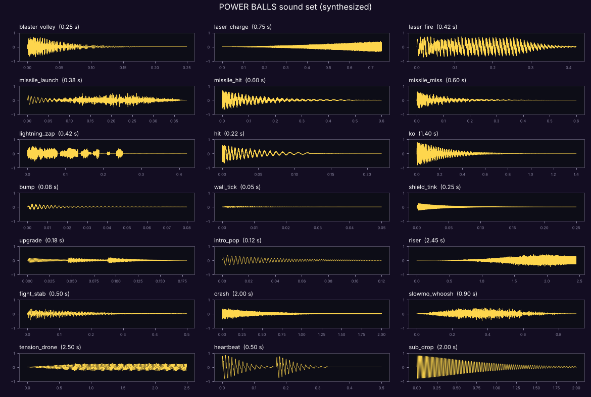

# ability-sfx: POWER BALLS sound set (synthesized)

All 21 sound effects from POWER BALLS. Each is built from oscillators, filtered noise and envelopes in `sfx.py`, with no samples or licensed audio. The WAVs are in `assets/` (44.1 kHz, 16-bit, mono), and the code regenerates or tweaks any of them.



**Used in:** POWER BALLS (Marble Pop, Nov 2026). `sfx.py` is the same file the game template's `audio.py` builds with.

| file | used for | gain in the video |
|---|---|---|
| `blaster_volley.wav` | 360 blaster ring (the code makes it louder with more bullets) | 1.05 |
| `laser_charge.wav` | laser charging, 0.75 s, under the aim line | 0.85 |
| `laser_fire.wav` | laser beam | 0.75 |
| `missile_launch.wav` | missile volley | 1.0 |
| `missile_hit.wav` / `missile_miss.wav` | missile explodes on a fighter / on a wall | 0.9 / 0.6 |
| `lightning_zap.wav` | lightning strike | 0.8 |
| `hit.wav` | a fighter loses a heart; pitched ×1.0, 1.12, 0.9 and 1.22 for red, blue, green and yellow | 0.9 |
| `upgrade.wav` | power-up chime, 0.06 s after a hit | 0.8 |
| `ko.wav` | knockout | 1.0 (1.25 on the final blow) |
| `bump.wav` | balls collide faster than 120 px/s | 1.0 |
| `wall_tick.wav` | bullet hits the wall | 0.6 |
| `shield_tink.wav` | bullet blocked by i-frames | 1.0 |
| `intro_pop.wav` | 4 pops 0.08 s apart from 0.03 s, each a little lower (played at rate 1/(1 + 0.12·i)) | 0.6–0.9 |
| `riser.wav` | 2.45 s build-up ending on FIGHT! | 0.75 |
| `fight_stab.wav` + `crash.wav` | FIGHT! hit, layered with a kick (1.0) and a small explosion (0.55) | 1.0 / 0.6 |
| `slowmo_whoosh.wav`, `tension_drone.wav`, `heartbeat.wav` | slow-motion final blow; the heartbeat repeats every 0.85 s | 0.7 / 1.0 / 0.9 |
| `sub_drop.wav` + `crash.wav` | the final blow lands | 1.0 / 0.7 |

Inside the slow-motion window, every event sound plays at half speed (an octave down) with gain ×1.1. The video mixes the effects bus at ×0.9 over the music at ×0.2, limits it, then normalizes to -14 LUFS.

## Use

```bash
python sfx.py --export assets          # regenerate every WAV
python sfx.py --preview preview.png    # waveform sheet (matplotlib)
python sfx.py --style style.json
```

```python
import numpy as np, sfx
buf = np.zeros((2, sfx.SR * 3))
sfx.add(buf, sfx.sfx_laser_fire(), at=0.5, gain=0.75, pan=-0.3)   # click-free, constant-power pan
sfx.add(buf, sfx.resample_rate(sfx.sfx_ko(), 0.5), at=1.2)        # slow-motion version
```

- Each `sfx_*` function returns a mono numpy array; `add()` mixes it into a stereo buffer.
- Settings at the top: `SR`, `SEED` (the noise texture) and `HIT_PITCH`. Every random draw goes through one generator (`reseed()`), so the same call order always gives the same audio.
- The WAVs here are fresh renders of the same patches. Their noise textures differ sample by sample from the copies mixed into the video, which `../ability-battle-template` regenerates exactly.

## Dependencies (tested)

Python 3.13.18 · numpy 2.5.3 · scipy 1.18.1 · matplotlib 3.11.2 (only for `--preview`)
