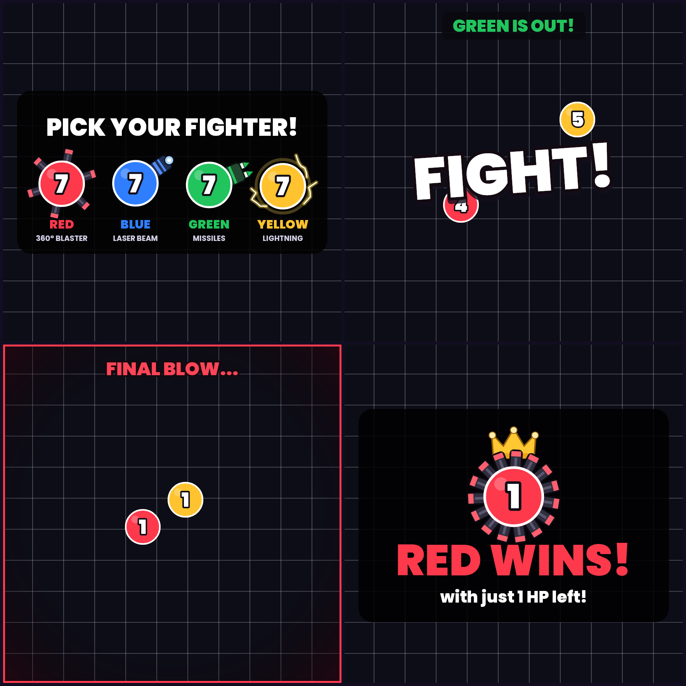

# battle-overlays: intro, knockout, final blow and winner overlays

The POWER BALLS overlays, drawn in arena coordinates (0..872 px) over the grid:

| function | what you see | timing in the video |
|---|---|---|
| `draw_intro(c, tau, layer_alpha, frame)` | PICK YOUR FIGHTER! panel; the four fighters pop in and bob, with names and ability names | 0–2.6 s, then fades out over 0.3 s |
| `draw_fight(c, age)` | big tilted white FIGHT! that slams in and fades | 1 s from the start of the fight |
| `draw_out(c, i, age)` | "{NAME} IS OUT!" banner in the fighter's color | 2 s after each knockout (not the last one) |
| `draw_final_blow(c, strength, tau)` | pulsing red FINAL BLOW... | during the slow-motion final blow |
| `draw_vignette(c, strength)` / `draw_flash(c, strength)` | dark-red edge vignette / white KO flash | final blow / knockouts |
| `draw_winner(c, age, i, hp, frame, weapon)` | crown, big winner, "{NAME} WINS!", "with just 1 HP left!" | from 1.15 s after the final hit until the end |
| `Confetti` | full-screen confetti burst + 2.6 s of rain (screen coordinates) | winner screen |



**Used in:** POWER BALLS (Marble Pop, Nov 2026). `overlays.py` is the same file the game template uses. The fighters come from `fighters.py`, a copy of `../ability-fighters`. The red arena frame for the final blow is `layout.draw_arena_frame(alert=1)` in `../battle-screen-layout`.

## Use

```bash
python overlays.py --preview preview.png     # 2x2 sheet: intro, OUT + FIGHT!, final blow, winner
python overlays.py --style style.json
```

```python
import drawkit as dk, overlays as O
surf = dk.new_surface(872, 872); c = surf.getCanvas()
O.draw_out(c, 2, age=0.6)                                  # GREEN IS OUT!
O.draw_winner(c, 1.5, 0, hp=1, weapon=dict(n=15, rot=1.0))  # RED WINS! with just 1 HP left!
dk.save_png(surf, 'overlay.png')
```

- Settings at the top: names, colors, abilities and ability names, every text template (`OUT_TEXT = '{name} IS OUT!'` and so on), and one dict of geometry and timing per overlay (`INTRO`, `FIGHT`, `OUT`, `FINAL`, `VIGNETTE`, `WINNER`, `CONFETTI`).
- Call `Confetti.update(tau, tau_win, winner_color)` once per video frame and `draw(c)` in 1080x1920 screen coordinates.

## Not in this folder

The Poppins font files: run `python drawkit.py --fetch-fonts`, or see `drawkit.py` for where it looks.

## Dependencies (tested)

Python 3.13.18 · skia-python 144.1 · fonttools 4.67.0 + brotli 1.2.1 (only for `--fetch-fonts`)
