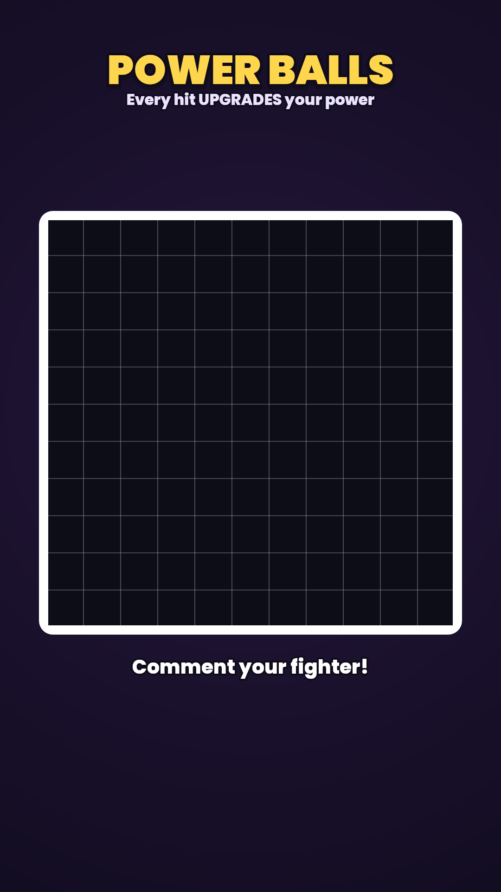

# battle-screen-layout: 1080x1920 battle screen (board)

The static frame of the POWER BALLS screen: a purple radial background, a yellow title with a lavender subtitle (plus the "WE HAVE A WINNER!" header pop), the white-framed 872 px grid arena, and the caption line under the arena. The caption reads "Comment your fighter!", then a pulsing "FINAL DUEL!", then "Did your fighter win? Comment!". During the final blow the arena frame can fade to red.



**Used in:** POWER BALLS (Marble Pop, Nov 2026); it matches the Sword Balls layout. `layout.py` is the same file the game template uses. The empty band at y = 262..394 is where `../fighter-cards` goes.

## Use

```bash
python layout.py --preview preview.png
python layout.py --style style.json
```

```python
import drawkit as dk, layout as L
surf = dk.new_surface(L.W, L.H); c = surf.getCanvas()
L.draw_background(c)
L.draw_header(c, 'POWER BALLS', 'Every hit UPGRADES your power')
L.draw_arena_frame(c, ox=0, oy=0, alert=0.0)     # alert 0..1 fades the frame to red; ox/oy = screen shake
L.begin_arena(c, zoom=1.0)                       # clip + arena coords + grid; draw the game here...
c.restore()
L.begin_overlay(c)                               # unzoomed arena coords for banners and panels
c.restore()
L.draw_caption(c, 'duel', tau=1.2)               # 'normal' | 'duel' | 'end'
dk.save_png(surf, 'screen.png')
```

- `begin_arena(c, ox, oy, zoom, focus)` zooms the camera around `focus`; the final blow uses 1.32.
- Settings at the top: canvas size, background stops, title/subtitle/winner-title text and styles, arena position, size and grid, and the caption texts and styles. Call `configure(TITLE='...')` to override settings at runtime.

## Not in this folder

The Poppins font files: run `python drawkit.py --fetch-fonts`, or see `drawkit.py` for where it looks.

## Dependencies (tested)

Python 3.13.18 · skia-python 144.1 · fonttools 4.67.0 + brotli 1.2.1 (only for `--fetch-fonts`)
