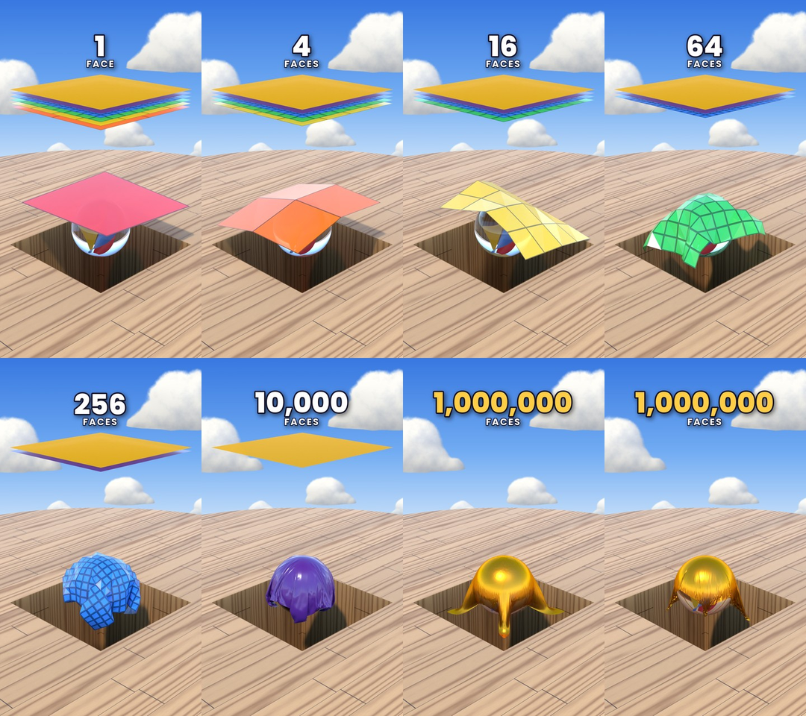
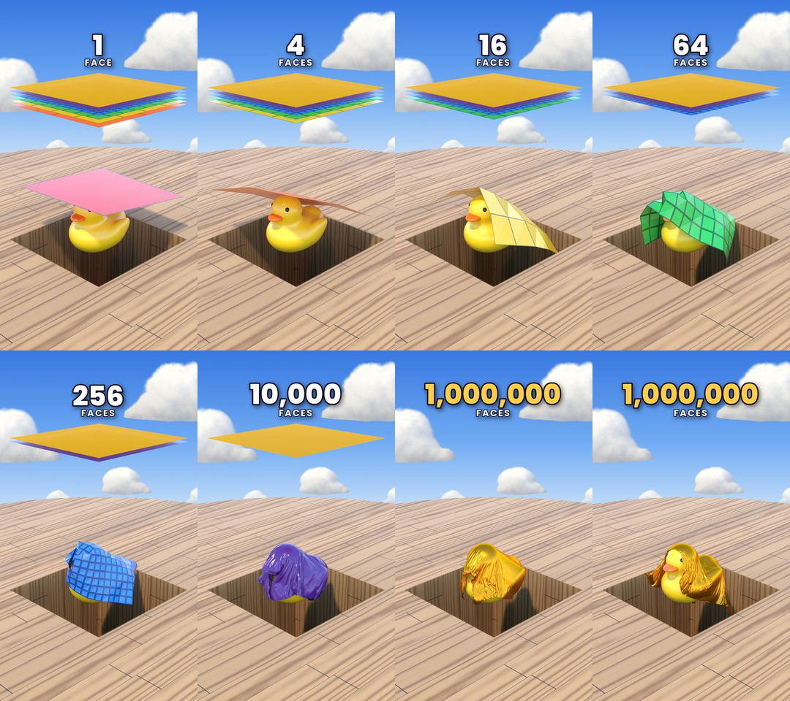

# cloth-faces

Blender cloth Shorts in the "1 Face vs 1,000,000 Faces Blanket" format. Rainbow blankets drop one at a time from a floating stack onto an object over a square hole, in a round wooden platform floating in the sky. Each blanket has more faces than the last: 1, 4, 16, 64, 256, 10,000, then 1,000,000. The low-face ones stay stiff and blocky and tip off. The gold 1,000,000 one wraps the object like liquid, shown in slow motion, and then slides off into the hole. At the end the stack refills, so the video loops. A big counter shows the face count, and all the sound is synthesized, so there is no licensed audio. A ~20 s video takes about 2.5 hours on 2 CPU cores from scratch, or about 70 minutes if the plates and sims already exist.

**Used in:** "1 Face vs 1,000,000 Faces Blanket 🤯" (glass marble, over 30k views) and its sequel "1 Face vs 1,000,000 Faces Blanket on a Rubber Duck 🦆", Nov 2026. Every frame and sound in both came from this code.



The duck version:



## Files
- `settings.py`: `HERO` (`'marble'` or `'duck'`), per-stage sim flags (`SIM_ARGS`), the timeline (`SPEC`: hold frames, then sim-frame segments with a speed, where 0.5 is slow motion and 2.0 is fast-forward), render quality, and thumbnail framing
- `scene.py` (Blender): the platform with its hole and shaft (procedural plank wood), the glass cat's-eye marble or the rubber duck, the stage colors (`STAGES`), the cloth material (grid lines show the faces up to 256), the camera, the sun and sky light, and the window-mapped "plate" emission trick the renderer uses. Camera, sun, sizes and colors are at the top.
- `duck.py`: the rubber duck as a signed distance field turned into a mesh with marching cubes (body, head, tail and wings, plus a separate beak and two eyes)
- `sky.py`: painted cartoon cumulus sky in numpy, kept clear behind the counter
- `sim.py` (Blender): one Blender cloth sim per face count, written to `build/sims/stageN.npz`. The 1,000,000 stage is a 250×250 grid (62,500 faces) subdivided twice at render time, which gives exactly 1,000,000 faces.
- `run_sims.py`: runs all 7 sims in two parallel queues
- `plates.py` (Blender): static plates. `base` is the empty set; `stack` adds the floating stack with the already-dropped sheets removed.
- `build_timeline.py`: turns `SPEC` into `build/timeline.json` (video frame → stage and sim frame)
- `render_frames.py` (Blender): renders each frame in two passes. First a low-res shadow-catcher pass gives the cloth and object shadows, which are multiplied onto the plate. Then Cycles renders only the box around the cloth and object at 0.8 scale, and that box is pasted in wherever it differs from the plate. Static floor and sky pixels are never re-rendered. A frame takes about 10–25 s on one core.
- `run_render.py`: two single-thread workers (even and odd frames). Blender restarts every 60 frames so its memory doesn't grow.
- `overlay.py`: the counter: the number plus FACE/FACES in Poppins ExtraBold with a pop-in, gold on the last stage
- `audio.py`: sound effects timed from the sims, plus a quiet glockenspiel-and-bass music bed fitted to exactly 12 bars so the loop is seamless. The effects are a pop that rises in pitch each stage, a whoosh on each drop, an impact matched to the face count (plastic slap, then fabric flop), a rustle driven by how fast the cloth slides on the object, a whoosh and distant thud down the hole, a gooey "gloop" and a chime when the gold one reveals the object, and ticks as the stack refills.
- `thumb.py`: a no-text thumbnail, rendered as a full-quality close-up of the gold stage
- `quickview.py`: fast preview strips of one sim (Workbench, or low-res Cycles)
- `make_video.sh`: everything above in order

## Reuse
Install the fonts once with `../style-kit/get_fonts.py`. Then run the whole pipeline (`PY` must have bpy 5.3.0):
```bash
HERO=duck PY=python3 ./make_video.sh
```
Step by step:
```bash
python3 sky.py                                   # ~10 s
HERO=duck python3 run_sims.py                    # ~30 min (the 1,000,000 sim is the long one)
python3 plates.py -- base 256                    # ~16 min, once per set/camera/light change
python3 plates.py -- stack 96 0,1,2,3,4,5        # ~6 min
HERO=duck python3 build_timeline.py
python3 render_frames.py -- --list 24,405,499    # check a few frames first
HERO=duck python3 run_render.py                  # ~60-80 min
python3 overlay.py build/timeline.json build/frames build/final 0 588
HERO=duck python3 audio.py
HERO=duck python3 thumb.py
```
The plates contain no object, so they're shared by the marble and the duck. Changing `HERO` only needs new sims, a new timeline and a new render.

To put a new object under the blankets, write a builder like `add_duck()` in `scene.py` that returns objects whose names start with `Hero`, and pick it with `HERO`. Then tune its line in `SIM_ARGS`: `--dx/--dy` set the drop offset, `--rot` the spin and `--fric` the object's friction. The goal is for every sheet to slide off instead of balancing. A fast test is `python3 sim.py -- --stage 5 --n 50 --out build/t50.npz` followed by `quickview.py`. Finally, set the `SPEC` end frames from the `zmean` numbers that `sim.py` prints.

**What worked on YouTube:**
- Title: `1 Face vs 1,000,000 Faces Blanket 🤯`. It's short and has a big number.
- Thumbnail: a gold-stage frame with no text.
- Description: `Blankets with 1 to 1,000,000 faces drop onto a giant marble 👀` / `Pick your favorite in the comments 🔴🟠🟡🟢🔵🟣✨` / `Made with Blender` / `#satisfying #simulation #blender`.

## Gotchas
- Marching-cubes normals have to point outward. If they point inward, Blender cloth gets sucked inside the collider.
- A 1-face sheet only touches the object with its face, not its corners. If it flies off, raise `--quality`/`--cq` or move the drop point (the duck uses `--quality 10 --cq 4`).
- In Blender 5.x a multilayer EXR needs `image_settings.media_type = 'MULTI_LAYER_IMAGE'`, and each pass is a separate EXR part (read it with `OpenEXR.File(path, separate_channels=True)`).
- With persistent data on, call `image.update_tag()` after changing pixels, or Cycles keeps rendering the old image.
- Adaptive sampling doesn't skip flat emission pixels, so render only the box around moving things.
- `hide_render` needs a Python `bool`, not `numpy.bool_`.

## What it can't do
- The 1,000,000 stage is simulated at 62,500 faces and only subdivided for render. A true 1M-face sim takes hours.
- Each sheet disappears at its stage cut. The sheets don't pile up.
- The 1,000,000 sheet has no self-collision (too slow), so its folds can pass through each other.
- The camera can't move, because the plates are rendered once.
- What's seen through a translucent sheet keeps its tint, but the floor's reflections of the cloth are skipped.

## Dependencies
- Blender 5.3.0 as a Python module (`pip install bpy==5.3.0`, Python 3.13)
- numpy, scipy, Pillow, OpenEXR 3.5, scikit-image 0.26 (only for `duck.py`)
- ffmpeg 6.1
- Poppins ExtraBold and Bold (`../style-kit/get_fonts.py`)
