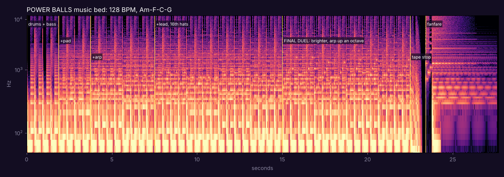

# edm-battle-bed: 128 BPM battle music bed, tape stop and victory fanfare

The synthesized music from POWER BALLS: 128 BPM EDM in A minor (Am–F–C–G, one bar each). The layers build up: kick, clap, hats and offbeat bass from bar 0, a sidechained pad from bar 1, a 16th arp from bar 2, then 16th hats and a lead motif from bar 4. From the bar after the second knockout everything brightens and the arp jumps an octave (the FINAL DUEL section). `tape_stop()` winds the bed down when the slow-motion final blow starts, and `fanfare()` plays the winner jingle. All of it is generated, with no samples or licensed audio.



**Used in:** POWER BALLS (Marble Pop, Nov 2026). The bed ran from FIGHT! (2.6 s) to the slow-mo at 42.9 s, with the duel section from the bar after 33.4 s. It sat under the effects at ×0.2, high-passed at 35 Hz. `music.py` is the same file the game template uses. It builds on the DSP helpers and drums in `sfx.py`, a copy of `../ability-sfx/sfx.py`.

`assets/`:
- `loop_main.wav` and `loop_duel.wav`: seamless 4-bar loops (7.5 s, stereo) of the full arrangement and the duel section
- `victory_fanfare.wav`: the E–A–C#–E arpeggio over an A-major pad, with kick, crash and party poppers (4.4 s)

## Use

```bash
python music.py --export assets          # regenerate the three WAVs
python music.py --preview preview.png    # spectrogram with the section map (matplotlib)
python music.py --style style.json
```

```python
import numpy as np, sfx, music
n = int(30 * sfx.SR)
bed = music.build_bed(n, t0=2.6, t1=25.0, tau_duel=18.0)   # bars after the one holding 18 s are intense
music.tape_stop(bed, at=24.2, d=0.7)                        # wind down into a slow-motion moment
music.fanfare(26.0, bed)                                    # winner jingle on top
```

- Settings at the top: `BPM`, `CHORDS`, `LEAD`, `LAYERS` (when each layer enters), `GAINS`, `CUTOFFS`, `SIDECHAIN`, `FANFARE_NOTES` and `FANFARE_CHORD`.
- `build_bed(..., bar_offset=4)` starts with the full arrangement; that's how the loops are made.

## Dependencies (tested)

Python 3.13.18 · numpy 2.5.3 · scipy 1.18.1 · matplotlib 3.11.2 (only for `--preview`)
