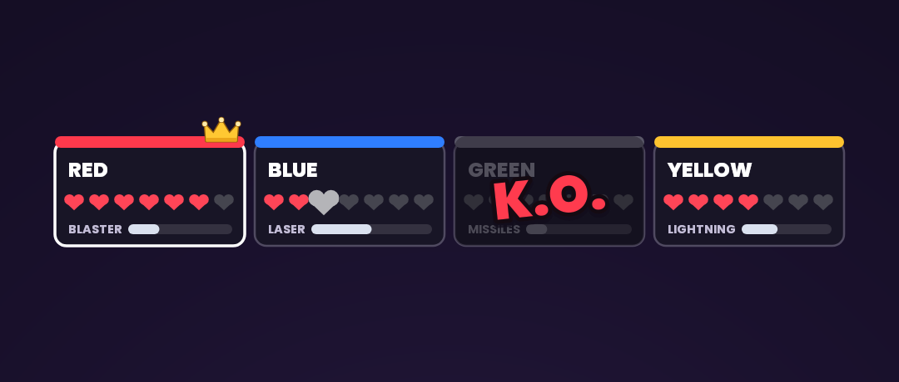

# fighter-cards: POWER BALLS scoreboard

A row of four fighter cards for a 1080-wide Shorts canvas. Each card has a colored top bar, the name, 7 hearts, and the ability label with a power bar (level / 10). The unique HP leader gets a gold crown and a white border. A hit shakes the card and pops the lost heart white, and a knocked-out card greys out under a slammed-in red K.O. stamp.



**Used in:** POWER BALLS (Marble Pop, Nov 2026), at y = 262..394 under the title. `cards.py` is the same file the game template uses.

## Use

```bash
python cards.py --preview preview.png                        # the image above
python cards.py --hp 6,2,0,4 --levels 3,5,2,4 --out cards.png  # any state (0 HP = K.O.)
python cards.py --style style.json
```

```python
import drawkit as dk, cards
surf = dk.new_surface(1080, 460); c = surf.getCanvas()
hp, lv = [6, 2, 0, 4], [3, 5, 2, 4]
cards.draw_cards(c, hp, lv, leader=cards.auto_leader(hp),
                 ko_age=[None, None, 0.1, None],      # seconds since each K.O. (stamp pops for 0.25 s)
                 shake=[0, 0.3, 0, 0],                # hit-shake seconds left (0.4 s total)
                 heart_pop=[None, (2, 0.1), None, None])  # (heart index just lost, its age)
dk.save_png(surf, 'cards.png')
```

- `draw_cards(c, hp, levels, alive=None, leader=None, ko_age=None, shake=None, heart_pop=None)` draws in the 1080x1920 frame's coordinates, so translate first to move the row.
- `auto_leader(hp)` returns the index with the unique highest HP, or `None` on a tie. The video hides the crown during the intro and gives it to the winner at the end.
- Settings at the top: `NAMES`, `COLORS`, `LABELS`, `MAX_HP`, `MAX_LEVEL`, plus one dict each for card geometry, name, hearts, label, power bar, crown, K.O. stamp and shake. Every color is hex.
- The preview's purple background matches `../battle-screen-layout`.

## Not in this folder

The Poppins font files: run `python drawkit.py --fetch-fonts`, or see `drawkit.py` for where it looks.

## Dependencies (tested)

Python 3.13.18 · skia-python 144.1 · fonttools 4.67.0 + brotli 1.2.1 (only for `--fetch-fonts`)
