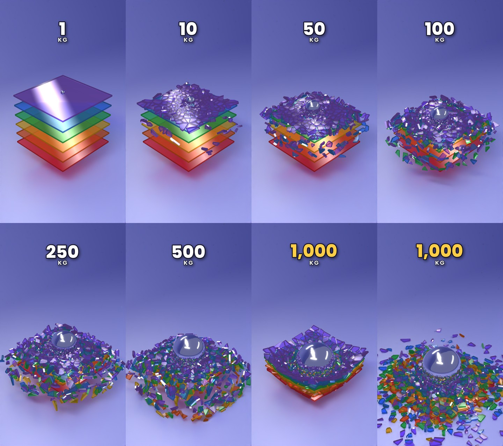

# glass-shatter

Steel ball vs glass Shorts in the "1 KG vs 1,000 KG" format. A steel ball drops onto a floating stack of six rainbow glass panes (top to bottom: purple, blue, green, yellow, orange, red) in a soft periwinkle studio. The weights go 1, 10, 50, 100, 250, 500, then 1,000 KG, and each heavier ball breaks one more pane: the 1 KG ball just bounces and the 1,000 KG ball smashes all six onto the floor. Ball sizes follow real steel density, so 1 KG is 6 cm across and 1,000 KG is 62 cm. Each pane shatters into about 400 shards, simulated in pybullet, and the 1,000 KG smash plays in slow motion. Every stage starts with a fresh stack, the counter shows the weight, and all the sound is synthesized (glass crashes and shard tinkles timed to the sim). A ~22 s video takes about 2 hours on 2 CPU cores.

**Used in:** "1 KG vs 1,000 KG Ball Smashing Glass 😱", Nov 2026, made in the format of a "Thick glass layer vs Steel ball" Short. Every frame and sound in it came from this code.



## Files
- `settings.py`: the stack (6 panes, 1 m square, 2.5 cm thick, 16 cm apart), pane colors, stages (label, kg and how many panes break), per-stage sim flags (`SIM_ARGS`: where the ball drops), the timeline (`HOLD` frames, then each stage's last sim frame in `END`), render quality, and the thumbnail crop
- `fracture.py`: radial Voronoi shatter. Rings of seed points around the impact plus random outer points are mirrored across the pane edges, then each cell is clipped and extruded into a convex prism shard. The faces get material 0 and the broken edges material 1.
- `glass_sim.py` (pybullet): drops the ball. Intact panes are static boxes. When the ball reaches a pane it is meant to break, the box is swapped for its shards, the shards near the impact get an outward and downward kick, and the ball keeps 70–93% of its downward speed. Ball and shard poses plus impact events go to `build/sims/stageN.npz`.
- `run_sims.py`: runs the 7 sims in two parallel queues (~15 min)
- `glass_scene.py` (Blender): the studio sweep (the floor curves up into a back wall), the lights (key and fill; the rim and three strip lights show up only in reflections), the camera, the steel ball, the panes, and the shard mesh (one mesh per stage, posed every frame in numpy). The glass is a fake-reflection shader: a tinted Transparent BSDF plus fresnel-weighted emission from procedural light strips (the view direction reflected about the normal). It renders about 3x faster than real Glossy glass, denoises cleanly, and still casts colored shadows.
- `bgemit.py`: window-mapped plate emission, so static studio pixels are never re-shaded (the same helpers as in `../cloth-faces/scene.py`)
- `plates.py` (Blender): the empty studio plate
- `build_timeline.py`: writes `build/timeline.json`, with hold frames and slow motion around the finale's breaks
- `glass_render.py` (Blender): renders each frame in two passes like `../cloth-faces`: a low-res shadow catcher (colored glass shadows) times the plate, then a 0.8-scale render of only the box around the ball, panes and shards. A frame is copied instead of rendered when nothing moved more than 1 mm.
- `run_render.py`: two single-thread workers (even and odd frames). Blender restarts every 48 frames so its memory doesn't grow.
- `overlay.py`: the counter: the number plus KG, white, gold on the last stage
- `audio.py` + `synth.py`: the sound. Each break is a glass crash built from 70–110 short glassy partials plus a noise burst. Shard landings trigger tinkles, found where a shard's speed suddenly drops. There's also a whoosh as the ball falls, a metal clink for bounces, a thud that gets deeper as the ball gets heavier, a crunch when the ball hits the floor, a faint rattle while shards slide, a pop per stage and a quiet music bed.
- `thumb.py`: a no-text thumbnail: the finale mid-smash at full quality, zoomed 1.3x and lightly graded
- `quickview.py`: low-res Cycles frames of one sim: `python3 quickview.py -- STAGE 0,20,40 OUT.png 270 8`
- `make_video.sh`: everything above in order

## Reuse
Install the fonts once with `../style-kit/get_fonts.py`. Then run the whole pipeline (`PY` needs bpy 5.3.0 and pybullet):
```bash
PY=python3 ./make_video.sh
```
Step by step:
```bash
python3 run_sims.py                         # ~15 min
python3 plates.py 96                        # 96 = plate samples
python3 build_timeline.py
python3 glass_render.py -- --list 26,460,561  # check a few frames first
python3 run_render.py                       # ~80 min
python3 overlay.py build/timeline.json build/frames build/final 0 663
python3 audio.py
python3 thumb.py
```
To change the stack, edit `N_P`, `GAP` and `PANE_COLORS`. To change the weights, edit `STAGES`, where `brk` is how many panes that ball breaks. A different drop point gives a different shatter, so use the `--bx/--by` flags in `SIM_ARGS`.

**YouTube copy used:**
- Title: `1 KG vs 1,000 KG Ball Smashing Glass 😱`
- Description: `Steel balls from 1 KG to 1,000 KG drop on 6 layers of rainbow glass 💥` / `Pick your favorite color in the comments 🟣🔵🟢🟡🟠🔴` / `Made with Blender` / `#satisfying #simulation #asmr`
- Thumbnail: no text, the 1,000 KG ball mid-smash.

## Gotchas
- pybullet's default convex-hull collision margin (4 cm) makes thin shards explode apart. Set `collisionMargin` to about 0.6 mm and shrink each shard by 0.7 mm.
- Bullet can't handle huge mass ratios, so the ball's physics mass is capped at 60 kg. The weight you see comes from the ball's size and from how many panes it breaks, which is scripted.
- A ball can stall on a cushion of shards above the next pane, so a pane also breaks when the ball is within 12 cm of it and moving slower than 0.35 m/s.
- With real Glossy glass, six stacked panes rendered about 3x slower and noisier.
- Frame reuse saved only 91 of 663 frames, mostly the opening holds and the end of the 1 KG stage. In the bigger smashes some shard is nearly always still moving more than 1 mm, so expect ~13 s per frame per core for almost every frame.

## What it can't do
- Which panes break is set per stage, not computed from impact energy.
- Shards never break into smaller pieces.
- Each stage cuts to a fresh stack, so there's no single continuous take.
- The glass has no real refraction, and there are no caustics.
- The camera can't move, because the plate is rendered once.

## Dependencies
- pybullet 3.2.7 (`pip install pybullet==3.2.7`; on Python 3.13 pip builds it from source)
- Blender 5.3.0 as a Python module (`pip install bpy==5.3.0`, Python 3.13)
- numpy, scipy, Pillow, OpenEXR 3.5
- ffmpeg 6.1
- Poppins ExtraBold and Bold (`../style-kit/get_fonts.py`)
