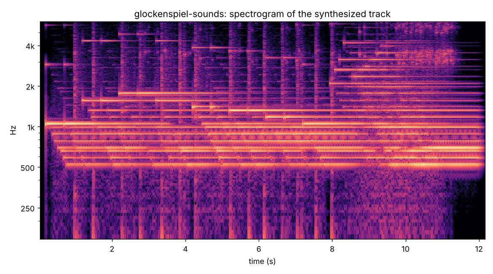

# glockenspiel-sounds

The whole soundtrack of the marble xylophone Shorts, synthesized from scratch with no samples. It turns hit events into a finished stereo WAV:
- metal-bar glockenspiel notes, tuned by MIDI note, with brighter tone on harder hits
- glass marble-on-marble clicks
- wicker basket thuds
- soft rolling noise on the bars and in the basket
- a small-room reverb, slow loudness leveling (so a single marble is as audible as the 40-marble finale) and a limiter

**Used in:** both marble xylophone Shorts. The Twinkle track (−13.9 dBFS RMS) and the 40 marbles track (−14.8 dBFS RMS) regenerate sample-for-sample from this code.



*The preview is a spectrogram of the Twinkle track: the tune in the 1–2 kHz band, the soft rolling runs below it, and the shimmering pour after 8 s.*

## Reuse
Get an events file from `../marble-drop-sim/events.py` first. Then:
```bash
python3 synth.py ../marble-drop-sim/build/melody_events.npz build/melody.wav --duration 12.2 --spectrogram preview.png
python3 synth.py ../marble-drop-sim/build/rounds_events.npz build/rounds.wav --duration 12.6
```
**Input** (`events.npz`):
- `notes`: rows of `t, bar, midi, amp, x, marble, first`
- `clicks` and `thuds`: rows of `t, strength, x`
- `t`, `roll_bar_env`, `roll_bar_x`, `roll_bask_env`, `roll_bask_x`

Any source can feed it, not just this sim.

**Settings** are at the top of `synth.py`: gains, partials, decay, reverb, `LEVEL_WINDOW` (the stretch whose loudness becomes the target for the whole track) and the peak. If your video's busiest part isn't at 7.5–11 s, move `LEVEL_WINDOW` to cover it. The random seed is fixed, so the same events always give the same file. The WAVs are generated output; don't commit them.

## Dependencies
- numpy 2.5.3
- scipy 1.18.1
- matplotlib 3.11.2 (only for `--spectrogram`)
