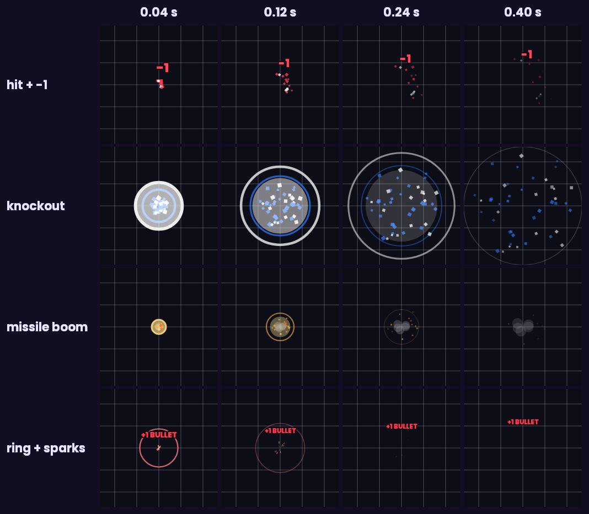

# impact-fx: particles, rings, damage numbers, shake and flash

The effects engine behind every hit in POWER BALLS. It covers rotating-square bursts, sparks, glows, smoke puffs, expanding rings, floating "-1" damage numbers and upgrade labels ("+1 BULLET"), screen shake and the white knockout flash. The presets reproduce the video's effects exactly.



The preview shows each preset at 0.04, 0.12, 0.24 and 0.40 s, at half scale.

**Used in:** POWER BALLS (Marble Pop, Nov 2026). `fx.py` is the same file the game template uses, and its `render.GameFX` maps sim events onto these presets.

## Use

```bash
python fx.py --preview preview.png
python fx.py --style style.json
```

```python
import drawkit as dk, fx
surf = dk.new_surface(872, 872); c = surf.getCanvas()
f = fx.FX(seed=3)
f.hit(300, 300, 200, 380, '#FE394C')      # victim at (300, 300) hit from (200, 380): squares spray away + "-1"
f.label('+1 BULLET', 600, 600, '#FE394C')  # floats above a ball centered at (600, 600)
f.ko(600, 250, '#2F7EFF', final=False)     # rings + 44 squares + glow, shake 14, flash 0.25 (0.55 on the final KO)
f.explosion(250, 650, hit=True)            # missile boom: ring, glow, embers, smoke
for _ in range(24):                        # 0.1 s of physics steps; pass speed < 1 in slow motion
    f.update(1 / 240, speed=1.0)
f.draw_smoke(c); f.draw_rings(c)           # under your fighters
f.draw_particles(c); f.draw_texts(c)       # over them
dk.save_png(surf, 'fx.png')
# f.shake: random +-shake px offset for the arena; f.flash: white overlay alpha (0..1)
```

- Primitives for new effects: `burst`, `ring`, `glow`, `puff`, `float_text`, `add_bolt`.
- Settings at the top: the preset dicts (`HIT`, `KO`, `EXPLOSION`, `DAMAGE_TEXT`, `LABEL_TEXT`, `TEXT_STYLE`), the spark, smoke and ring colors, and the decay rates. Every color is hex.
- Randomness comes only from `FX.rng`, so the same calls in the same order always give the same frames.

## Not in this folder

The Poppins font files (for "-1" and the labels): run `python drawkit.py --fetch-fonts`, or see `drawkit.py` for where it looks.

## Dependencies (tested)

Python 3.13.18 · skia-python 144.1 · fonttools 4.67.0 + brotli 1.2.1 (only for `--fetch-fonts`)
