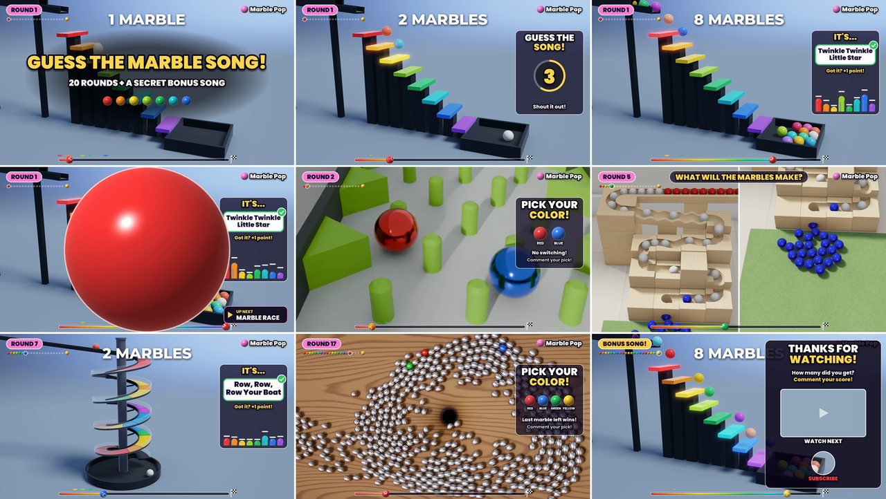

# longform-compilation

One command turns Marble Pop's music templates and vertical Shorts into a full-screen 16:9 long-form "Guess the Marble Song" game video. The music rounds are fresh 16:9 renders of `../marble-stairs-song`, `../marble-twin-stairs` and `../marble-spiral-round` (`MARBLE_RES=1920x1080 MARBLE_CAM=wide`). Every other Short is reframed to fill the screen: a crop that follows the racing marbles by colour, a split view of a tall marble run, or a virtual camera that pans, pushes in and turns top-down shots a quarter turn. A game layer runs on top: a round pill with progress marbles, a guess panel with a countdown and an answer pop-in, pick-your-colour and did-your-colour-win cards, run reveals, a rainbow progress bar with a rolling marble, a live equaliser, up-next slides, marble-pop transitions, an intro, an end screen, and music beds under the rounds that only had sound effects.



**Used in:** *Guess the Marble Song! 🎵 20 Rounds + a Secret Bonus*, the full-screen version (Marble Pop long-form, Nov 2026; 11:17, 20,303 frames, 1920×1080, 30 fps). It replaced the first upload, which showed each Short in a card (10:29). It was built from 14 fresh 16:9 template renders (7 staircase, 6 twin-stairs, 1 spiral, including the bonus *Joy to the World*) and 7 Shorts: 2 races with a tracked crop, 3 marble runs in split view, and the chrome-marble drain and the xylophone through the virtual camera. Verified on the finished file with `check.py`:
- The video and audio streams are 676.767 s and 676.766 s long, and a full decode shows no errors.
- Every round's own audio sits within 5 ms of where the plan put it, so the cuts and the sample-accurate audio assembly stay in sync to the end.
- Integrated loudness is −15.0 LUFS with a 4.6 LU range; the true peak is −0.8 dBFS.
- Stills of the intro, every round type, a transition, every reveal and the end screen were checked by eye, and so were the three thumbnails.

## Files
| file | what |
|---|---|
| `settings.py` | every value: paths, canvas, loudness and beds, timings, layout and colours, `ITEMS` (the running order: each round's source, how a Short fills 16:9, cut points, speed-ups, game type and answers) and `THUMBNAILS` |
| `build.py` | plan → overlay sprites → one H.264 segment per round (resumable) → sample-accurate audio with beds and SFX → concat + AAC → chapters, plan and copy. `--render-wide` first makes any missing 16:9 template render |
| `track.py` | finds race marbles by colour and turns their smoothed height into crop keyframes |
| `vcam.py` | the virtual camera: eased (centre, view height, roll) keys warp a 1080×1920 Short into 1920×1080, and it pushes in during a roll so no border ever shows |
| `widgets.py` | a per-frame RGBA strip piped into ffmpeg, driven by the round's audio: equaliser, progress bar with a rolling marble, beat pulse |
| `ui.py` | Pillow sprites: round pill and progress marbles, logo, guess, answer, race and run panels, countdown, up-next slide, intro and end-screen overlays, marble-pop transition frames, thumbnail polish |
| `thumbs.py` | three no-text 1280×720 thumbnails for YouTube's Test & Compare: two close 16:9 template renders and a 2×2 collage |
| `check.py` | stream lengths, a full decode, loudness and true peak, and each round's audio sync measured by cross-correlation |
| `youtube_copy.py` | three titles and the description with chapters → `build/youtube_copy.txt` |
| `style.json` | the numbers: layout, timings, framing modes, audio, encode |
| `preview.png` | nine moments of the finished video |

## Reuse
```bash
./setup.sh ball-sims                        # numpy, scipy, Pillow, opencv-python, ffmpeg, Poppins
cd ball-sims/longform-compilation
SHORTS_DIR=/path/to/shorts python3 build.py --plan          # the timeline (PLAN_LENIENT=1 if renders are missing)
SHORTS_DIR=/path/to/shorts python3 build.py --render-wide   # missing 16:9 template renders, then the whole video
SHORTS_DIR=/path/to/shorts python3 build.py --only 7,16     # only those rounds' segments, to check framing
python3 thumbs.py --render                                  # close-camera renders if missing, then 3 thumbnails
python3 check.py                                            # verify the finished file
```
Outputs in `build/`: the mp4, `thumbnail_*.jpg`, `chapters.txt`, `youtube_copy.txt`, `plan.json`, and the cached `segs/`, `audio/`, `assets/` and `reframe/`. On a 2-core cloud session, a 16:9 template render takes about 8 minutes for a staircase song, 3 for a twin-stairs song and 2 for the spiral (plus about 6 minutes the first time a camera's set is path-traced). A round's segment takes about a minute, a virtual-camera reframe about 2 minutes for 30 s, and the audio and mux about 3 minutes once the segments exist.

**A new compilation:** edit `ITEMS` in `settings.py`, render the changed rounds with `--only`, and look at stills before a full build.
- `src`: `("wide", template, song)` is a 16:9 template render in `<template>/build_wide/<song>/`; `("short", glob)` is a vertical Short matched in `SHORTS_DIR`.
- `kind` picks the game:
  - `song`: guess panel and countdown, then the answer pops in; the equaliser runs after the reveal.
  - `race`: pick your colour, then "did your colour win?" at `end_t`.
  - `run`: a question (`prompt`) with an optional reveal (`reveal`, `answer`, `icon`).
  - `bonus`: the closing song with the end screen.
- `frame` (Shorts only) says how a vertical Short fills 16:9:
  - `track=[colours]`: a full-width 1080×608 window follows the marbles of those colours (red, blue, green); `tail=[(t, top)]` takes over for the finish.
  - `keys=[(t, top)]`: the same window from hand keyframes; `top` is a fraction of 1920.
  - `vcam=[(t, cx, cy, view height, roll)]`: the virtual camera. A view height of 608 is the Short's full width; roll 90 with height 1080 shows a top-down shot whole, turned a quarter turn.
  - `split=(yl, yr)`: two 960×1080 windows side by side with a white divider, for runs taller than wide (left: the track from `yl`, right: the tray from `yr`).
  - `extend=True`: the whole Short in the middle with blurred, smeared sides. A last resort; no round uses it now.
- `ts`/`te` cut the Short, `speed=[(from, to, factor)]` fast-forwards a stretch (pitch kept with `atempo`), `bed` puts a loop from `../battle-audio` under an SFX-only round.

## Gotchas
- **Give each camera its own template build folder.** The templates cache the path-traced set per folder by scene hash, so a different camera in the same folder re-renders the set, and two jobs at once overwrite each other's. Hence `BUILD_DIR=build_wide` for the 16:9 renders and `build_thumb` for the thumbnails.
- **Only top-down shots get rolled.** A quarter turn is invisible on a table seen from above, but it tips a perspective shot on its side. In `last_marble`, the camera rolls to 90° for the two top-down stretches and back to 0° for the close-ups, timed with the Short's own zooms so each roll reads as one camera move.
- **The tracker's colour rules are tuned for pale courses.** Red is r > 140, g < 90, b < 90; blue and green need a clear lead over the other channels. Chrome and wood don't match, and the smoothing is a 0.6 s Gaussian, so a crop lags fast swaps a little. Check a few stills per tracked round.
- **`keys` tops are fractions of 1920, not of the 1312 px a 608-tall window can travel.** ffmpeg's crop clamps anything past the bottom.
- **The widgets come in as a raw RGBA pipe**, one 1180×298 strip per frame cut into three overlays. Drawing them in Python and overlaying is far cheaper than ffmpeg's drawing filters, and the segment checks it got exactly N frames.
- **Segments, audio and reframes are cached.** Delete `build/segs/seg_NN.mp4` (or set `FORCE=1`) after changing a round's picture. The audio per round is cached by its cut and loudness settings, and a reframe by its keys and cut.
- **Loudness:** each round is gained to −15 LUFS. SFX-only rounds are first set to −16 LUFS with their bed at −21 LUFS. The mix then goes through a −3 dBFS limiter, because AAC adds about 2 dB of overshoot.
- **No spoilers:** up-next slides and chapter titles never name a song; the names are in the description's spoiler line.
- **Made for kids:** YouTube turns off comments, end screens and Test & Compare on videos set as made for kids. The "comment your score" line, the end-screen slots and the three thumbnails only do anything on videos that aren't.

## What it can't do
- Shorts must be 1080×1920 and template renders 1920×1080, both at 30 fps.
- The progress marbles hold 20 rounds plus the bonus.
- Reveal times, run splits and camera keys are set by hand from stills; nothing detects a winner or plans a camera path.
- The xylophone Short is reframed, not re-rendered in 16:9: `../xylophone-song-template` needs Blender and about 20 minutes of Cycles plates for a new camera.
- There's no narration.

## Dependencies (tested)
- Python 3.13.18, numpy 2.5.3, scipy 1.18.1, Pillow 12.3.0, opencv-python 5.0.0 (vcam)
- ffmpeg 6.1.1 with libx264 and the built-in AAC encoder
- Poppins Black, ExtraBold, Bold and SemiBold from `../style-kit/get_fonts.py`
- `../battle-audio/assets` (SFX and beds) and the three music templates, which need `../marble-raytrace-kit`
- Linux x86-64, 2 cores
