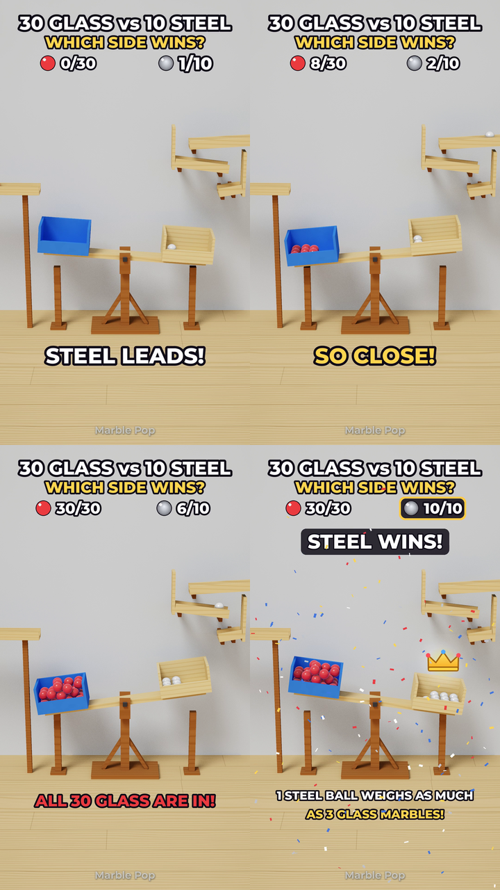

# marble-balance (game template)

One command for a "30 GLASS vs 10 STEEL — WHICH SIDE WINS?" balance Short: red glass marbles roll in along a shelf on the left, steel balls come down a wooden zigzag on the right, both drop into the baskets of a wooden seesaw, and the heavier side goes down. The lead changes hands seven times, then all 30 glass marbles are in and steel needs every one of its 10 balls: the 10th tips it. It's the co-owner's "18 GLASS vs 2 STEEL" Short made physically correct (a steel ball is 3.14 times as heavy as a glass marble of the same size, so 2 steel balls can't beat 18 glass marbles, but 10 beat 30), and it ends with that fact on screen. Real physics moves everything, and it renders on the CPU with `../marble-raytrace-kit`, moving seesaw included: no Blender, no GPU.



**Used in:** "30 Glass vs 10 Steel ⚖️ Which Side Wins?" made for Marble Pop (Nov 2026; 24.73 s, 733 frames, 1080×1920, 30 fps; steel wins 31.4 to 30). Verified on a 2-core cloud session, running from this folder:
- The first full build path-traced the level set and the two end poses (51 s each), found the window (41% of the image) and path-traced the 66 beam poses in 23.7 minutes (about 21.5 s each).
- With the poses cached, `python3 make_video.py` took 3 min 29 s: physics, soundtrack, the 733 frames in four parts two at a time, the mux and the thumbnail. The delivered mp4 is that run: −13.1 LUFS integrated, −0.7 dBFS peak.
- The physics lands every marble within 0.21 s of its scheduled time, ends with all 40 marbles in their own baskets, and the beam changes sides at 0.63, 2.59, 5.55, 6.97, 12.23 and 13.32 s before the decisive tip at 21.05 s, the 7 changes `schedule.py` predicts on paper.
- The window's feathered edge leaves no seam: across its top and bottom edges, frames with the beam tilted (10 s and 22 s) differ from the level opening frame by at most 1.5 levels of 255 in row means away from marbles and text, with no step at the edge.

## How it works
1. **The set.** `scene.py` builds everything from boxes (the kit's `boxtrace` scenes): wall, floor, the stand with its pivot pin and two stop posts, the beam with a blue basket and a wooden one, the glass shelf and the three-plank steel zigzag with its end stops and wall brackets. The beam and baskets are turned about the pivot by the beam angle.
2. **Physics.** `sim.py` (numba, 6 kHz): soft-sphere marbles against every box and each other, rolling (5/7 g on slopes, no sliding friction on wood), landing in the baskets and piling up. The beam turns under the vertical push of every marble on a basket at the fixed arm, like the pans of a scale, so the side with more mass goes down wherever the marbles sit, and the counters always predict the result. Stop posts hold it at ±8°. In the physics only, the baskets' low front walls go up to full height like clear panes, so a tall pile can't spill toward the camera.
3. **The race.** `settings.LAND_LEFT` / `LAND_RIGHT` say when each marble lands; `sim.run()` finds start times that land them on time (a lone marble's travel time first, then small corrections, keeping the best pass). `python3 schedule.py` shows the designed totals and lead changes on paper.
4. **A moving set on a static renderer.** `boxtrace` path-traces the set once level (the whole 2160×3840 image), and once at each end of the swing. The pixels that differ (the seesaw, its shadows and bounce light, blurred so ray noise doesn't count) give the window the seesaw can change: 41% of the image. `timeline.py` rounds the beam angle per frame (0.15° when slow, 0.3° or 0.6° when it swings fast) and turns marbles in a basket by the same rounding; `make_video.py` path-traces that window once per rounded pose with the kit's `crop` (66 poses), and `bake.py` paints the wood grain in the beam's own frame so it turns with it.
5. **Frames.** `balance_comp.py` subclasses the kit's compositor: before each frame it swaps the window of the G-buffer for that frame's pose (feathered 40 px into the level set) and points the marble-lighting tracer at the boxes in that pose, so shadows, contact AO and depth tests all see the beam where it is. Steel balls are drawn as polished metal (Fresnel 0.78, a dark band at the horizon and a bright room above in their reflection).
6. **Text and sound.** `overlays.py`: title, a counter over each basket, callouts at the bottom, the winner box, a crown over the winning basket (`../crown-icon`), confetti and the fun fact. `audio.py` builds the soundtrack from the physics events (`../battle-audio`).

## Files
| file | what |
|---|---|
| `settings.py` | **every setting**: the two teams, the seesaw, the tracks, the landing schedule, look, camera, text; `EPISODE=<name>` runs `episodes/<name>.py` after it |
| `scene.py` | the set as boxes (with the beam at any angle), camera, light, scene files for `boxtrace` |
| `sim.py` | the physics, landing-time fitting, lead changes, `check()` that every marble ended in its basket |
| `schedule.py` | the race on paper: totals and lead changes from the landing times |
| `timeline.py` | physics → frames: positions, rounded beam poses, counters and cues |
| `bake.py` | wood grain, painted basket, floorboards and wall texture baked into each G-buffer |
| `balance_comp.py` | the compositor with a moving set and steel balls |
| `overlays.py` | title, counters, callouts, winner box, crown, confetti, fun fact |
| `audio.py` | clinks, metal rings, knocks, beam thunks, whooshes, rolling, suspense pulse, riser, fanfare, claps, winner loop |
| `make_video.py` | the whole pipeline; also `--stills`, `--thumb-only`, `--thumb-frame`, `--max-frames`, `PREVIEW=1` |
| `style.json` | every value, plus the YouTube copy |
| `preview.png` | four moments of the shipped video |

## Reuse
```bash
./setup.sh ball-sims                                    # numpy, scipy, numba, Pillow, skia-python, Montserrat
python3 schedule.py                                     # the designed race on paper
PREVIEW=1 python3 make_video.py --stills 15,124,560,700 # half-size sets, only the poses these frames need
python3 make_video.py                                   # -> build/Glass_vs_Steel_Balance.mp4 + build/thumbnail.png
```
The first full build takes about 30 minutes on a 2-core cloud session: 2.5 to trace the level set and the end poses, 24 for the 66 beam poses (cached in `build/poses/`), then 3.5 for the frames. After that, a change to the text, sound or marble look re-renders in about 3.5 minutes.

**A new matchup:** make `episodes/<name>.py` with the new `LEFT` / `RIGHT` (name, count, mass, colour, `metal`) and new `LAND_LEFT` / `LAND_RIGHT`, check it with `EPISODE=<name> python3 schedule.py` (aim for lead changes at least a second apart and the last marble deciding it), then look at `PREVIEW=1` stills. The title, counters, callouts and fun fact follow the teams. Keep the totals honest: the counters and the beam always agree.

**Copy** (Marble Pop rules in the repo's `CLAUDE.md`): title `30 Glass vs 10 Steel ⚖️ Which Side Wins?`; description `30 glass marbles vs 10 steel balls on a wooden balance. Which side goes down?` / `Pick your side in the comments 🔴⚪` / `Made with a 3D physics simulation` / `#marbles #physics #satisfying #shorts`. The thumbnail (the 10th steel ball landing, before the tip) has no text.

## Gotchas
- **Rigid baskets would cheat.** With the baskets bolted to the beam, marbles roll to the low end of a tipped basket and lengthen their own lever, so a side that's down stays down even when it's lighter. The scale-pan torque (fixed arm) keeps the result honest.
- **Spread them across the track.** Marbles that all arrive at z = 0 stack in one plane and overflow the basket; each one starts with a small random offset across the track.
- **Landing knocks.** A steel ball landing in the raised basket lifts it for a moment (up to about 6° in the shipped race, shown as SO CLOSE!). A lighter beam (`BEAM_MASS`) makes those knocks big enough to tip it for real.
- **Zigzag gaps.** A ball only drops to the next plank if the gap between a plank's end and the end stop is wider than a marble (2.8 here).
- **Poses are cached** by angle in `build/poses/`; they're only valid for the set they were traced with, so delete the folder after changing the set, the camera or the samples. The level set and the window are cached by the scene file.
- **The window's edge is blended.** Far from the seesaw, a pose differs from the level set only by the noise of a few ambient rays that hit the beam; the 40 px feather hides it. Don't shrink `FEATHER` to zero.
- **The baskets' front panes are invisible.** Keep `BASKET_FRONT_H` low enough to see in, but remember the physics uses the full height.

## What it can't do
- Only boxes, turned only about the z axis (`boxtrace`), so the seesaw has to swing in the picture plane.
- Each beam pose costs a path trace of the window (about 20 s at full size), so a beam that never stops moving gets expensive.
- The marbles are spheres of one size; glass is drawn as glossy red plastic (no transparency).
- The camera can't move.

## Dependencies (tested)
- Python 3.13.18, numpy 2.5.3, scipy 1.18.1, numba 0.68.1, Pillow 12.3.0, skia-python 144.1 (for the crown)
- gcc 13.3.0 with OpenMP (the kit compiles `boxtrace`), ffmpeg 6.1.1 with libx264 and the built-in AAC encoder
- Montserrat (`../marble-raytrace-kit/get_fonts.py`, run by `./setup.sh ball-sims`)
- Linux x86-64, 2 cores
