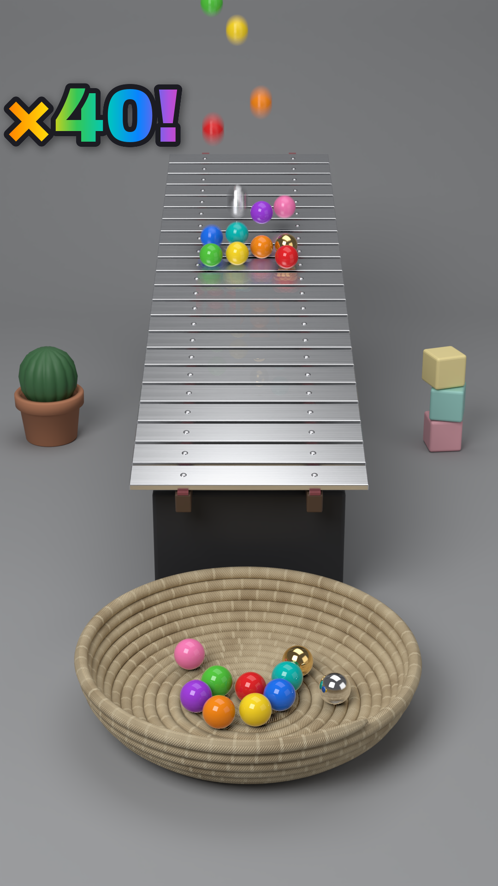

# marble-counter

The pop-in round counter from the 40 marbles video: "×1", "×2", "×3", "×4", then a rainbow "×40!" in the top-left corner. Each new label springs in with an overshoot while the old one grows and fades out. It's white Archivo Black with a dark outline and a soft shadow.

**Used in:** the 40 marbles video (Nov 2026). The Twinkle video uses no text.



## Reuse
```bash
# the preview: a 40 marbles frame at 8.0 s (render it with marble-plate-compositor first)
python3 ../marble-plate-compositor/render_frame.py ../marble-drop-sim/build/rounds_sim.npz ../marble-drop-sim/build/rounds.json --t 8.0 --ns 16
python3 counter.py --png ../marble-plate-compositor/build/frame_8.00.png --t 8.0 --out preview.png   # one frame
python3 counter.py --video in.mp4 --out out.mp4                                                       # burn into a video (audio copied)
```
To draw it while rendering, which gives one encode and no quality loss:
`python3 ../marble-plate-compositor/render_video.py SIM CFG 0 290 part.mp4 --overlay ../marble-counter/counter.py`

**Settings** are at the top of `counter.py`:
- `EVENTS`: start time, text, size and rainbow on/off for each label
- `CENTER`: where the label sits
- colors, pop timing, crossfade

The labels show whatever text you give them, so "1 MARBLE" style works too.

## Font
The font file is not included. Download **Archivo Black** (`ArchivoBlack-Regular.ttf`, SIL Open Font License) from https://fonts.google.com/specimen/Archivo+Black. Put it in a `fonts/` folder next to `counter.py`, in `shared/fonts/` at the repo root, or install it system-wide; the script finds it in any of those places. Keep the font file out of git.

## Dependencies
- numpy 2.5.3
- Pillow 12.3.0
- matplotlib 3.11.2 (only to find system-installed fonts)
- ffmpeg 6.1 (for `--video`)
