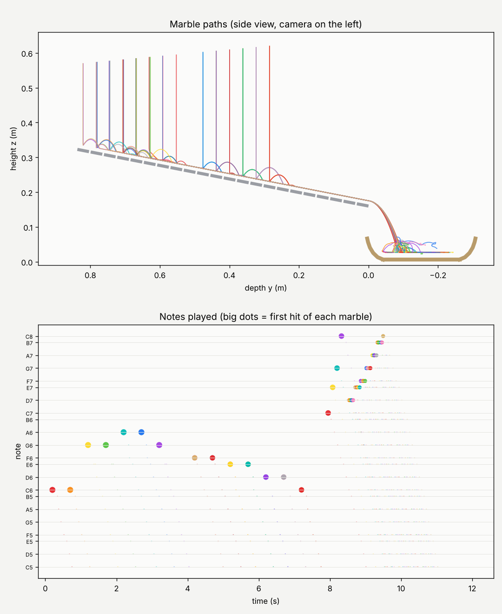

# marble-drop-sim

Rigid-body physics for marbles dropped onto `xylophone-ramp`. Each marble falls from just above the frame, hits a bar, rolls down the ramp and lands in the basket. The prop has two drop schedules:
- `rounds.py`: rounds of 1, 2, 3 and 4 marbles, then a 40-marble rainbow pour (the 40 marbles video).
- `melody.py`: every marble is timed so its first hit lands on the right bar exactly on the beat, so the marbles play a song (the Twinkle Twinkle video: 7 single marbles, 7 pairs, a 4-note sparkle, then a 25-marble pour, 50 marbles in all).

`events.py` turns a simulation into sound events (bar hits with their MIDI note, marble-on-marble clicks, basket thuds, rolling) for `glockenspiel-sounds`.

**Used in:** both marble xylophone Shorts (40 marbles, Twinkle Twinkle), Nov 2026.



*The preview shows the Twinkle simulation. The top panel is a side view of every marble's path, with the camera on the left. The bottom panel shows every note played: each marble's first hit is a big dot, its bounces and roll are small dots.*

## Files
- `settings.py`: physics, guard and path settings
- `setlink.py`: loads `../xylophone-ramp/params.py` and the set's `build/` files
- `rounds.py` / `melody.py`: the drop schedules, with their settings at the top. Each writes `build/*.json`.
- `calibrate.py`: measures how long a marble takes to fall onto each bar (`build/fall_calib.json`). `melody.py` needs this file.
- `sim.py`: the Blender rigid-body sim. It writes `.npz` files with `pos`, `quat` and `t` at 240 Hz.
- `impacts.py`: detects each marble's first hit, even when it falls between sim frames
- `check.py`: confirms every marble ends in the basket, every melody note lands on the right bar within 12 ms, and nothing touched the invisible guards
- `events.py`: converts a sim into `events.npz` for `glockenspiel-sounds`
- `plot_preview.py`: draws `preview.png`

## Reuse
Run `../xylophone-ramp/build_set.py` once first. Then:
```bash
# Twinkle video
python3 calibrate.py                                   # ~20 s, once per camera/ramp/physics change
python3 melody.py                                      # build/melody.json
python3 sim.py build/melody.json build/melody_sim.npz  # ~10 s
python3 check.py build/melody_sim.npz build/melody.json
python3 events.py build/melody_sim.npz build/melody.json build/melody_events.npz --mode role
python3 plot_preview.py build/melody_sim.npz build/melody.json build/melody_events.npz

# 40 marbles video
python3 rounds.py
python3 sim.py build/rounds.json build/rounds_sim.npz
python3 events.py build/rounds_sim.npz build/rounds.json build/rounds_events.npz --mode physics --scale pentatonic
```
With desktop Blender, run `sim.py` as `blender --background --python sim.py -- CFG.json OUT.npz` and set `BLENDER_CMD` in `settings.py`.

To play a new song, edit `MELODY` at the top of `melody.py`. It's a list of `(note, beat)` pairs. Every note must exist on the ramp; with the default C major tuning that's C5 to C8, white keys only, and `melody.py` stops with a message if one doesn't. `BEAT` sets the tempo, `SINGLE_NOTES` how many notes use one marble before switching to pairs, and `TOTAL_MARBLES` how many marbles the pour tops up to. Run `check.py` afterwards to confirm every note landed. Keep the tune in the middle of the ramp (octave 6), because notes near the top leave less room before the next marble lands.

The sims are deterministic: the same settings give exactly the same marble paths, bit for bit.

Everything these scripts write goes to `build/`. It's generated, so don't commit it.

## Dependencies
- Blender 5.3.0 (`pip install bpy==5.3.0`, Python 3.13) for `sim.py` and `calibrate.py`
- numpy 2.5.3
- matplotlib 3.11.2 (only for `plot_preview.py`)
