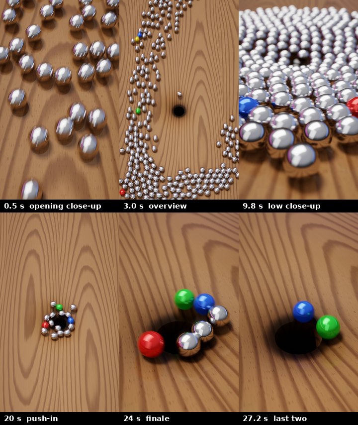

# marble-funnel-drain (game template)

The complete code behind the Marble Pop Short **"Last Marble Left WINS 🕳️ Pick Your Color"** (Nov 2026; 30.8 s, 924 frames, 1080×1920, 30 fps), a glossy 3D marble drain rendered on the CPU with no Blender and no GPU. The episode plays out like this:
- 0–1.4 s: a low close-up as 480 chrome marbles flood across a lacquered hardwood board, in slow motion.
- By 3.2 s the camera has pulled back to an angled overview. The flood sweeps down the left side, along the bottom and up into a spiral around a funnel with a hole in the middle.
- 7–12 s: the camera swoops down to a low close-up with depth of field. The four coloured marbles (red, blue, green, yellow) roll past in focus, in slow motion.
- 12–21 s: a slow push-in as the disk drains and shrinks to a ring of marbles circling the rim. Yellow drops out at 18.0 s.
- 22–29.6 s: a close-up at the hole in slow motion. Red drops at 26.3 s, then blue at 27.5 s, and green, the last marble on the board, wins at 29.3 s. A chime plays for each colour that drops out, and a short arpeggio for the winner.
- The camera then glides back to the opening shot over the empty board, so frame 0 follows the last frame seamlessly.

**Marble Olympics Grand Final** (`EPISODE=olympics500`, Nov 2026, for the 500-subscriber special in `../marble-olympics`; 30.77 s, 923 frames): 500 marbles instead of 480, one per subscriber, in red, blue, green and yellow teams of 125. The race is seed 12 of the 500-marble seeds 1–26, recorded in `assets/drain500_seed12.npz`. The last three marbles drain at 21.81, 22.77 and 24.70 s, so the last two circle the hole for almost 2 s. `TEAM_SEED` 18 leaves the finalists even, 5/5/5 at 17 s and 3/3/3 when the camera arrives. Green goes out at 15.8 s, then red, then yellow, and blue wins at 29.27 s video. Its sims and renders go to `build/olympics500/`. It rendered in 18.0 minutes on a 2-core session.

The physics really decides the order the marbles drain in. Every marble is identical; the colours are given afterwards, from the drain order (see **Gotchas**).



**Used in:** the "Last Marble Left WINS" Short made for Marble Pop (Nov 2026, delivered as `last_marble_wins_v3.mp4`). Verified on a 2-core cloud session, running from this folder:
- `python sim.py --compare` re-simulates seed 3 and gets arrays bit-identical to `assets/drain_seed3.npz` (positions, states, events, drain times).
- `--stills 0,300,600,720` (opening, low close-up, push-in, finale) match the frames rendered for the delivered video pixel for pixel, and match the delivered mp4 itself to 41–43 dB PSNR (H.264 noise).
- `--thumb-only` matches the delivered thumbnail pixel for pixel. `audio.py` reproduces the delivered soundtrack WAV sample for sample.
- `python make_video.py --max-frames 60` builds a 2-second test video end to end (two workers, concat, soundtrack, mux).
- `python make_video.py` with the shipped settings rebuilt `build/marble_funnel_drain.mp4` byte-identical to the delivered file (same MD5 for the whole file, 82,965,910 bytes) in 18.9 minutes, and `build/thumbnail.jpg` byte-identical to the delivered thumbnail.

**Episode 2** (`EPISODE=ep2`, Nov 2026, delivered as `last_marble_wins_ep2.mp4`; 29.6 s, 888 frames, −14.0 LUFS): the race of seed 7. Green drops out 4th at 18.0 s, then in the finale yellow (26.2 s), red (27.2 s) and blue, the winner (28.1 s). The video was rendered in 18.5 minutes from a copy of this folder with the same settings. In this folder, verified on the same 2-core session:
- `EPISODE=ep2 python sim.py --compare` re-simulates seed 7 bit-identical to `assets/drain_seed7.npz`.
- `--info` gives the same places and times, and `--stills 0,300,760` and `--thumb-only` match the delivered video's frames and thumbnail pixel for pixel. `audio.py` reproduces its soundtrack WAV sample for sample.
- Without `EPISODE`, `--info` still describes episode 1 exactly as before.

**Episode 2 in team colours** (`EPISODE=ep2-teams`, delivered as `last_marble_wins_ep2_colors.mp4`; 29.6 s, 888 frames, −14.0 LUFS) is GJ's follow-up: the same race, but all 480 marbles are red, blue, yellow or green, 120 each, and a colour is out when its last marble drops (`TEAM_COLOURS`). Green goes at 18.0 s, then yellow (26.2 s) and red (27.2 s), and blue's last marble wins (28.1 s). It rendered in 20.6 minutes from a copy of this folder. In this folder, `--info`, `--stills 0,300,760`, `--thumb-only` and `audio.py` match it exactly, and episode 2's stills and thumbnail are unchanged by the team-colour code.

**Episode 3** (`EPISODE=ep3`, Nov 2026, delivered as `last_color_left_wins_ep3.mp4`; 31.6 s, 947 frames, −14.0 LUFS): another team-colour Short, in new colours so it doesn't look like episode 2. The teams are purple, orange, pink and cyan, and the race is seed 30. `pick_race.py races` chose it from seeds 1–40, and `pick_race.py teams` chose `TEAM_SEED` 19 for a neck-and-neck finish. Pink goes out at 18.0 s, then cyan (26.8 s) and orange (28.3 s), and purple wins (30.1 s).
- It was rendered from this folder in 17.7 minutes.
- This race's soundtrack is quieter (−15.4 LUFS at the shipped level), so the episode sets `VOLUME_DB` to −1.1 dB. The delivered file was re-muxed at that level with `make_video.py`'s own mux command.
- `sim.py --compare` re-simulates seed 30 bit-identical to `assets/drain_seed30.npz`.
- Episodes 1, 2 and 2-teams still give the same places with `--info`.

## Files
| file | what |
|---|---|
| `settings.py` | **every setting**: physics and board, colours and how they're picked, look (lights, wood, exposure), camera shots and keys, slow motion, thumbnail, encoding |
| `sim.py` | deterministic physics (numba): soft-sphere marbles rolling on the board's height field, invisible rounded walls, the hole; writes positions at 120 Hz plus every impact for the sound |
| `render.py` | the renderer (numba): board ray-cast with a glossy lacquer that reflects the marbles, ray-traced chrome and metallic marbles, soft shadows, motion blur, depth of field, bloom, ACES tone map |
| `timeline.py` | sim time ↔ video time (eased slow motion), the camera path between shots, marble positions per frame, which marbles get colours |
| `audio.py` | the soundtrack, synthesized from the simulation's impacts and drops: steel clicks, rolling noise, drops into the hole, whooshes on camera moves, chimes |
| `make_video.py` | the whole pipeline: frames in 2 workers → soundtrack → mux → thumbnail; also `--stills`, `--thumb-only`, `--info`, `--where`, `--max-frames`, `--style` |
| `assets/drain_seed3.npz` | the recorded race for seed 3 (6.8 MB), so it replays identically on any machine |
| `episodes/ep2.py` | episode 2 (`EPISODE=ep2`): only the settings that differ from episode 1 |
| `episodes/ep2-teams.py` | episode 2 in team colours (`EPISODE=ep2-teams`): ep2 plus `TEAM_COLOURS` |
| `assets/drain_seed7.npz` | the recorded race for seed 7, used by episode 2 (6.7 MB) |
| `episodes/ep3.py` | episode 3 (`EPISODE=ep3`): seed 30 in purple, orange, pink and cyan teams, purple wins |
| `assets/drain_seed30.npz` | the recorded race for seed 30, used by episode 3 (6.8 MB) |
| `episodes/olympics500.py` | the Marble Olympics Grand Final (`EPISODE=olympics500`): 500 marbles, seed 12, blue wins |
| `assets/drain500_seed12.npz` | the recorded 500-marble race for seed 12, used by the Olympics final (7.0 MB) |
| `pick_race.py` | ranks seeds for a new race (`races 1-40`) and team colourings for an episode (`teams 1-40`) |
| `style.json` | every value plus the episode facts (frames, places, out times), camera moves and the YouTube copy |
| `preview.png` | six moments: opening close-up, overview, low close-up, push-in, finale, last two |

## Reuse
```bash
./setup.sh ball-sims            # or: pip install numpy scipy numba opencv-python pillow (plus ffmpeg)
python3 make_video.py --info    # length, camera keys, when each colour drops out
python3 make_video.py --stills 0,300,600,720
python3 make_video.py           # -> build/marble_funnel_drain.mp4 + build/thumbnail.png/.jpg
EPISODE=ep2 python3 make_video.py   # episode 2 -> build/last_marble_wins_ep2.mp4 (use BUILD_DIR to keep both thumbnails)
EPISODE=ep3 python3 make_video.py   # episode 3 -> build/last_marble_wins_ep3.mp4
python3 pick_race.py races 1-40     # simulate and rank races for a new episode
EPISODE=ep3 python3 pick_race.py teams 1-40   # rank team colourings of an episode's race
```
A full build takes about 19 minutes on a 2-core cloud session. A fresh clone adds about 20 s to build the board's world maps, which are then cached in `build/cache/`. The slowest frames are the low close-up (about 3–5 s each); overview frames with a still camera take about 1 s.

**A new episode:** copy `episodes/ep2.py` to `episodes/<name>.py`, change it as below, and run everything with `EPISODE=<name>`. The episode file runs at the end of `settings.py`, so it only reassigns what differs.
1. Pick a new race: `python3 pick_race.py races 1-40` simulates any seed not yet in `build/` (about 10 s each) and ranks them. A good finale has the last three marbles dropping about a second apart, not together, and several marbles still circling the rim when the camera arrives; rows marked `*` pass. Then set `SEED` in the episode file. (Seeds 3, 7 and 30 are taken.)
2. Change `PLACES` for other colours or another order: `PALETTE` has red, blue, green and yellow (episodes 1 and 2) and purple, orange, pink and cyan (episode 3). 4th place is the marble draining closest to `FOURTH_OUT_AT`; pick a time in the overview so that elimination is visible. For every marble in a team colour, set `TEAM_COLOURS = True` and pick a `TEAM_SEED` with `EPISODE=<name> python3 pick_race.py teams 1-40`: it prints how many marbles each finalist colour has left at 17 s, when the camera reaches the hole and 3 s before the end.
3. Aim the shots: `--where 7.8` prints where the coloured marbles are at a sim time. Move `SHOTS["CLOSE"]` (and the `KEYS` around it) to where they roll past, and point `THUMB` at a moment with several colours close together.
4. Move the finale with the race: `--info` prints when each colour drops out. Shift the last four `KEYS`, the `SPEED` points from 19.2 s on, and `T_END` so the camera reaches the hole about 2.9 s before 3rd place drops and holds until about 0.2 s after the winner drops, as in episode 1.
5. Render `--stills` of the busiest moments, then the full video (until the race is in `assets/`, add `USE_RECORDED_SIM=0`). To keep the race reproducible, copy `build/sim_seed<n>.npz` to `assets/drain_seed<n>.npz`.
6. Copy (Marble Pop style, see the repo's `CLAUDE.md`): title `Last Marble Left WINS 🕳️ Pick Your Color`; description `480 marbles swirl into one hole. The last color left wins!` / `Pick your color in the comments 🔴🔵🟢🟡` / `Made with a 3D physics simulation` / `#marbles #satisfying #3d #pickyourcolor #whowillwin`. The thumbnail has no text.

## Gotchas
- **The colours are assigned after the simulation.** The winner is whichever marble happens to drain last, 2nd and 3rd are the two before it, and 4th is picked by time. The race itself is real physics with identical marbles. With `TEAM_COLOURS`, each of those four is its team's last marble: a team's other marbles are drawn only from marbles that drain before it, so 4th place's team is all early drainers.
- **Team colours keep the render time.** With `TEAM_COLOURS`, coloured marbles blurred by more than 7 px take the same shortcut as chrome ones (see the depth-of-field gotcha), so the all-colour episode rendered in 20.6 minutes against 18.5 for the four-colour one.
- **Re-simulating on another machine can give a different race.** The sim is chaotic and numba's floating point can differ between CPUs. That's why the recorded race ships in `assets/` and is used by default (`USE_RECORDED_SIM=1`).
- **The finale depends on friction.** With `crr=8, gam=0.2` and a 2.05 hole, the last 20 marbles drop within 0.4 s and you can't see who's last. The shipped `crr=4, gam=0.15, RH=2.2` leaves about 40 marbles circling the rim and dropping one by one. Much lower friction (`crr=3, gam=0.1`) leaves stragglers orbiting for 15 s.
- **The hole is drawn smaller than the physics hole** (`LOOK["RH"]=2.05` vs `SIM["RH"]=2.2`). These are the shipped values, kept so the video reproduces; for a new video set them equal, as `episodes/ep2.py` does.
- **`--style` describes the selected episode.** It rewrites `style.json` from whatever `EPISODE` is set, so run it without `EPISODE` to keep the shipped description.
- **Keep the spawn band out of every shot.** Marbles appear at y 52.5–55.5; a shot that sees past y ≈ 51 on the board shows them popping in. The walls are invisible, so shots also shouldn't look past the board's edges, where no marble ever goes.
- **Camera elevation 29° or more.** The board ray-cast assumes rays steeper than the board's slopes, and grazing views can glitch at the funnel rim. Keep the top edge of the frame below the horizon too.
- **Depth of field cheats on blurry marbles.** Chrome marbles blurred by more than 7 px skip neighbour reflections and motion blur. That's invisible under the blur and roughly halves the close-up render time.
- **The opening is the loop point.** The last key must be the first shot (`OPEN`), and `T0` should be when the first marbles reach that shot's top edge. Then frame 0 continues the last frame.
- Don't commit `build/`: it holds the cache, stills, segments, the WAV and the mp4.

## What it can't do
- There's no on-screen text, winner card or end screen; this format has none. Use `../thumbnail-title` or `../winner-card` if you want them.
- One board shape with one hole. Marbles can't leave the surface (no jumps or ramps) except by falling into the hole.
- Chrome and glossy metallic colours only: no glass or transparent marbles.
- The camera can't roll or shake, and a held shot can't drift (the board ray-cast is cached only while the camera is still; a moving camera costs about 1 s more per frame).
- The board is only lit by the fixed studio set-up in `LOOK`: one key softbox, one fill strip and two accent strips.

## Dependencies (tested)
- Python 3.13.18, numpy 2.5.3, scipy 1.18.1, numba 0.68.1, opencv-python 5.0.0, Pillow 12.3.0
- ffmpeg 6.1.1 with libx264 and the built-in AAC encoder
- Linux x86-64, 2 cores
