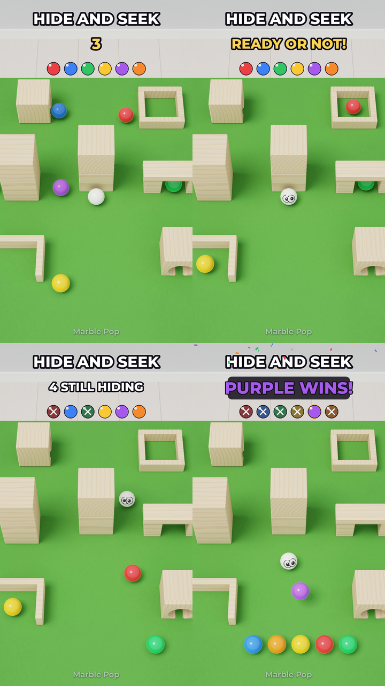

# marble-hide-seek (game template)

One command for a 3D marble hide-and-seek Short: six marbles race off to hide around a wooden playground on a green felt mat while a white seeker with big googly eyes counts down against a tower, eyes shut. At READY OR NOT! it turns round, opens its eyes and checks the hiding places one by one: FOUND! and a climbing ding for each marble it finds, a ? at the empty arch, a last search right past the winner, TIME'S UP!, and the marble it never found rolls out from behind the tower and wins. The audience asked for it. It renders on the CPU with `../marble-raytrace-kit`: no Blender, no GPU.



**Used in:** "Marble Hide and Seek" made for Marble Pop (Nov 2026; 36.10 s, 1074 frames, 1080×1920, 30 fps; purple wins). Verified on a 2-core cloud session, running from this folder:
- With the set cached, the 1074 frames took 2 min 50 s in two worker processes (about 0.3 s a frame).
- The soundtrack was then rebuilt (a quiet bed under the countdown, a felt rumble that actually follows the marbles, a riser after TIME'S UP! and the winner loop, all now in `audio.py`) and muxed with the same frames: −13.1 LUFS integrated, −1.1 dBFS peak, no silent stretch.
- After the video, `story.py` was changed to take who hides where from `settings.HIDE_AT`. With the shipped `HIDE_AT` it gives exactly the shipped story (every position, eye pose and cue identical), and an episode with green and purple swapped runs (green wins).
- From a fresh clone of this branch: `PREVIEW=1 python3 make_video.py --stills 150,250,420` built the half-size set, the lighting table and three stills in 39 s, and `python3 make_video.py --stills 189` (full-size set traced and baked, lighting table, one still) took 5 min 11 s. That still matches frame 189 of the delivered mp4 at 40.1 dB PSNR (H.264 noise).

## How it works
1. **Playground.** `layout.py` places the pieces on the mat: the base tower the seeker counts against, a stack of two cubes, a tunnel block, an arch, a pen of four low walls, a bridge and a corner of two low walls, plus the hiding spots (`SPOTS`: where a marble hides, where the seeker stands to look, how a found marble leaves, and whether it has to hop a wall). `mesh.py` builds plain blocks as analytic rounded boxes and the tunnel and arch with marching cubes on signed distance fields (copied from `../marble-run-picture`).
2. **Static render, once.** `meshtrace` path-traces the set at 2160×3840; `bake.py` paints wood grain, the felt, the floor boards and the wall into the key and ambient layers.
3. **The story.** `story.py` is the script, top to bottom like the video. Every move rolls along a Catmull-Rom curve through waypoints with a short speed-up and slow-down; hops are parabolas. The seeker's heading follows its path unless the script makes it face something (the wall while it counts, a hiding spot, the winner), and its eyes open, widen and glance on cue. `check()` warns about any marble inside a block and logs the closest two marbles (3.42 units apart at worst in the shipped story).
4. **Googly eyes.** `eyes.py` subclasses the kit's compositor and paints the eyes into the seeker's own albedo per pixel (white with a dark rim, a black pupil with a glint, or a lash line when shut), so they turn with the ball, catch the light and hide behind blocks like the rest of it.
5. **Lighting tables.** `meshtrace`'s env mode lights marble positions every 0.5 units over the mat; frames interpolate them.
6. **Frames, text and sound.** `overlays.py` draws the title, the status line, the chips that get an X, FOUND! and ? pops, the winner box and confetti. `audio.py` builds the soundtrack from the story's cues (`../battle-audio`): Grieg's *In the Hall of the Mountain King* (public domain, synthesized) speeds up as hiders are found.

## Files
| file | what |
|---|---|
| `settings.py` | **every setting**: the cast and its colours, who hides where, blocks, room, timing, camera, light, text, sound; `EPISODE=<name>` runs `episodes/<name>.py` after it |
| `layout.py` | the pieces, the tunnel tubes, the hiding spots, `blocked()` |
| `mesh.py` | rounded boxes and marching-cubes pieces → `build/mesh.bin` |
| `scene.py` | camera, light and look in the form the kit's compositor reads |
| `bake.py` | wood, felt, floor and wall textures baked into the G-buffer |
| `story.py` | the script: every marble's path, the seeker's heading and eyes, the cues |
| `eyes.py` | the compositor with googly eyes on the seeker |
| `overlays.py` | title, status, chips, FOUND!/? pops, winner box, confetti |
| `audio.py` | ticks, Mountain King, dings, uh-oh, heartbeat, buzzer, fanfare, claps, felt rumble |
| `make_video.py` | the whole pipeline; also `--stills`, `--thumb-only`, `--thumb-frame`, `--max-frames`, `PREVIEW=1` |
| `style.json` | every value, plus the YouTube copy |
| `preview.png` | four moments of the shipped video |

## Reuse
```bash
./setup.sh ball-sims                                   # numpy, scipy, numba, scikit-image, Pillow, Montserrat
PREVIEW=1 python3 make_video.py --stills 150,250,420   # half-size set and stills in build_preview/
python3 make_video.py --stills 189,420,1000            # full-size stills (path-traces the set the first time)
python3 make_video.py                                  # -> build/Marble_Hide_and_Seek.mp4 + build/thumbnail.png
```
The first full build takes about 8 minutes on a 2-core cloud session: about 5 to trace the set and light the mat, then about 3 for the frames.

**A new episode:** make `episodes/<name>.py` with only what changes and run with `EPISODE=<name>`:
- `HIDE_AT`: which colour hides where (`bridge`, `pen`, `corner`, `stack`, `tunnel`, `base`). The seeker always checks bridge, pen, the empty arch, corner, stack, tunnel in that order, so the marble at `base` wins and the order of the others is the order they're found.
- `HIDERS`: the six names and colours (the names are shown in the chips and the winner box).
- `COUNT_FROM`, `SEEK_SPEED`, `LOOK_S`, `HOLD_S`: pacing.

**Copy** (Marble Pop rules in the repo's `CLAUDE.md`): title `Marble Hide and Seek 👀 Who Hides Best?`; description `Six marbles hide, one googly-eyed marble seeks. Who stays hidden?` / `Pick your color in the comments 🔴🔵🟢🟡🟣🟠` / `Made with 3D animation` / `#marbles #hideandseek #satisfying #shorts`. The marbles' moves are scripted, so say animation, not physics. The thumbnail (frame 189) is the seeker turned round with its eyes open, no text.

## Gotchas
- **Big marbles on purpose.** `R` is 1.55, not the kit's usual 1.0, so the eyes read on a phone. The blocks, paths and camera were laid out for that size; `check()` warns if a path cuts into a block and logs the closest two marbles.
- **Heading 0 faces the camera.** The seeker counts facing the wall (heading π) and the script turns it at READY OR NOT!. Forget the override and it counts looking at the hiders.
- **Hiding spots are fixed.** Moving a piece in `layout.py` means checking the paths in `story.py`, which are written for this ground plan.
- **The watermark sits at the bottom** (`WATERMARK_Y` 0.968), under the row where found marbles wait.
- **The static set is cached** by the scene file and mesh hash; `PREVIEW=1` has its own `build_preview/`. Don't commit `build/`.

## What it can't do
- One playground and one search route; the story is scripted, not simulated (marbles never push each other).
- Exactly six hiders and one seeker.
- The camera can't move (the set is rendered once), and the marbles are glossy plastic only (the kit's limits).

## Dependencies (tested)
- Python 3.13.18, numpy 2.5.3, scipy 1.18.1, numba 0.68.1, scikit-image 0.26.0, Pillow 12.3.0
- gcc 13.3.0 with OpenMP (the kit compiles `meshtrace`), ffmpeg 6.1.1 with libx264 and the built-in AAC encoder
- Montserrat (`../marble-raytrace-kit/get_fonts.py`, run by `./setup.sh ball-sims`)
- Linux x86-64, 2 cores
