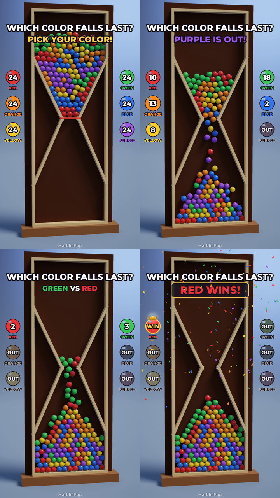

# marble-hourglass (game template)

One command for a "Which color falls last?" Short: 144 glossy marbles in six colours fill the top half of a tall wooden hourglass in rainbow patches, a red pin slides out of the neck after a 3-2-1-GO, and they pour through the neck into a growing pile below. A counter beside the hourglass shows how many of each colour are still up top; a colour is OUT when its last marble passes the neck, the last two colours get a "GREEN VS RED" duel, and the colour whose last marble falls last wins, with a crown and confetti. Real physics picks the winner, and it renders on the CPU with `../marble-raytrace-kit`: no Blender, no GPU.



**Used in:** the hourglass challenge made for Marble Pop as a new-idea test (Nov 28 2026; 20.03 s, 601 frames, 1080×1920, 30 fps). It's seed 37 (third in `sim.py --search 1-60`, picked for its 2-second duel): PURPLE runs out 7.64 s after GO, then BLUE, YELLOW and ORANGE; GREEN and RED duel for 2.0 s, and RED's last marble falls 0.09 s after GREEN's. Verified on a 2-core cloud session, running from this folder:
- `python3 sim.py --search 1-60` ranked 60 races in 2.0 min while a Blender render shared the cores.
- `PREVIEW=1 python3 make_video.py --stills 30,92,118,171,336,470,540` traced the half-size set and wrote seven stills in 16 s.
- `python3 make_video.py` traced the full-size set in about 1 min, then its two workers rendered the 601 frames in 34 min, at low priority while a Blender render shared the 2 cores. The soundtrack was rebuilt once after the intro chime was added and muxed onto the same frames. The mp4 measures −13.0 LUFS integrated, −3.2 dBFS peak, and the thumbnail is frame 171.
- From a fresh clone of the branch, `sim.py` reproduced seed 37's race exactly, and two `PREVIEW=1` stills matched the ones rendered here pixel for pixel.

## How it works
1. **The hourglass.** `scene.py` builds it from boxes (the kit's `boxtrace` scenes): a dark walnut board, a pale maple frame and four slanted maple rails that narrow to a neck 5.1 marble radii wide and open out again, on a plinth. `walls()` gives the same rails to the physics as oriented rectangles.
2. **Filling it.** Before the clip starts, `sim.py` pours the marbles in one at a time, in one-colour batches of 6 that come in a random order, each batch around its own random spot along the top, with the neck shut by a gate. The top half settles into rainbow patches like a sand-art bottle, and every colour is spread through it.
3. **Physics.** numba, 4 kHz, in the board's plane: soft contacts (spring and damper) with light tangential friction against the rails and between marbles. At `FILL_S` the gate opens. Every marble passing the neck is logged (for the counters and the notes), and so are hard knocks (for the sound).
4. **Picking a race.** `sim.py --search a-b` simulates seeds and ranks them with `finish_score`: the first colour out early, outs at least 0.6 s apart so each gets its moment, a duel of the last two colours that lasts 0.8–2.5 s, and the winner's last marble 0.25–1.2 s after the runner-up's. Races that jam at the neck rank last.
5. **Frames.** `make_video.py` interpolates the recorded positions to 30 fps, and the kit's compositor paints the marbles onto the traced set. On top: the red gate pin (an overlay, since the set is traced once; it slides out in the 0.2 s before GO), the question, a status line (PICK YOUR COLOR!, 3-2-1-GO!, "PURPLE IS OUT!", "N COLORS LEFT", "GREEN VS RED"), six counter discs beside the top half that swell as each marble passes and turn grey with OUT, and the winner box, crown (`../crown-icon`) and confetti.
6. **Sound.** `audio.py`: a soft chord and sparkle run as the question appears (so the clip isn't silent before the countdown), ticks for 3-2-1, a wooden clack as the pin slides out and a chord for GO. Every marble through the neck rings its colour's note (one C major pentatonic note per colour), knocks on the pile below click, each OUT gets a falling two-note bell, and the winner a fanfare. `pipeline.mux` sets it to −13 LUFS.

## Files
| file | what |
|---|---|
| `settings.py` | **every setting**: hourglass size, colours, marbles and pour, physics, camera, text and counters, sound; `EPISODE=<name>` runs `episodes/<name>.py` after it |
| `scene.py` | the hourglass as boxes, the rails as walls for the physics, the camera, `project()` |
| `sim.py` | the pour, the physics, `outs()` (when each colour runs out), `finish_score()` and `--search` |
| `make_video.py` | the whole pipeline and the HUD; also `--stills`, `--thumb-only`, `--thumb-frame`, `--max-frames`, `PREVIEW=1` |
| `audio.py` | neck notes, knocks, countdown, OUT bells and the fanfare |
| `style.json` | every value, plus the YouTube copy |
| `preview.png` | four moments of the shipped video |

## Reuse
```bash
./setup.sh ball-sims                                   # numpy, scipy, numba, Pillow, skia-python, Montserrat
python3 sim.py --search 1-60                           # rank races (about 2 s each), then SEED=<n>
PREVIEW=1 python3 make_video.py --stills 30,336,470,540   # half-size set and stills in build_preview/
python3 make_video.py                                  # -> build/Marble_Hourglass.mp4 + build/thumbnail.png
python3 make_video.py --thumb-only --thumb-frame 200
```

**A new race:** `SEED=<n> python3 make_video.py` with a seed from `--search`. For other colours, more marbles or another hourglass shape, put the values in `episodes/<name>.py`, run with `EPISODE=<name>`, and search again: any change to the pour or the physics changes every race.

**Copy** (Marble Pop rules in the repo's `CLAUDE.md`): title `Rainbow Hourglass ⏳ Which Color Falls Last?`; description `144 marbles pour through a wooden hourglass. The last color still up top wins! ⏳` / `Pick your color in the comments 🔴🟠🟡🟢🔵🟣` / `#marbles #hourglass #satisfying #pickyourcolor` / `Made by Marble Pop with our own 3D physics simulation`. The thumbnail (2.5 s after GO: the top still full of patches, a stream through the neck, the pile starting) has no text. It plays like a Last Color Left race in a new container, so don't post it next to the funnel drain.

## Gotchas
- **Rainbow layers give the answer away.** Poured one colour after another, the colours sit in level layers, and the hourglass drains in mass flow (everything moves down together), so they ran out in pour order in every race that finished and the top layer always won. Pouring one-colour batches in a random order spreads every colour through the top half.
- **The pour can blow marbles apart.** Marbles spawned 0.05 s apart at nearby spots overlap, and the contact springs throw them out at speed. Each poured marble starts moving down at `POUR_V` (45 radii a second), so it's clear of the spot before the next arrives.
- **The neck can jam.** A narrower neck arched shut. `NECK_HALF` 2.55 with light tangential friction runs freely for most seeds; a seed that still jams makes `make_video.py` stop with a message (pick another from `--search`).
- **Changing the pour or any physics value changes every race,** including `FILL_S`. `LEAD_S` only moves where the clip starts, so it keeps the race.
- **Memory: about 1.3 GB per worker** (the 2160×3840 G-buffer plus the timeline). Render one Short at a time on an 8 GB session, or set `WORKERS=1`.
- The static set is cached by the scene file (`build/g_*`); only the main process traces it. Don't commit `build/`.

## What it can't do
- The rails are straight boxes (`boxtrace` has no curves), so it's an angular hourglass, open at the front with no glass, and the marbles move in one plane.
- The pour happens before the clip: shown, marbles would pop into being under the top rail.
- One camera, fixed: the set is traced once.
- The marbles are glossy plastic, all one size (the kit's limits).

## Dependencies (tested)
- Python 3.13.18, numpy 2.5.3, scipy 1.18.1, numba 0.68.1, Pillow 12.3.0, skia-python 144.1 (for the crown)
- gcc 13.3.0 with OpenMP (the kit compiles `boxtrace`), ffmpeg 6.1.1 with libx264 and the built-in AAC encoder
- Montserrat (`../marble-raytrace-kit/get_fonts.py`, run by `./setup.sh ball-sims`)
- Linux x86-64, 2 cores
