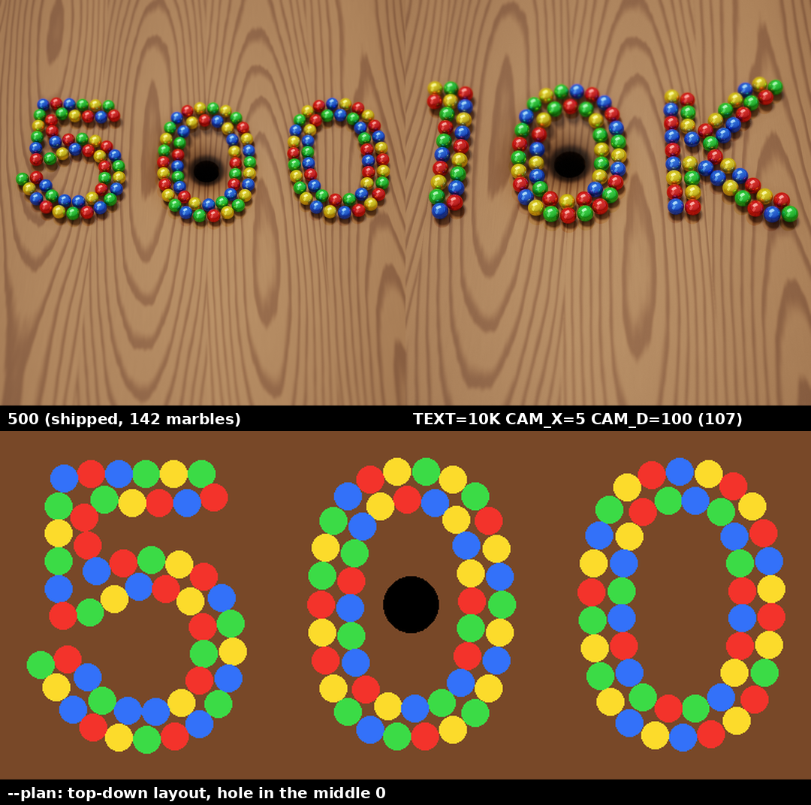

# marble-milestone-post

A square post image of glossy team-colour marbles spelling a number on the lacquered hardwood funnel board of `../marble-funnel-drain`, rendered with that prop's ray-caster, made for Marble Pop's 500-subscriber thank-you post (Nov 2026).
- **Any short text** is laid out from the skeleton of Poppins Regular, redrawn as monoline strokes exactly two marbles wide with round ends, and filled lane by lane. Every stroke comes out as two neat rows of touching marbles. `layout.py` does this and works on its own.
- **Colours** are the four Pick-your-colour teams (red, blue, green, yellow), spread so no two touching marbles match.
- **One character's opening is centred on the funnel hole**, so the middle 0 of "500" rings the drain from the "Last Marble Left WINS" Shorts.
- **Counts for a guessing game:** the script prints the number of marbles, per colour and per character, and how many are visible in the render.



**Used in:** the Marble Pop 500-subscriber post (Nov 2026). The 2160×2160 render was put on a Claude Design canvas, which adds "THANK YOU!", "SUBSCRIBERS" and a "HOW MANY MARBLES?" pill; the post asked viewers to guess the count. Verified on a 2-core cloud session from a fresh clone of this repo:
- `OUT_SIZE=2160 python3 make_post.py` rebuilt the delivered render pixel for pixel (identical PNG and JPG bytes) in 25 s, world maps included. Later runs take about 22 s.
- The layout has 142 marbles: 36 red, 36 blue, 35 green and 35 yellow, with 50 in the 5 and 46 in each 0. All 142 show at least 90% of their disc in the render.
- `TEXT=10K CAM_X=5 CAM_D=100 python3 make_post.py` renders "10K" (107 marbles, all visible), shown on the right of the preview.
- `--plan`, `--style` and both guard messages (frame past the maps, marble over the hole) work as described below.

## Files
| file | what |
|---|---|
| `settings.py` | **every setting**: text, font, stroke, colours, which character frames the hole, camera, sizes; most can be overridden from the environment. It is also the `settings` module the drain's `render.py` imports, with the drain's look and palette unchanged |
| `layout.py` | text → marble positions: glyph mask, monoline skeleton, lanes along the distance field's iso-lines, a short relaxation; `colour_mix()` spreads the team colours |
| `make_post.py` | the pipeline: layout → top-down plan → render → visibility count → PNG, JPG and JSON; `--plan` (layout only), `--style` |
| `style.json` | every value, the counts and the post copy that went with the 500 image |
| `preview.png` | the 500 render, a 10K render and the 500 plan |

## Reuse
```bash
./setup.sh ball-sims                      # numpy, scipy, numba, OpenCV, scikit-image, Pillow, Poppins
python3 make_post.py --plan               # counts + build/milestone_500_plan.png, in about 2 s
python3 make_post.py                      # -> build/milestone_500.png/.jpg at 1080 + .json (counts, positions)
OUT_SIZE=2160 python3 make_post.py        # the full 2160 render, as used for the 500 post
TEXT=10K CAM_X=5 CAM_D=100 python3 make_post.py   # another number
```
**Another number:**
1. Run `TEXT=... python3 make_post.py --plan` and look at the plan.
2. Set `HOLE_IN` to the index of the character whose opening should frame the hole (a 0, 6, 8, 9 or O).
3. Render a draft with `SIZE=1080 OUT_SIZE=1080`. The script prints where the text lands ("text spans ... px"). Centre it with `CAM_X`, size it with `CAM_D` (smaller is bigger), and move it up or down with `CAM_Y`. The shipped framing leaves room for a title above and a label and a pill below.
4. For a guessing post, give the `marbles` number from the JSON; `visible` should be the same.

**The 500 post's copy** (also in `style.json`): "🎉 WE HIT 500 SUBSCRIBERS! 🎉 / Thank you SO much for watching and picking your colors. You made this happen! 💛 / How many marbles did it take to make this 500? 🤔 / Comment your guess 👇 Closest guess gets pinned 📌 / Next stop: 1,000! 🔴🔵🟢🟡". The answer is 142.

## Gotchas
- **The board's maps are only 80 units wide.** The drain's wood and light maps cover x −40 to 40 and y −60 to 70. A frame that sees past them would render blank floor, so the script stops and says so. About three characters fit at `HEIGHT` 22.
- **The hole is always at the board's origin.** The drain renderer draws it there, so one character must frame it (`HOLE_IN`), or `HOLE_IN=-1` centres the whole text on it. If any marble would sit over the hole, the script stops.
- **Strokes are exactly two marbles wide** because `STROKE` 4.15 is two diameters plus a little play. Much thicker leaves a gap between the two rows or crowds in a third; thinner merges them into one wobbly row.
- **Why the skeleton:** filling the bold Poppins glyphs directly gave lumpy junctions (the 5's stem and bowl), because their strokes vary in width. Redrawing the Regular weight's skeleton with a round pen gives even strokes everywhere.
- **The framed character sits in the funnel's dip.** Its inner ring is about 1.5 units lower than the rest, which reads as marbles circling the drain from 60°. A low camera would show it sinking.
- **The look comes from the drain's `settings.py`**, so the image matches the Shorts; changing the drain's `LOOK` changes this image too. The world maps are cached in `build/cache/` by the look's hash.

## What it can't do
- No text on the image: add it in a design tool, as the 500 post did, or with `../thumbnail-title`.
- The hole can't be hidden or moved, and the board can't be flat. "1K" has no opening to frame it, and "1000" is too wide for the maps at a readable size.
- Still images only: the marbles don't roll into place.
- One font skeleton at a time; letters with very tight counters (a small "e" or "a") leave no room for two rows.

## Dependencies (tested)
- Python 3.13.18, numpy 2.5.3, scipy 1.18.1, numba 0.68.1, opencv-python 5.0.0, scikit-image 0.26.0, Pillow 12.3.0
- Poppins Regular, installed by `../style-kit/get_fonts.py` (run by `./setup.sh ball-sims`)
- `../marble-funnel-drain` (`settings.py` and `render.py`)
- Linux x86-64, 2 cores
