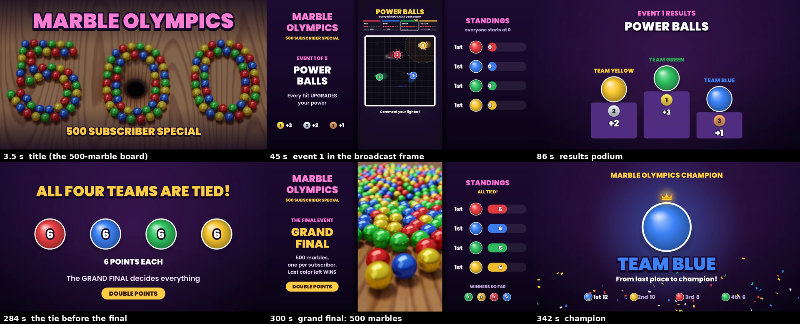

# marble-olympics

The long-form "Marble Olympics" special for Marble Pop's 500 subscribers (Nov 2026; 5:56, 1920×1080, 30 fps): red, blue, green and yellow play five events made from the repo's game templates, score points for every place, and one team is crowned champion.
- **The events come from their own templates** (`events.py`):
  1. POWER BALLS (`../ability-battle-template`)
  2. Sword Roulette with 4 balls (`../sword-roulette`)
  3. Laser Wars: POWER BALLS, with a laser for everyone
  4. Blaster Battle: POWER BALLS, with a 360° blaster for everyone
  5. Grand Final: 500 marbles, one per subscriber (`../marble-funnel-drain`, `EPISODE=olympics500`)

  Each template is copied into `build/ball-sims/`, next to symlinks of every other prop, so its `../` imports still work and only the `settings.py` lines in the event's `set` change.
- **This folder adds the broadcast around them** (`cards.py`, `make_special.py`):
  - a 1920×1080 frame with the vertical event in the middle (608×1080), the event and its scoring on the left, and the standings on the right
  - title, thank-you, teams, rules, event-intro, results-podium, standings, tie, champion and outro cards, with a team-colour wipe between them
  - `../battle-audio` music and sounds under the cards, with each event's own soundtrack in its segment
- **Scoring:** 3, 2, 1 and 0 points for 1st to 4th, double in the Grand Final. The seeds were picked so each team wins one event and finishes once in every place. All four go into the final tied at 6, and blue, last after event 3, wins it 12–10–8–6.



**Used in:** the Marble Pop 500-subscriber special (Nov 2026), delivered as `Marble-Olympics-500-Sub-Special.mp4` with `build/thumbnail.jpg` and the title, description and chapters in `build/copy.txt`. Verified on a 2-core cloud session:
- From a fresh clone, `python3 make_special.py` built everything in 24.9 min. That covers the four template events (about 4 min), the 500-marble final (16.3 min), the milestone image and the special itself (about 4 min).
- Its video and audio streams decode to the same MD5 as the delivered mp4. So do all five event videos, compared one by one with the production renders. `thumbnail.png` and `copy.txt` are byte-identical too.
- `events.py` reads every event's finishing order from its template's own simulation and stops if it differs from `places` in `settings.py`. All five match.
- `pick_seeds.py` (seeds 2000–2999) ran in 1 min 53 s from a fresh clone. It found 1,184 combinations that tie every team before the final, and the shipped seeds (2494, 2496, 2900 and 2241) are the 2nd best. The best, 2275/2369/2050/2398, ties them too, but the shipped one lets blue win from last place.
- From a fresh clone, `--plan` without events says to run `events.py` first. With the events, `--plan` and `--style` reproduce `copy.txt` and `style.json` exactly.
- The delivered mp4 is 356.9 s long at −14.0 LUFS integrated (LRA 8.6). The cards sit 1–4 LU under the events.
- Every chapter in `copy.txt` lasts at least 10 s, as YouTube requires.

## Files
| file | what |
|---|---|
| `settings.py` | **every setting**: teams, points, the five events (template, settings lines, seed, places), card copy and lengths, YouTube copy, encoding |
| `events.py` | renders each event with its template and checks the finishing order; `python events.py <key>` for one |
| `pick_seeds.py` | searches seeds for the non-final events and lists combinations where every team wins once and all tie before the final |
| `cards.py` | the look at 1920×1080: cards, the broadcast frame, standings bars, podium, confetti, wipe |
| `make_special.py` | the whole special: events → running order → sound → frames → mux → thumbnail → `copy.txt`; also `--plan`, `--stills`, `--audio`, `--thumb`, `--style` |
| `style.json` | every value, the five results, the running order and the YouTube copy |
| `preview.png` | title, an event in the broadcast frame, a podium, the tie, the final and the champion |

## Reuse
```bash
./setup.sh ball-sims
cd ball-sims/marble-olympics
python3 events.py                  # the five events with their templates (~21 min; the 500-marble final is ~16)
python3 make_special.py --plan     # running order, length, and the YouTube title/description with chapters
python3 make_special.py --stills   # one frame per segment in build/stills/
python3 make_special.py            # -> build/marble_olympics_500.mp4, thumbnail.png/.jpg, copy.txt
python3 make_special.py --audio    # remix the sound only (keeps build/video_only.mp4)
python3 pick_seeds.py              # seed combinations for a new story
```
**A new special:**
1. Edit `EVENTS`. An event can use any template that `events.py` knows how to build and read (`BUILD_CMD` and `SNIPPETS`): POWER BALLS with any `ABILITIES`, Sword Roulette with any `NAMES`, and marble-funnel-drain episodes. To add Ring Escape or another game, add its build command and a snippet that prints its places and the video time of the win.
2. Pick seeds with `pick_seeds.py` and copy each event's seed and places into `EVENTS`. `events.py` refuses an event whose places don't match.
3. The final's colours are assigned after its race, so choose its `PLACES` in the drain episode (and `places` here) for the ending you want.
4. Change `SHOW`, `SPECIAL`, `THANKS` and `OUTRO` for the occasion, and `HERO_IMAGE` for the title background. It defaults to the `../marble-milestone-post` render, which it renders if missing.

## Gotchas
- **Run `events.py` with keys while another render runs.** On its own it builds every missing event, including the 18-minute final.
- **A cut must never land on a frame that doesn't exist.** Each event is cut `KEEP_AFTER_WIN` (2.6 s) after its win, but the drain's video ends 1.5 s after the last drop and then glides back to its loop start. That's why the final uses `keep=0.7`. Past the end of an event's video, the last frame would freeze.
- **`pop()` scale starts at 0.** cairo refuses a zero scale matrix, so `title()` and `line()` skip drawing until the element starts growing. Use them, not `kit.text()`, for anything that pops in.
- **The subscribe CTA centres its prompt on the Shorts' x = 540.** `card_outro` shifts the whole CTA by 420 px instead of moving its button.
- **Ties share a rank.** Standings sort equal totals in team order and show the same place for each, so before the final all four read "1st".
- **Sword Roulette's chips centre themselves** for any number of balls since this special. 6 balls still start at x = 42, as shipped.

## What it can't do
- Every event is a vertical template video in a 608 px column. There are no native landscape events.
- There is no narration and no on-screen commentary during events, only the frame and the events' own text.
- Ring Escape can't be an event yet: it only has a winner, not a full finishing order.
- Thumbnails have no text, following the channel's rule. Add a title in a design tool if you want one.

## Dependencies (tested)
- Python 3.13.18, numpy 2.5.3, scipy 1.18.1, numba 0.68.1, pycairo 1.29.2 (cairo 1.18.0), skia-python 144.1, opencv-python 5.0.0, Pillow 12.3.0
- ffmpeg 6.1.1 with libx264 and the built-in AAC encoder
- Poppins (`../style-kit/get_fonts.py`, run by `./setup.sh ball-sims`)
- The sibling props listed above, imported by path: keep the `ball-sims/` layout
- Linux x86-64, 2 cores
