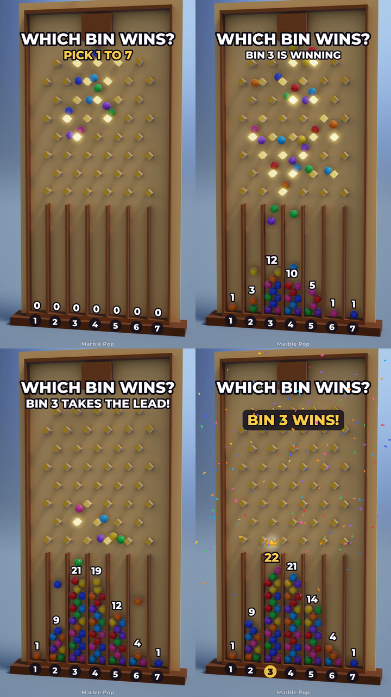

# marble-peg-board (game template)

One command for a peg-board challenge Short where viewers pick the bin that gets the most marbles: 72 glossy marbles drop one by one from a hopper at the top of an upright maple board, bounce down through 8 rows of brass diamond pegs (each peg flashes and rings a note when it's hit) and pile up in 7 bins, with a live count over each pile. The lead changes as the bins fill; the bin with the most marbles at the end wins, with a crown, a gold count and confetti. Real physics picks the winner, and it renders on the CPU with `../marble-raytrace-kit`: no Blender, no GPU.



**Used in:** the peg-board challenge made for Marble Pop (Nov 28 2026; 23.90 s, 717 frames, 1080×1920, 30 fps). It's seed 2, where bin 3 beats bin 4 by 22 to 21 and the lead last changes hands at 20.1 s. Verified on a 2-core cloud session, running from this folder:
- `python3 sim.py --search 1-40` ranked 40 races (about 5 s each). Seed 2 ends at counts [1, 9, 22, 21, 14, 4, 1] with every marble in a bin.
- `PREVIEW=1 python3 make_video.py --stills 120,330,560,700` traced the half-size board and wrote four stills in 39 s. Then the full render: it ran while three other renders shared the 2 cores, and one of its two workers was killed for memory (see **Gotchas**). Frames 473–717 were re-rendered with `python3 make_video.py --worker 473 717 build/part2.mp4` (7.8 min), and the two parts were muxed with the kit's `pipeline.mux`. The first worker took 17.5 min for frames 0–473 while the CPU was shared.
- The mp4 measures −13.0 LUFS integrated, −3.4 dBFS peak. `--thumb-only` picked frame 417 for the thumbnail.

## How it works
1. **The board.** `scene.py` builds everything from boxes (the kit's `boxtrace` scenes): the back board, the walnut side rails and top rail, the hopper, the bin floor and the 6 bin walls, the plinth, and 44 pegs, each a square post turned 45 degrees so it reads as a diamond. Each peg has its own object id, so it can flash on its own. The rows alternate pegs over the bin centres (without the outermost two, so a marble can't wedge against a rail) and pegs in line with the bin walls. The lowest row is in line with the walls, so marbles leave the pegs over the middle of a bin.
2. **Physics.** `sim.py` (numba, 4 kHz, in the board's plane): soft contacts between marbles, the diamond pegs, the rails, the bin walls and each other. Drag of 6/s stands in for marbles rolling down a tilted board: it keeps them to about 20 radii a second, so each peg sends a marble about one step left or right and the bins come out bell-shaped. Every new peg contact is logged (for the flash and the note), and so are landings in a bin (for the counters) and knocks in the bins (for the sound).
3. **Picking a race.** `sim.py --search a-b` simulates seeds and ranks them by a one-marble margin and a late last lead change, skipping races where a marble never reaches a bin.
4. **Frames.** `make_video.py` interpolates the recorded positions to 30 fps. The kit's compositor paints the marbles onto the traced board and flashes each peg on its hits. The HUD is drawn on top: the question, the leader callouts (BIN 3 TAKES THE LEAD!, TIED!), a count that sits on top of each pile and pops when it goes up, the bin numbers on the plinth, and the winner box, crown (`../crown-icon`) and confetti.
5. **Sound.** `audio.py`: every peg hit rings a bell, pitched by row (falling through a C major pentatonic scale as the marble drops) and panned by where it hits. Landings are a wooden clunk with a tiny sparkle, and knocks in the bins are clicks. The winner gets a fanfare chord and a sparkle run. `pipeline.mux` sets it to −13 LUFS.

## Files
| file | what |
|---|---|
| `settings.py` | **every setting**: board size, pegs, bins, colours, marbles and physics, camera, text, sound; `EPISODE=<name>` runs `episodes/<name>.py` after it |
| `scene.py` | the board as boxes, the camera that frames it, peg positions, `project()` |
| `sim.py` | the physics, the event log, `lead_story()` and `--search` |
| `make_video.py` | the whole pipeline and the HUD; also `--stills`, `--thumb-only`, `--thumb-frame`, `--max-frames`, `PREVIEW=1` |
| `audio.py` | peg bells, landings, clicks and the fanfare |
| `style.json` | every value, plus the YouTube copy |
| `preview.png` | four moments of the shipped video |

## Reuse
```bash
./setup.sh ball-sims                                      # numpy, scipy, numba, Pillow, skia-python, Montserrat
python3 sim.py --search 1-40                              # rank races, then SEED=<n>
PREVIEW=1 python3 make_video.py --stills 120,330,560,700  # half-size board and stills in build_preview/
python3 make_video.py                                     # -> build/Marble_Peg_Board.mp4 + build/thumbnail.png
python3 make_video.py --thumb-only --thumb-frame 520
```

**A new race:** `SEED=<n> python3 make_video.py` with a seed from `--search`. To change the board (more rows, other bins, a new colour scheme), put the values in `episodes/<name>.py` and run with `EPISODE=<name>`. Then check the spread with `--search`: the bins should come out bell-shaped, and every marble should end up in a bin.

**Copy** (Marble Pop rules in the repo's `CLAUDE.md`): title `Which Bin Gets the Most Marbles? 🏆 Pick 1 to 7`; description `72 marbles bounce down through brass pegs into 7 bins. Which bin gets the most? 🏆` / `Pick a bin from 1 to 7 in the comments` / `#marbles #physics #satisfying #pickone` / `Made by Marble Pop with our own 3D physics simulation`. The thumbnail (late in the drop, with marbles among the pegs and full bins) has no text.

## Gotchas
- **Fast, bouncy marbles fly to the rails.** With little drag the diamond faces throw marbles sideways at speed, and they run down the clear lanes beside the rails into bins 1 and 7, so the outer bins win. `G` 120 with `DRAG` 6 gives the bell shape.
- **Bins overflow.** With 90 marbles and `BIN_H` 25 the middle bin overflowed, and marbles left lying on top of it were never counted. With 72 marbles and `BIN_H` 27, seed 2's fullest bin holds 22. With more marbles, raise `BIN_H` (the camera reframes itself) or add bins.
- **Divider tops are flat**, but the lowest peg row sits right above them, so marbles don't land on them.
- **The pile counts follow resting marbles.** A count sits 1.9 radii above the highest marble in its bin that is moving under 4 radii a second, and never moves down. Falling marbles don't make it jump.
- **Memory: about 1.3 GB per worker** (the 2160×3840 G-buffer plus the timeline). With several renders at once on an 8 GB session, one worker was killed for memory; render one Short at a time, or set `WORKERS=1`.
- The static board is cached by the scene file (`build/g_*`). Only the main process traces it: workers that trace it at the same moment can each see the other's half-written scene file and start a needless full re-trace. Don't commit `build/`.

## What it can't do
- Pegs are diamonds (boxes turned about z): `boxtrace` has no cylinders.
- The board is open at the front (no glass), and the marbles move in one plane.
- One camera, fixed: the set is traced once.
- The marbles are glossy plastic, all one size (the kit's limits).

## Dependencies (tested)
- Python 3.13.18, numpy 2.5.3, scipy 1.18.1, numba 0.68.1, Pillow 12.3.0, skia-python 144.1 (for the crown)
- gcc 13.3.0 with OpenMP (the kit compiles `boxtrace`), ffmpeg 6.1.1 with libx264 and the built-in AAC encoder
- Montserrat (`../marble-raytrace-kit/get_fonts.py`, run by `./setup.sh ball-sims`)
- Linux x86-64, 2 cores
