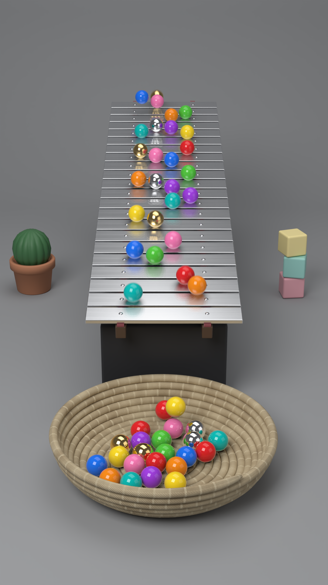

# marble-plate-compositor

A fast renderer for glossy and metal marbles on a Blender set. Rendering 380 frames of marbles in Cycles would take hours on a laptop CPU. Instead, Cycles renders the empty set once (the "plates"), and this prop paints the marbles on top in numpy. Each marble is ray-traced as a sphere and lit from lighting probes captured in the set. The marbles cast soft shadows from the key and top lights, darken what they touch, reflect in the aluminum bars and in each other, hide behind the basket rim using a depth plate, and get motion blur. A frame takes 0.1–6 s, and the full 12-second video takes about 8 minutes on 2 cores.

**Used in:** both marble xylophone Shorts (40 marbles, Twinkle Twinkle), Nov 2026. Every video frame came from this code.



## Files
- `settings.py`: paths, plate quality, marble palette (`PALETTE` glossy, `METALS` gold/silver), exposure, samples, motion blur, bar-reflection strength
- `render_plates.py` (Blender): beauty plate, key-only and top-only direct light, position/normal/object-id buffers, and 7 cube-map lighting probes, all written to `build/plate/`
- `probes.py`: turns the probe cube maps into lat-long maps plus spherical-harmonic irradiance (`build/probes_proc.npz`)
- `compositor.py`: the marble renderer (`Renderer`) and the tone curve
- `render_frame.py`: renders frames to PNG (previews, thumbnails)
- `render_video.py`: renders a frame range to a silent mp4. `--overlay FILE.py` draws an overlay such as `../marble-counter/counter.py` on every frame.

## Reuse
Run `../xylophone-ramp/build_set.py` once first, and get a sim from `../marble-drop-sim`. Then:
```bash
python3 render_plates.py all      # ~20 min on 2 cores, once per set/camera/light change (add --quick for a ~3-min rough test)
python3 probes.py                 # ~10 s
python3 render_frame.py ../marble-drop-sim/build/melody_sim.npz ../marble-drop-sim/build/melody.json --t 9.5 --ns 16 --out preview.png
python3 render_video.py ../marble-drop-sim/build/melody_sim.npz ../marble-drop-sim/build/melody.json 0 262 build/partA.mp4
python3 render_video.py ../marble-drop-sim/build/melody_sim.npz ../marble-drop-sim/build/melody.json 262 366 build/partB.mp4
```
Run the two `render_video.py` lines at the same time (one per core), then join the parts with `ffmpeg -f concat -i list.txt -c copy`. `xylophone-song-template` does all of this, plus the sound, in one command.

To add a marble color, add a name and a linear-RGB albedo to `PALETTE` (or an F0 color to `METALS`), then use that name in a drop schedule.

To use a different Blender set, it needs a camera named `cam`, area lights named `key`/`top`/`fill`, mirror-like objects with `pass_index` 2 or 3, and a `params.py` exposing `MARBLE_R, TOP, D, N, L, SIM_HZ, probe_positions()`.

`build/` holds about 250 MB of float plates. It's generated, so don't commit it.

## What it can't do
- Marbles are perfect solid-color spheres, so their spin isn't visible.
- Marbles don't move anything in the scene.
- Reflections between marbles are one bounce.
- The reflections in the bars are a blurred approximation, not true brushed anisotropy.

## Dependencies
- Blender 5.3.0 (`pip install bpy==5.3.0`, Python 3.13) for `render_plates.py`
- numpy 2.5.3, opencv-python 5.0.0.93, Pillow 12.3.0
- ffmpeg 6.1 (for `render_video.py`)
