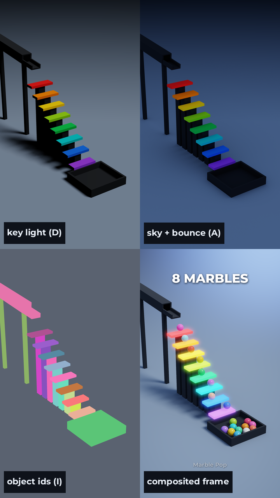

# marble-raytrace-kit

The rendering and sound engine of the 3D marble music Shorts: C path tracers render the set once, and numpy paints the marbles onto it frame by frame, with no Blender and no GPU. It drives the rainbow staircase, spiral round and twin stairs templates: the marbles get soft shadows, contact shadows and colored light from the glowing tiles, and `bells.py` synthesizes every note.



**Used in:** all four 3D marble music Shorts on Marble Pop (Nov 2026, uploaded while the channel was still Fun House 67): the staircase *Twinkle Twinkle Little Star* and *Jingle Bells*, the spiral *Row Row Row Your Boat* and the twin-stairs *Ode to Joy*. The three templates that use it (`../marble-stairs-song`, `../marble-spiral-round`, `../marble-twin-stairs`) rebuild those uploads from this repo; their READMEs list what was checked against the uploads. For this kit, that means:
- `boxtrace.c` re-renders the staircase set byte-for-byte: all 6 G-buffer files match the originals.
- Since `boxtrace` learned the optional `crop` window (for `../marble-balance`, Nov 2026), a scene without a `crop` line renders to the same bytes as before (checked on the staircase scene at 270×480: all 6 layers and the preview identical), and a crop is exactly the same window of the full render (all 6 layers).
- `compositor.py` + `bells.py` produce pixel-identical frames and a byte-identical soundtrack for *Jingle Bells*.
- `pipeline.py`, with `SPLIT=even`, reproduces the uploaded H.264 streams bit for bit.
- `get_fonts.py` fetches exactly the Montserrat file the videos were made with (same SHA-256).

## How it works
1. **Static set, once.** `boxtrace` (box scenes) or `meshtrace` (triangle meshes with clear glass) path-trace the set at 2160×3840. The output is a G-buffer of separate layers: key light `D`, sky and bounce light `A`, reflections and fog `O`, plus depth `Z`, normals `N` and object ids `I`. `meshtrace` also writes the front glass layer (`GA`/`GC`/`GZ`). Sampling is seeded per pixel, so a scene always gives the same bytes. It takes 1.5–4 min on 2 cores, depending on the set.
2. **Marbles, every frame.** `compositor.Compositor` redraws only the rectangles around the marbles:
   - Each marble darkens the key-light layer with an analytic soft shadow (the overlap of the 11° light disc with the sphere) and the ambient layer with contact AO.
   - It is ray-traced as a sphere, lit by the key light, a 6-direction ambient cube from its spot in the scene, a Blinn-Phong highlight and a sky reflection.
   - It hides behind the set by depth and sits behind glass.
   - Glowing tiles add emission, a bloom halo and colored light on the marbles next to them.

   ACES tone mapping and a vignette finish the frame, then the round title and watermark are drawn. A frame takes about 0.1–1 s, depending on how many marbles are moving.
3. **Sound.** `bells.py` synthesizes mallet bells (lead, inner, spark, bass), marble clacks and the reverb/master. It's seeded, so a timeline always gives the same samples.
4. **Encode.** `pipeline.py` renders in worker processes, joins the parts and muxes the music at −13 LUFS.

## Files
| file | what |
|---|---|
| `look.py` | the shared studio look (cyclorama, key light, sky, ACES, vignette), camera and light helpers, scene-file writers; `set_hue(deg, sat, bright)` recolours the studio for a variant (call it before importing a scene module) |
| `boxtrace.c` | path tracer for scenes made of boxes (axis-aligned or turned about z), up to 128 boxes; an optional `crop x0 y0 w h` line renders just that window of the image (for sets with moving parts) |
| `meshtrace.c` | path tracer for triangle meshes (BVH, smooth normals, clear glass) + `env` mode that lights marble positions |
| `tracers.py` | compiles the tracers, renders a G-buffer once per scene (cached by the scene's SHA-256), runs `env` queries |
| `compositor.py` | `configure(scene)` + `Compositor(...)`: marbles, shadows, AO, glass, tile glow, titles, watermark; `render_video()` |
| `bells.py` | bell, spark, bass and clack synthesis, panning, reverb and master (seed 7) |
| `pipeline.py` | `run_workers()` (balanced or even frame split), `mux()` (concat + AAC 192k at −13 LUFS), `frame_costs()` |
| `get_fonts.py` | downloads Montserrat (OFL) from google/fonts at a pinned commit, checks its SHA-256 |
| `style.json` | every look, text, sound and encode value |
| `preview.png` | the staircase G-buffer layers (key, ambient, reflections, ids) and the finished frame |

## Reuse
Use the templates for whole videos. A new set on the kit looks like this (a sketch; the three templates' `make_video.py` are complete, runnable adapters):
```python
import sys; sys.path.insert(0, "../marble-raytrace-kit")
import look, tracers, compositor as C, bells, pipeline
# a scene module defines: W, H, FPS, R, LIGHT_ANG, LIGHT_COL, SKY_Z, SKY_H, EXPOSURE, FLOOR_LIN (from look),
# CAM_TARGET/AZ/EL/DIST/FOVY/SHIFT, camera(), light_dir(), boxes() (box scenes), write_scene(), vignette, tonemap
scene.write_scene("build/scene.txt", 2160, 3840, 49, 64)
tracers.render_static(tracers.build("boxtrace", "build"), "build/scene.txt", "build/g")
C.configure(scene)
comp = C.Compositor("build/g", pos, vis, colors_srgb, glows, titles=[{"t": 0.0, "text": "1 MARBLE"}],
                    watermark="Marble Pop", spill_fn=...)
img = comp.render(frame)              # 1080x1920x3 uint8
```
- `pos`/`vis`: marble centers per frame `(frames, marbles, 3)` and visibility.
- `glows`: one dict per glowing part with its object id, linear color, `events` `[(t, amplitude, decay_s)]` and optional `hold` intervals.
- Mesh scenes pass `env_fn` (lighting looked up from a `meshtrace env` table) instead of the built-in box tracer. See `../marble-spiral-round/make_video.py`.

```bash
python3 get_fonts.py      # Montserrat into fonts/ (./setup.sh ball-sims runs it)
```

## Gotchas
- The compositor needs the G-buffer at exactly 2× the output size (2160×3840 for 1080×1920).
- The render cache is keyed on the scene file (and the mesh, via `deps`), not on the tracer binary. After editing a `.c` file, delete `build/*_scene.sha` to re-render.
- A `crop` matches the full render only where the scene inside the window is the same. With moving parts, pixels outside the window whose ambient rays would have hit the parts keep the level pose's light; the difference is a little noise, so blend the window's edge into the full render (see `../marble-balance/balance_comp.py`).
- `compositor` is configured per process with one scene (`configure()` sets module globals). Render a second camera, like the staircase thumbnail, in its own process.
- Render time grows with the number of marbles on screen, resting ones included: their shadows and AO are redrawn every frame, even though the lighting of a marble at rest is cached. The busiest rounds render several times slower than the first, so `run_workers()` splits the frames by `frame_costs()` (1.4 + marbles on screen) unless `SPLIT=even`.
- `bells.rng` is shared. Call `bells.reset_rng()` before building a soundtrack, so it's identical every time. Each template also keeps its own generator for levels and pans.
- Object ids are `uint8`. A scene can have up to 255 ids, and 255 is the sky.

## What it can't do
- The camera can't move: the static set is rendered once from one camera. Moving set pieces are possible with `boxtrace`'s `crop` (render the window they touch once per pose and swap it in per frame, as `../marble-balance` does), but each pose costs a path trace of that window.
- Marbles are glossy plastic only (no glass marbles; `../marble-balance` subclasses the compositor for polished steel), all the same radius (1.0).
- There are no marble-on-marble reflections, and no caustics through the glass.
- Glass is one clear sheet: no refraction, no frosted or colored glass.
- `boxtrace` takes at most 128 boxes, with rotation only about the z axis.
- Text is limited to the centered round title and watermark. For other overlays, draw onto the returned frame.

## Dependencies (tested)
- Python 3.13.18, numpy 2.5.3, scipy 1.18.1, Pillow 12.3.0
- gcc 13.3.0 with OpenMP (`-O3 -march=native -fopenmp`)
- ffmpeg 6.1.1 with libx264 and the built-in AAC encoder
- Montserrat variable font, google/fonts commit `83c62e3` (`get_fonts.py`)
- Tested on Linux x86-64 (2 cores). Another CPU or compiler can change the last bits of the path-traced G-buffer, which is invisible but breaks byte-for-byte comparisons.
