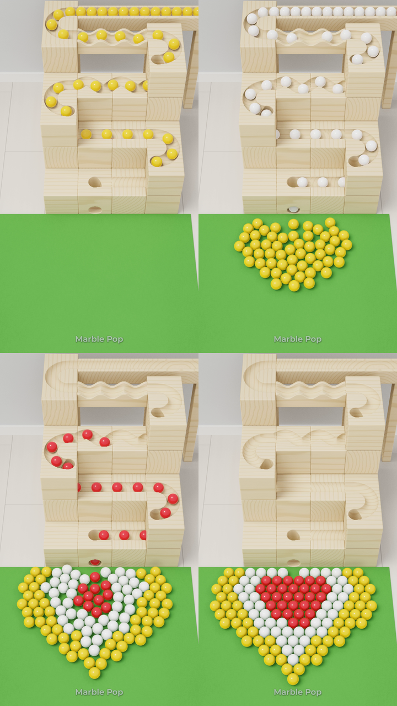

# marble-run-picture (game template)

One command for a wooden marble run Short that ends in a picture: 130 glossy marbles roll off a rail, wind down a staircase of carved wooden blocks (U-turns, a wave piece, a meander and hidden drops through holes and tunnels) and out of the front face onto a felt mat, where each new marble pushes the growing picture outward until it's a gold, white and red heart. It's modeled on a viral real-life-style marble run GJ sent (blue, white and red marbles making a heart on a green mat), and it renders on the CPU with `../marble-raytrace-kit`: no Blender, no GPU.



**Used in:** "Can 130 Marbles Make a Heart?" made for Marble Pop (Nov 2026; 25.13 s, 754 frames, 1080×1920, 30 fps). Verified on a 2-core cloud session, running from this folder:
- `python3 make_video.py` with an empty `build/` ran end to end in 21.5 minutes: 5.5 to path-trace the set, 15.7 to render the frames, then the mux and the thumbnail. The last frames of the hold were reused instead of re-rendered.
- After that render the soundtrack's levels were retuned (`CLONK_GAIN` 0.07 and `CHIME_GAIN` 0.065, now the shipped values), and the delivered mp4 is the same frames muxed with the new soundtrack: −13.3 LUFS integrated, −2.5 dBFS peak.
- `--stills 330,520,753` took 14 s with the set cached, and still 753 matches the delivered mp4's last frame to 38.9 dB PSNR (H.264 noise). `--thumb-only --thumb-frame 600` took 8 s. `python3 pile.py` draws the plan view.
- From a fresh clone of this branch, `PREVIEW=1 python3 make_video.py --stills 300,480,750` built everything it needs (mesh, quarter-size set, bake, timeline, lighting tables) and wrote the three stills in 49 s.

**The gift box** (`EPISODE=present`, Nov 28 2026, "137 Marbles Wrap a Christmas Present"; 26.17 s, 785 frames, 1080×1920, 30 fps, −13.2 LUFS) is the first picture that isn't made of bands: a red box with a gold ribbon cross and a gold bow, on the same run and mat.
- `SHAPE = "present"` gives the outline: the box's back edge runs through the notch, and the bow's two loops sit behind it, like the heart's lobes (`PRESENT` holds the sizes).
- With `REGION_COLOURS`, each spot is coloured by where it is: the bow behind the notch, the ribbon (a vertical strip plus the two lattice rows nearest `ribbon_at`) and the box.
- Every marble can take any spot while the picture grows (one matching group), and each marble wears the colour of the spot it settles on. So the run shows a mix of red and gold, and the present only appears once the last marbles push it into place.
- `N_MARBLES` 137 is a count that fills the box's rows completely (`python3 pile.py` draws the plan). `WATERMARK_Y` moves to 0.98, under the box.
- Verified on a 2-core cloud session: `python3 pile.py` (plan view), `PREVIEW=1` stills 300, 550 and 770, then the full render. The physics put every marble exactly on its spot ("within 0.00 radii"). The full render ran while three other renders shared the 2 cores. One of its two workers was killed for memory, so frames 492–785 were re-rendered with `EPISODE=present python3 make_video.py --worker 492 785 build/part2.mp4` and the parts muxed with the kit's `pipeline.mux`. `--thumb-only` gives the finished present (frame 784).
- The heart is unchanged: with the default settings, `python3 pile.py` gives the same 130 spots in the same three bands (55 gold, 45 white, 30 red).
- A first try that coloured spots by region but kept per-colour matching left red marbles stranded inside the ribbon, because marbles can't swap places through the crowd. That's why region colours use one group.

## How it works
1. **Set.** `layout.py` places 40 pieces: plain cubes, the rail, the wave piece, the end blocks that carry the U-turns, and the groove blocks. `mesh.py` turns every carved piece into triangles with marching cubes on a signed distance field (a rounded box minus the groove, hole and tunnel tubes from `layout.carves()`), so a groove that crosses several blocks lines up across the seams, and a groove under a stacked block becomes a tunnel through both. Plain cubes are analytic rounded boxes. With the wall, baseboard and mat that's 1.06 million triangles.
2. **Static render, once.** `meshtrace` path-traces the set at 2160×3840 (25 key-light and 36 ambient samples per pixel). Then `bake.py` paints the wood grain (a different log for every block), the floor boards, the felt and the wall into the key and ambient layers. Every textured surface is traced with gloss 0, so those layers are exactly albedo × light and multiplying them by a texture is the same as tracing it.
3. **The run.** `timeline.py`: every marble follows the same position-vs-time curve along the 133-radius course (packed in the queue at 14 radii/s, 27 radii/s in the grooves with a ±16% swing on the wave piece, free fall in the holes), each one 1/7 s behind the one before. Marbles inside holes and tunnels are hidden.
4. **The picture.** `pile.py`: the points of a hex lattice get a level, their gauge for the heart scaled about its notch (and cut just in front of the face). The 130 lowest-level points form the finished heart and are handed out from the outside in, so the first batch becomes the outer band. While the picture grows, a marble's point sits on the line from the notch to its final spot, at sqrt(marbles that arrived after it ÷ marbles from it on) of the way out. That's equal-area growth, so the picture is a scaled copy of the heart at every moment. A 240 Hz 2D physics sim pulls every marble toward its point with a damped spring and keeps contacts apart; the marble rolling in from the tunnel can't be pushed back, and marbles of one colour are re-matched to their colour's points every frame (shortest total move), so nobody jams.
5. **Lighting tables.** `meshtrace`'s env mode lights marble positions every 0.25 radii along the course and on a 0.5-radius grid over the mat; frames interpolate them.
6. **Frames and sound.** The kit's compositor paints the marbles onto the baked set in two worker processes; a frame whose marbles haven't moved is reused. `audio.py` builds the soundtrack from the same timeline, and `pipeline.mux` sets it to −13 LUFS.

## Files
| file | what |
|---|---|
| `settings.py` | **every setting**: blocks, room, colours, the picture's batches, speeds, camera, light, sound; `EPISODE=<name>` runs `episodes/<name>.py` after it to reassign values |
| `layout.py` | the run: pieces, groove/hole/tunnel centerlines, the marble path with its tags, which positions are hidden |
| `mesh.py` | signed distance fields + marching cubes for carved pieces, rounded boxes, wall, baseboard, mat → `build/mesh.bin` |
| `scene.py` | camera, light and look in the form the kit's compositor reads; writes the tracer's scene file |
| `bake.py` | wood grain, floor boards, felt and wall texture baked into the G-buffer |
| `timeline.py` | where every marble is in every frame → `build/timeline.json`, `build/marbles.npz` |
| `pile.py` | the heart's lattice points, banding, and the growing-picture physics; `python3 pile.py` draws a plan view |
| `audio.py` | rolling, ticks, clonks, felt thuds, clacks and the finishing sparkle |
| `make_video.py` | the whole pipeline; also `--stills`, `--thumb-only`, `--max-frames`, `PREVIEW=1` |
| `style.json` | every value, plus the YouTube copy |
| `preview.png` | four moments of the shipped video |

## Reuse
```bash
./setup.sh ball-sims                                  # numpy, scipy, numba, scikit-image, Pillow, Montserrat
PREVIEW=1 python3 make_video.py --stills 300,480,750  # quarter-size set and stills in build_preview/, about 1 minute
python3 pile.py                                       # plan view of the finished picture -> build/heart_plan.png
python3 make_video.py --stills 330,520,753            # full-size stills (traces the set the first time)
python3 make_video.py                                 # -> build/Marble_Run_Heart.mp4 + build/thumbnail.png/.jpg
python3 make_video.py --thumb-only --thumb-frame 600
EPISODE=present python3 pile.py                       # plan view of the gift box -> build/present_plan.png
EPISODE=present python3 make_video.py                 # -> build/Marble_Run_Present.mp4 + thumbnail
```
The first full build takes about 22 minutes on a 2-core cloud session: about 5.5 to trace the set, which is then cached, and about 16 to render the frames. Early frames take about 1 s each and frames with 100+ marbles on the mat about 3.8 s.

**A new episode:** make `episodes/<name>.py` with only the values that change, then run with `EPISODE=<name>`:
- `BATCHES`: the colours, in the order they leave the rail (the first ends up outermost), and how many marbles of each. The counts must add up to the picture's size; 3 bands of 55/45/30 give bands about 2 marbles thick at the sides.
- `RATE`, `V_TRACK`: marbles per second and rolling speed. Keep `V_TRACK / RATE` above 2 radii so marbles on the run don't touch.
- `CUSP_Z`: how far in front of the exit hole the heart's notch sits (the red heart's lobes need about 5 radii).
- Look at `python3 pile.py` and a few `PREVIEW=1` stills before the full render.

**Copy** (Marble Pop rules in the repo's `CLAUDE.md`): title `Can 130 Marbles Make a Heart? ❤️`; description `130 marbles race down a wooden marble run and build a heart, one marble at a time ❤️` / `Pick your color in the comments 🟡⚪🔴` / `Made with a 3D physics simulation` / `#marbles #marblerun #satisfying #pickyourcolor #asmr`. The thumbnail is the finished heart with no text.

## Gotchas
- **Bands, not pixel art.** Marbles of one colour are interchangeable (the physics re-matches them), so a picture has to be made of colour bands that follow the outline. A face with eyes in exact places would need per-marble targets, which jam.
- **The bands are thin near the notch.** The picture grows from one point, so every band is a scaled copy of the outline: thick toward the tip, about 2 marbles at the sides, and squeezed where the lobes come back toward the notch.
- **Lone marbles get swapped.** Hex rows near the heart's tip can put a single marble of one colour inside the next band; `fix_strays()` swaps it with a marble on the edge of its own band.
- **Hidden means really inside.** `layout.covered()` hides a marble only once it's more than 1.15 radii inside a block, so marbles visibly sink into holes and come out of tunnel mouths. The depth test does the rest.
- **The static set is cached** by the scene file and mesh hash; the bake reruns whenever `bake.py` is newer than the baked layers. `PREVIEW=1` has its own `build_preview/` folder, so it never overwrites the full-size cache.
- **Textured surfaces must stay gloss 0.** The bake multiplies the key and ambient layers; a glossy surface's reflection layer wouldn't get the texture.
- **The watermark sits at the bottom** (`WATERMARK_Y` 0.962) because the picture fills the middle of the frame.
- Render time grows with the marbles on the mat: the last third of the video costs several times as much per frame as the first (see the timing above). Don't commit `build/`.

## What it can't do
- Two outlines are built in, the heart and the gift box. Another needs a boundary function in `pile.py` (see `present_boundary()`), star-shaped as seen from its notch, and a branch in `boundary()`.
- Region colours fit pictures whose parts are big blobs or strips (a ribbon, a bow). The colours only show up as the last marbles settle, so the picture can't be read halfway.
- The course is fixed in `layout.py` (4 columns, 5 rows, these pieces). Moving pieces means checking `marble_path()`, `covered()` and the camera.
- Marbles on the course follow a scripted path, not physics: they never bump into each other there.
- The camera can't move (the set is rendered once), and the marbles are glossy plastic only, all one size, with no marble-on-marble reflections (the kit's limits).
- No on-screen titles or winner card.

## Dependencies (tested)
- Python 3.13.18, numpy 2.5.3, scipy 1.18.1, numba 0.68.1, scikit-image 0.26.0, Pillow 12.3.0
- gcc 13.3.0 with OpenMP (the kit compiles `meshtrace`), ffmpeg 6.1.1 with libx264 and the built-in AAC encoder
- Montserrat for the watermark (`../marble-raytrace-kit/get_fonts.py`, run by `./setup.sh ball-sims`)
- Linux x86-64, 2 cores
