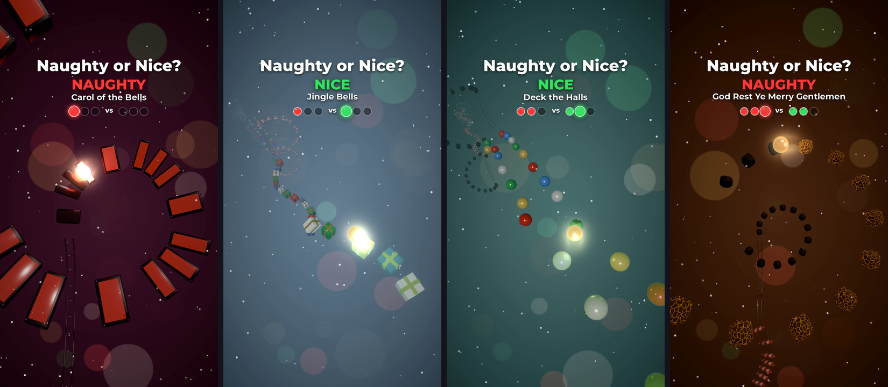

# marble-song-battle

Blender marble-music Shorts in the "X or Y?" song-battle format (modeled on the viral "Backrooms or Dreamcore?" marble videos). A gold marble falls through an obstacle course and every bounce plays the next note of a song. Six rounds alternate between two teams, three songs each. Every round has its own course shape, obstacles, glow colour and lighting mood. The HUD shows the question, the current team and song, and 3-vs-3 score dots. The video loops seamlessly, and all the sound is synthesized from public-domain melodies, so there is no licensed audio and nothing for Content ID to claim. A ~64 s video takes about 1 h 50 min on 2 CPU cores, almost all of it the Blender render.

**Made for:** the "Naughty or Nice?" Christmas Short (Marble Pop, Nov 2026): 🔴 Naughty = Carol of the Bells, Sugar Plum Fairy, God Rest Ye Merry Gentlemen; 🟢 Nice = Jingle Bells, Deck the Halls, We Wish You a Merry Christmas. Running this code with the shipped settings reproduces that video and its text-free thumbnail pixel for pixel (checked: plan, audio, mood LUT, a rendered frame, finished frames and the thumbnail all match).



*Rounds 1, 2, 4 and 5: slab funnel, gift stairs, ornament zigzag, coal funnel.*

## Files
- `settings.py`: the matchup (`TITLE`, `TEAMS`, `ROUNDS`: song, team, course style and its shape, obstacle, glow colour, target bounciness), the lighting `MOODS`, camera offsets and lens, render size and samples, HUD dot positions, fonts and thumbnail picks. Everything else reads from here.
- `music.py`: the song library. Each song is written in beats: melody notes (each one a marble hit, or a flourish), chords with bass notes, tempo, meter and a backing style.
- `plan.py`: the physics. It turns hit times into a marble path: an exact ballistic arc between hits, and each obstacle tilted so its normal is along the velocity change (a true reflection). Course styles are `helix` (a narrowing funnel), `stairs` (forward with a sway) and `zigzag`. Rounds are joined by two-rail ramps that set the next round's speed. Prints bounce stats and collision checks.
- `export.py`: the camera (top-down over funnels, a chase cam elsewhere, smoothed), the loop seam (obstacles and rails seen in the first and last frames are copied by the course's end-to-start offset), the global note list, and occlusion/near-camera checks. Writes `build/plan.json`.
- `audio.py`: one melody note per hit (piano plus a glockenspiel sparkle, celesta for Sugar Plum) over per-song backing (`trap`, `pop`, `pizz`, `dark`, `waltz`), rolling noise on the rails and reverb. The tail wraps to the start so the loop is seamless.
- `mood_lut.py` (Blender): measures each mood colour through the AgX view, so the 2D backdrop matches the fogged objects
- `scene.py` (Blender 4.0): the obstacles (slab, gift, peppermint, ornament, coal, candy cane; each type shares one mesh and material, and per-object `glow`/`gcol`/`base` properties drive the colours), the rails, the gold marble, the hit glow with a little dip, 3 roving glow lights, the sun, the mood changes and distance fog in every material. Renders transparent 864×1536 PNGs.
- `post.py`: backdrop with drifting bokeh, the render upscaled on top, bloom, a halo and trail on the marble, vignette, snow, then the HUD (labels pop in each round; the current dot is enlarged and pulses on each hit). Encodes 318-frame chunks and joins them with the audio.
- `thumb_render.py` (Blender) + `thumb.py`: close-ups of the marble just after a hit in two rounds, joined by a glowing diagonal seam. No text by default; `--text` adds the team names.
- `make_video.sh`: everything above in order

## Reuse
```bash
BLENDER=blender ./make_video.sh      # BLENDER must be 4.0/4.1
```
Step by step:
```bash
python3 plan.py                                     # bounce stats + checks (want 0 issues), ~10 s
python3 export.py                                   # build/plan.json + camera checks, ~5 s
python3 audio.py                                    # build/audio.wav, ~15 s
blender -b --python mood_lut.py                     # build/lut.json, ~5 s
blender -b --python scene.py -- test 60,450,1150    # check a few frames first (~4 s each after setup)
python3 post.py test 60,450,1150                    # the same frames finished, in build/test/
blender -b --python scene.py -- full > build/render.log 2>&1 &    # ~1 h 45 min, resumable
nice -n 19 python3 post.py watch                    # encodes chunks as frames finish
python3 post.py concat                              # build/out/short.mp4
blender -b build/scene.blend --python thumb_render.py
python3 thumb.py                                    # build/out/thumbnail.jpg
```
To make a new matchup:
- Add songs to `music.py` and its `LIBRARY`. Only public-domain melodies (published before 1929); trending pop songs are copyrighted and get claimed. Notes closer than ~0.15 s can't each get a bounce, so mark them `False` and they play as a flourish from the previous hit.
- In `settings.py`, set `TITLE`, `TEAMS` and one `ROUNDS` entry per song (alternate the teams), plus a mood per round. A helix round's `turns` and radii, or a stairs/zigzag round's speed, set how far apart the obstacles are.
- Run `plan.py` until it prints `issues: 0`, then `export.py` and check the occlusion list (a few frames is fine).
- New obstacle: a mesh builder and material in `scene.py`, a size entry in `plan.py`'s `OBST`.
- Set `THUMB` to a hit in each team's round.

**Copy for YouTube:**
- Title: `Naughty or Nice? 🎄 Which Christmas Song Wins?`
- Description: `Every bounce plays a note: 3 Naughty songs vs 3 Nice songs. Which team wins?` / the two song lines / `Pick your side in the comments 🔴🟢` / `Made with Blender` / `#christmas #naughtyornice #marblemusic #satisfying #pickyourside`
- Thumbnail: the text-free one. The channel's best Shorts had no text on the thumbnail, and the title already asks the question.

## Gotchas
- Use Blender 4.0 or 4.1 for the Blender steps (`apt-get install blender` gives 4.0.2 on Ubuntu 24.04). On 2 CPU cores, EEVEE Legacy renders a frame in ~3.3 s at 864×1536 with 4 samples. EEVEE Next (bpy 5.3) needed ~4 s for a single sample, and Cycles ~6 s at 540×960. The EGL errors Blender prints are harmless.
- EEVEE bloom (~0.8 s) and a world backdrop shader (~0.7 s) were the slowest parts of a frame on software GL, so both happen in 2D in `post.py`, along with snow and the marble halo.
- A hop of `dt` seconds can drop at most `g·dt²/2` if the marble launches upward. Any more and it would have to bounce down into the block. `plan.py` picks each hop's drop from a target restitution instead.
- A helix with stacked turns hides the marble from a camera above it, so the funnels narrow (each turn sits inside the one above). Helix drift parked the camera inside old blocks, so it's off.
- The gold marble got lost among the gold ornaments; the halo and trail in `post.py` fix that everywhere.
- At the moment of a hit the block's glow blooms to white, so thumbnails use a frame 7 frames later, when the colour is back.
- The loop needs three things: the seam copies in `export.py`, the HUD reset finishing exactly on the last frame, and the audio tail wrapped to the start.
- `scene.py -- full` skips finished frames, so rerun it after a crash. Its 0-byte placeholders count as unfinished in `post.py watch`.
- Blender leaves ~15% of 2 cores idle, so `nice -n 19 python3 post.py watch` alongside it barely slows the render.

## What it can't do
- It isn't a physics simulation: the arcs are computed and keyframed. The marble doesn't visibly spin (plain gold), and there's no motion blur.
- In the shipped course, 5 frames on two funnel exits have the marble briefly hidden by the turn above.
- The camera style follows the course style (top-down for funnels, chase cam otherwise).
- Each song's melody, chords and backing style have to be written out by hand in `music.py`.

## Dependencies
- Blender 4.0.2 (Ubuntu package) for `scene.py`, `mood_lut.py` and `thumb_render.py`
- Python 3 with numpy, scipy and Pillow
- ffmpeg
- Montserrat (variable) for the HUD, or Poppins ExtraBold/Bold from `../style-kit/get_fonts.py`
