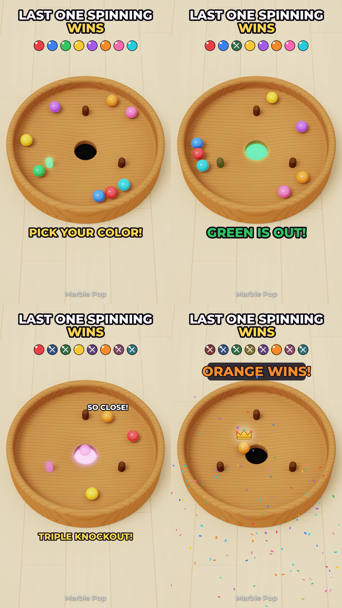

# marble-spin-dish (game template)

One command for a "Last One Spinning Wins" Short: eight marbles spin around a turned wooden dish, bounce off the rim, three walnut pegs and each other, slow down and spiral in, and drop through the hole in the middle one by one; the last one still spinning wins. It's the co-owner's "LAST ONE SPINNING WINS" Short made more interesting: more marbles, pegs that flash the colour of the marble that hits them, a hole that glows in the colour of each marble it swallows, SO CLOSE! near misses, DOUBLE and TRIPLE KNOCKOUT! callouts, a slow-motion close-up of the last drop and a crown on the winner. Real physics picks the order, and it renders on the CPU with `../marble-raytrace-kit`: no Blender, no GPU.



**Used in:** "Last One Spinning Wins" made for Marble Pop (Nov 2026; 25.03 s, 742 frames, 1080×1920, 30 fps; seed 1207, orange wins). Verified on a 2-core cloud session, running from this folder:
- `python3 make_video.py` with both sets cached took 1 min 31 s for the 742 frames, the mux and the thumbnail. The two sets had taken about 1 min (main camera) and 2 min (close-up) to path-trace and bake.
- The soundtrack was then rebuilt (a louder opening and the winner loop, now the shipped `audio.py`) and muxed with the same frames: −13.1 LUFS integrated, −1.5 dBFS peak, no silent stretch.
- `--thumb-only` reproduces the delivered thumbnail (frame 120, the first marble on the edge of the hole) byte for byte.
- `PREVIEW=1 python3 make_video.py --stills 30,98,176,330,450,600,612,624,700,735` built everything at half size and wrote the ten stills in 38 s.

## How it works
1. **The dish.** `dish.py` turns 2D profiles into meshes: the dish (a gentle cone with a funnel dip around the hole, a raised rounded rim and a thick outer wall), the three pegs and a black disc deep in the hole. The floor profile is the same function the physics uses (`sim.floor_y`), so marbles sit exactly on the surface. The table is the tracer's ground plane.
2. **Two static sets.** `meshtrace` path-traces the set once from the main camera and once from the close-up camera (`SPIN_CAM=main|close`, one process each, because the kit's compositor is configured per camera). `bake.py` paints wood grain on the dish and pegs and boards on the table. Each peg has its own object id, so it can light up on its own.
3. **Physics.** `sim.py` (numba, 4 kHz): soft-sphere marbles on the axisymmetric surface with rolling resistance and drag, bouncing off the rim, the pegs and each other. Launch speeds are spread evenly above orbital speed and shuffled per seed, so the drops come a few seconds apart instead of all at once. `python3 sim.py --search 1-800` ranks seeds by drops spread out, a final duel of 5–9 s, a winner that spins alone at the end and near misses.
4. **Timeline.** `timeline.py` starts 4 s before the first drop (everyone already spinning), plays lulls of over 4.5 s at 1.7×, slows to 0.55× around the last drop, and cuts to the close-up from at most 1.2 s before the last drop to at most 1.6 s after it, but only while every marble still in play is well inside the close camera's frame. Peg hits are matched to the peg and marble that made them.
5. **Light-ups.** The kit's glow elements: one per peg and colour (the peg flashes in the hitting marble's colour, strength from the impact speed) and one per colour for the hole.
6. **Frames, text and sound.** The compositor paints the marbles; `overlays.py` draws the title, the chips that get an X, the callouts, SO CLOSE! next to the marble, the winner box, confetti and the crown (`../crown-icon`). `audio.py` builds the soundtrack from the same events (`../battle-audio`).

## Files
| file | what |
|---|---|
| `settings.py` | **every setting**: marbles and colours, dish and pegs, physics, timing, light-ups, cameras, text; `EPISODE=<name>` runs `episodes/<name>.py` after it |
| `sim.py` | the physics, near misses, seed scoring and `--search` |
| `dish.py` | the dish, pegs and hole as lathe meshes → `build/mesh.bin` |
| `mesh.py` | the mesh container the kit's `meshtrace` reads |
| `scene.py` | camera (from `SPIN_CAM`), light and look in the form the kit's compositor reads |
| `bake.py` | wood grain for the dish and pegs, boards for the table |
| `timeline.py` | physics → frames: speed ramps, the close-up window, cues for text and sound |
| `overlays.py` | title, chips, callouts, SO CLOSE!, winner box, confetti, crown |
| `audio.py` | rolling, clacks, rim and peg knocks with a bell per peg, the plonk and stinger per drop, whooshes, heartbeat, riser, fanfare, claps and the winner loop |
| `make_video.py` | the whole pipeline; also `--stills`, `--thumb-only`, `--thumb-frame`, `--max-frames`, `PREVIEW=1` |
| `style.json` | every value, plus the YouTube copy |
| `preview.png` | four moments of the shipped video |

## Reuse
```bash
./setup.sh ball-sims                                   # numpy, scipy, numba, Pillow, skia-python, Montserrat
PREVIEW=1 python3 make_video.py --stills 30,330,612    # half-size sets and stills in build_preview/, under a minute
python3 make_video.py --stills 120,450,700             # full-size stills (path-traces both sets the first time)
python3 make_video.py                                  # -> build/Last_One_Spinning_Wins.mp4 + build/thumbnail.png
python3 sim.py --search 1-800                          # rank races for a new episode, then SEED=<n>
```
The first full build takes about 4.5 minutes on a 2-core cloud session: about 3 to trace both sets, then 1.5 for the frames.

**A new episode:** `SEED=<n> python3 make_video.py` with a seed from `--search` (look at a few `PREVIEW=1` stills first: the close-up window and the thumbnail frame are picked automatically). For more or fewer marbles or other colours, put a new `MARBLES` list in `episodes/<name>.py`; with more marbles, widen `V_SPIN` so the launch speeds stay spread out.

**Copy** (Marble Pop rules in the repo's `CLAUDE.md`): title `Last One Spinning Wins 🌀 Pick Your Color`; description `8 marbles spin around a wooden dish. The last one still spinning wins!` / `Pick your color in the comments 🔴🔵🟢🟡🟣🟠🩷🩵` / `Made with a 3D physics simulation` / `#marbles #satisfying #pickyourcolor #shorts`. The thumbnail has no text.

## Gotchas
- **Spread the launch speeds.** With random launch speeds the marbles lose speed together and drop in a 2–6 s burst. Even spacing above orbital speed (`V_SPIN`) plus the rolling losses is what spreads the drops out; `--search` does the rest.
- **One process per camera.** `compositor.configure()` sets module globals from the scene module, so the main and close cameras render in separate processes (`SPIN_CAM`). `make_video.py` does this for you.
- **The close-up can be short.** Marbles often swing wide just before they drop, so the close-up only starts once both are inside its frame (0.55 s before the drop with seed 1207). If the drop itself is out of frame, there's no close-up.
- **The camera labels are strings of fixed width.** `timeline.py` uses dtype `<U8`; a `<U4` array silently truncates "close" to "clos" and the close-up frames are never rendered.
- **Textured surfaces must stay gloss 0** (the bake multiplies the key and ambient layers).
- **Sets are cached** by the scene file and mesh hash; `PREVIEW=1` has its own `build_preview/`. Don't commit `build/`.

## What it can't do
- Only a round dish with the hole in the middle (the physics is axisymmetric apart from the pegs and the rim).
- Pegs are fixed posts; nothing in the set moves (the set is path-traced once per camera).
- Two cameras, both fixed: no camera moves, just a cut.
- The marbles are glossy plastic, all one size (the kit's limits).

## Dependencies (tested)
- Python 3.13.18, numpy 2.5.3, scipy 1.18.1, numba 0.68.1, Pillow 12.3.0, skia-python 144.1 (for the crown)
- gcc 13.3.0 with OpenMP (the kit compiles `meshtrace`), ffmpeg 6.1.1 with libx264 and the built-in AAC encoder
- Montserrat (`../marble-raytrace-kit/get_fonts.py`, run by `./setup.sh ball-sims`)
- Linux x86-64, 2 cores
