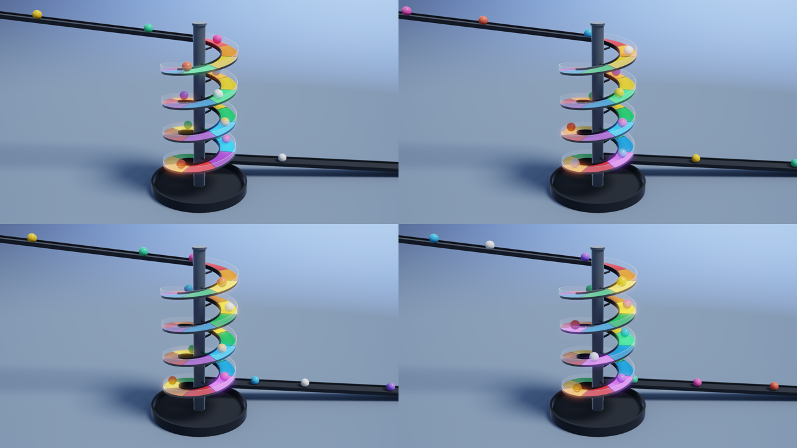

# marble-spiral-loop

A seamless landscape marble loop for a 24/7 YouTube livestream background, with its own music: marbles roll in along a rail at the top left, spiral down the rainbow helix of `../marble-spiral-round` and leave along a rail to the right, forever, while `music.py` plays the public-domain tunes of the marble music Shorts on the same synthesized bells. Built on `../marble-raytrace-kit` (mesh tracer with clear glass, numpy compositor, `bells.py`).



**Used in:** GJ's 24/7 marble music box livestream (Nov 2026), streamed from his Mac with `ffmpeg -stream_loop -1`. Verified in a 2-core cloud session:
- `make_loop.py` renders the 24 s loop (720 frames, 1920×1080, 30 fps): 3.9 min to path-trace the set once, then 3.7 min for the frames in 2 workers and a few seconds for the final encode.
- The loop is seamless: the analytic seam error is 2e-6 units, and in the decoded file the change from the last frame to the first (mean abs 0.56) is inside the range of ordinary frame-to-frame changes (0.24–0.73).
- The output is H.264 High at 5.7 Mbps with a keyframe exactly every 2 s. Streamed through the command in Reuse (to a local FLV for 60 s, so across two loop seams), keyframes stayed 2.000 s apart, including at 24 s and 48 s, with no timestamp warnings.
- `music.py` builds a 10.45-minute mix in 39 s, at -16.0 LUFS with peaks at -3.4 dBFS. Pitches were spot-checked by FFT (Twinkle opens on C5 = 523.3 Hz over a C3 bass and a C-E-G chord).
- Rebuilt from a fresh clone, frame 360 was pixel-identical to the delivered loop's render, and the mix WAV byte-identical.

## Files
| file | what |
|---|---|
| `make_loop.py` | the whole video pipeline: mesh + static set (cached) → periodic marble paths and glows → marble lighting table → frames in workers → one encode at YouTube live settings |
| `scene.py` | the set: 4-turn helix of 28 equal segments (6 colors, so the rainbow shifts one color per turn), glass outer wall, pole, dish, feeder rail (top left) and exit rail (bottom right); the landscape camera |
| `timeline.py` | constant-speed motion along feeder → helix → exit, marbles spawned on a pattern (`GAPS`) that repeats every `LOOP_S`; segment flash and hold times; `loop_check()` |
| `music.py` | the stream mix: arranges each song (soft / flow / sparkle passes, rounds over a pedal), renders it with `bells.py`, levels it to -16 LUFS and joins the songs |
| `stream_songs.py` | the nine public-domain tunes (Twinkle, Jingle Bells, Ode to Joy, Deck the Halls, Row Row Row, We Wish You a Merry Christmas, London Bridge, Sugar Plum Fairy, God Rest Ye) with chords, tempos and passes |
| `style.json` | every value: canvas, loop, motion, set, camera, glow, encode, music |
| `preview.png` | frames 0, 250, 360 and 500 |

## Reuse
```bash
./setup.sh ball-sims                       # numpy, scipy, Pillow; ffmpeg and gcc checks
python3 make_loop.py                       # -> build/marble_spiral_loop.mp4 (24 s, no audio)
python3 make_loop.py --stills 0,360        # stills only: build/still_0000.png ...
python3 music.py                           # -> build/marble_bells_mix.m4a (10.45 min)
python3 music.py --only "London Bridge"    # one song, for a quick listen
```
Stream both files forever (each loops on its own):
```bash
ffmpeg -re -stream_loop -1 -i build/marble_spiral_loop.mp4 -stream_loop -1 -i build/marble_bells_mix.m4a \
  -map 0:v -map 1:a -c:v copy -c:a aac -b:a 128k -ar 44100 -f flv "rtmp://a.rtmp.youtube.com/live2/$KEY"
```
On a Mac, put `caffeinate -i` in front so the Mac doesn't sleep while it streams. The video is copied, not re-encoded, so the stream needs almost no CPU.

**Changing it:**
- Busier or calmer: `GAPS` (seconds between marbles) and `SPEED` in `timeline.py`.
- Longer loop: lengthen `GAPS`. Keep `sum(GAPS) == LOOP_S`, a multiple of 2 s.
- More music: add a public-domain song to `stream_songs.py` and to `PLAYLIST`. For a mix without Christmas songs, take Jingle Bells, Deck the Halls, We Wish You and God Rest Ye out of `PLAYLIST`.

## Gotchas
- **Loop length:** `LOOP_S` must equal `sum(GAPS)`. Keep it a multiple of 2 s, so the 2-second keyframes line up every time the file repeats.
- **Colors:** marble colors cycle through 7, so `len(GAPS)` must be a multiple of 7, or the colors won't repeat each loop and the seam shows. `make_loop.py` prints the seam error; it should be about 1e-6.
- **Framing:** the kit's compositor never draws marbles at x < -45. The camera is framed so that point on the feeder rail is just off-screen (-0.022 of the width). If you widen the shot, check `python3 scene.py`, which prints where `feed-45` lands.
- **Frame aspect:** the tracers used to hard-code a 9:16 frame for the background glow and vignette. They now take it from the scene's `res`. Portrait renders come out the same: low-res renders of the spiral and staircase sets matched the old tracers byte for byte.
- **Static render cache:** it's keyed on `build/scene.txt` + `build/mesh.bin`. Camera or set changes re-render automatically (about 4 min).
- **Music rights:** only public-domain melodies (pre-1929), played by synthesized bells, so no recording rights are involved. Popular songs get Content ID claims.

## What it can't do
- The camera can't move (the set is rendered once).
- Every marble rolls at one constant speed, with no physics and no collisions. Marbles are solid colors, so their spin doesn't show.
- The music isn't synced to the marbles: the 24 s video and the 10.45-minute mix loop separately.
- No text overlays. Set `WATERMARK` to draw the kit's centered watermark.

## Dependencies (tested)
- Python 3.13.18, numpy 2.5.3, scipy 1.18.1, Pillow 12.3.0
- gcc 13.3.0 with OpenMP
- ffmpeg 6.1.1 with libx264 and the built-in AAC encoder
- `../marble-raytrace-kit`
- Linux x86-64, 2 cores
