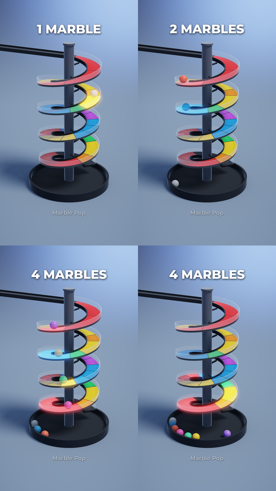

# marble-spiral-round (game template)

One command for a spiral marble music Short: marbles roll down a rainbow helix around a pole, and each colored segment plays its own note as a marble rolls onto it. The track is built from the song, one segment per note and as long as the note, so a single marble plays the tune. Marbles that follow two bars apart sing it as a round (canon). There are rounds of 1, 2 and 4 marbles, then everything lands in a dish. Built on `../marble-raytrace-kit` (its mesh tracer, with clear glass walls).



**Used in:** the spiral Short *Row Row Row Your Boat* on Marble Pop (Nov 2026, uploaded as Fun House 67; 48.27 s, 1448 frames). It was rebuilt from this folder, and the default build ran from a fresh clone:
- The mesh, the scene file and all 9 G-buffer files are byte-identical to the originals.
- So are the timeline, the marble paths and the marble lighting table.
- Stills 0, 150, 1080 and 1385 are pixel-identical to the original renders.
- With `SPLIT=even WATERMARK="Fun House 67"`, the finished mp4's video and audio streams are bit-identical to the upload (same stream MD5).
- The default thumbnail (frame 1080, set in `songs.py`) is the upload's thumbnail picture. With `--thumb-title` it matches it to within JPEG noise (41.5 dB PSNR); the default leaves the title off, because the channel's thumbnails have no text unless GJ asks.

## Files
| file | what |
|---|---|
| `make_video.py` | the whole pipeline: track mesh + static set → choreography → marble lighting table → music → frames (2 workers) → mp4 at −13 LUFS → thumbnail |
| `songs.py` | the songs: notes as (MIDI pitch, eighths) in 6/8, seconds per eighth, rounds; the pitch colors |
| `scene.py` | the set: helix track built from the song, glass outer wall, pole, feeder rail with gate, dish; the camera |
| `timeline.py` | queue on the rail, gate release, constant-speed roll down the helix, dish physics at 1/1200 s; notes, impacts, titles, finale |
| `music.py` | every note a lead bell panned by the marble's position; dish clacks; finale chord and sparkle run |
| `style.json` | every value: video facts, helix and dish sizes, colors, camera, physics, glow, music, text |
| `preview.png` | four moments: 1 marble, a 2-part round, a 4-part round, the finale |

## Reuse
```bash
./setup.sh ball-sims                         # or: pip install numpy scipy pillow && python3 ../marble-raytrace-kit/get_fonts.py
python3 make_video.py row-row-row            # -> build/row-row-row/Marble_Spiral_Row_Your_Boat.mp4 + thumbnail.png
python3 make_video.py row-row-row --stills 150,1080   # PNG stills only
python3 make_video.py row-row-row --thumb-only --thumb-title
```
The first run took 7.2 minutes on a 2-core cloud session: about 3.5 min to path-trace the set (a 13k-triangle mesh with glass, cached per song), seconds for the marble lighting table, and about 3 min for the frames. With the set cached, a rebuild takes about 3.5 minutes. `SPLIT=even WATERMARK="Fun House 67"` rebuilds the upload exactly. The defaults split the frames by estimated cost and use the Marble Pop watermark.

**A new song:**
1. Add an entry to `SONGS` in `songs.py`:
   - `notes`: (MIDI pitch, length in eighths).
   - `eighth`: tempo, as seconds per eighth note; `bar_eighths`: 6 for 6/8, 8 for 4/4.
   - `rounds`: marbles per round.
2. Every pitch needs a color in `PITCH_SRGB`.
3. Pick a song that works as a round, like *Three Blind Mice*. Marbles two bars apart must sound good together.
4. Check stills before the full render: a different song length gives a taller or shorter spiral.

## Gotchas
- **The track is the song.** Change a note's length and every later segment moves, which means a new static render (about 3.5 min). The render is cached per song (`build/<song>/g_*`).
- **The camera is framed for this song's length:** 48 eighths make 4.2 turns. A much longer song makes a taller spiral that leaves the frame. Raise `CAM_DIST` or `CAM_TARGET` in `scene.py`.
- **The round's marbles enter 2 bars apart** (`CANON_BARS` in `timeline.py`). Bars are 6/8 unless the song sets `bar_eighths=8` (4/4, for a round like *Frère Jacques*).
- Segments flash when a marble reaches them and stay half lit while it rolls over them. With 4 marbles, 4 segments are lit at once.
- Object ids 1–39 are segments, so a song can have at most 39 notes.
- Lighting for the marbles comes from a table the mesh tracer computes for every distinct marble position (`build/<song>/env.npz`). If you edit marble paths, rerun the whole script, not just the frames.
- Don't commit `build/`: it holds the mesh, the G-buffer (about 600 MB), the WAV and the mp4.

## What it can't do
- Notes can't overlap within one marble: one marble is one melodic line. Harmony comes only from the round.
- No tempo changes: the roll speed is constant.
- The pitch colors cover C5, D5, E5, F5, G5 and C6 only. Add more to `PITCH_SRGB` for other notes.
- No camera move. The glass is a clear sheet, without refraction.

## Dependencies (tested)
- Python 3.13.18, numpy 2.5.3, scipy 1.18.1, Pillow 12.3.0
- gcc 13.3.0 with OpenMP
- ffmpeg 6.1.1 with libx264 and the built-in AAC encoder
- `../marble-raytrace-kit`, including its Montserrat font (`get_fonts.py`)
- Linux x86-64, 2 cores
