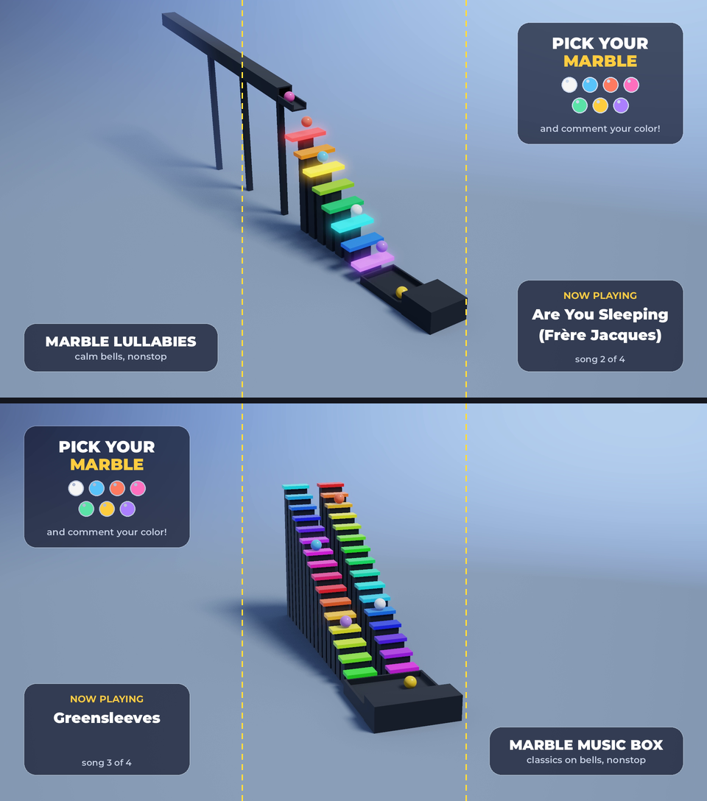

# marble-stairs-loops

Two endless 16:9 marble-music loops for 24/7 YouTube livestreams, built from the staircase Shorts. In `stairs`, marbles roll out of the feeder tube of `../marble-stairs-song`, hop down its 8 rainbow tiles and roll away into a tunnel. In `twin`, they drop onto the two 16-tile lanes of `../marble-twin-stairs`. Every hop plays a note of a medley of public-domain songs (the tune when a tune note starts, otherwise the bass or a broken chord), and both picture and sound loop with no seam. Each set keeps its Short's camera, so the middle 9:16 strip of the frame (what YouTube shows in the Shorts feed) is the Short's own framing; side panels ("pick your marble", "now playing", the medley's name) stay outside it. `streams.sh` runs several such streams at once from a Mac.



**Used in:** made for the second night of GJ's Marble Pop livestreams (Nov 26, 2026), streamed with `streams.sh` next to the `../marble-spiral-loop` stream. On the first night, about 87% of that spiral stream's 12,690 views came from the Shorts feed. Verified in a 2-core cloud session:
- The files: `stairs` is 236.000 s (7,080 frames, 189 marbles a loop) and `twin` 275.000 s (8,250 frames, 146 marbles). H.264 with a keyframe exactly every 2 s, and an ALAC sound track exactly as long as the picture.
- Picture seam: the last frame leads into the first like any two neighbours (mean difference 0.25 on the 0–255 scale, against 0.06–0.73 between neighbouring frames mid-loop). `seam_check` found no frame with a marble missing.
- Sound seam: decoded twice in a row, the way `streams.sh` reads the file, the step across the loop point is 0.005 (`stairs`) and 0.009 (`twin`). That's under the 99.9th-percentile step between neighbouring samples (0.06 and 0.05). The first, AAC version of `stairs` jumped by 0.05 there, hence ALAC.
- Looped through the ffmpeg command in `streams.sh` (without `-re`) for 500 s and 570 s, across two seams: no backwards timestamps, no gaps, keyframes at most 2.0 s apart.
- The tune notes match the songs (the first 24 notes of Twinkle and of Ode to Joy, as played). Both mixes measure −16.0 LUFS, with peaks of −4.2 and −2.8 dBFS.
- `streams.sh`, with bash 5.2 on Linux and local FLV files in place of YouTube:
  - three streams ran for 30 s and ended together
  - keys typed or piped in had their spaces trimmed
  - a duplicate key and a missing key were refused
  - Ctrl+C left no ffmpeg running, also during reconnect waits (checked 3 s and 11 s later)
  - a refused connection retried every 5 s
- Its stream and stop code is that of `../marble-live-streams/streams.sh`, which ran three streams on GJ's Mac on Nov 25. The table parsing is new and hasn't run on macOS yet.
- From a fresh clone: `--audio-only` rebuilt both `music.wav` files byte for byte, with identical marble paths and timelines. `--stills` path-traced both sets from scratch (2 and 3.3 min with the still) and rendered stills 3482 (`stairs`) and 4337 (`twin`) pixel-identical to the same stills from the build that made the streamed files.

## Files
| file | what |
|---|---|
| `make_loop.py` | the pipeline: static set (cached) → choreography → music → frames in 2 workers → panels → one encode at YouTube live settings → thumbnail |
| `stairs_set.py`, `twin_set.py` | the two sets: geometry (the Shorts' tiles, chute, camera, plus a trough and tunnel block where the tray was) and the hop kinematics |
| `loop.py` | choreography: which beat each marble lands on (gaps cycled to fit the loop), positions in every frame, hits per beat, tile glows, and `seam_check` |
| `medleys.py` | the songs (eighth-note beats) and the two medleys; public-domain melodies only |
| `music.py` | hits → notes (one note per hit, tune first), then a circular mix: notes wrap round the loop end, reverb and high-pass by FFT, −16 LUFS |
| `panels.py` | the side panels (Pillow), checked to stay outside the 9:16 strip |
| `streams.sh` | runs the streams in its `STREAMS` table at once on a Mac: asks for the keys, keeps the Mac awake, reconnects, stops all at 11 h |
| `style.json` | every value: sets, cameras, tempo, gaps, medleys, music rules, panels, encode |
| `preview.png` | one frame of each loop, with its 9:16 strip marked |

## Reuse
```bash
./setup.sh ball-sims                       # Python packages, fonts (Montserrat from marble-raytrace-kit), ffmpeg check
python3 make_loop.py stairs                # -> build/stairs/marble_lullaby_stairs.mp4 + thumbnail.jpg
python3 make_loop.py twin                  # -> build/twin/marble_twin_stairs_loop.mp4 + thumbnail.jpg
python3 make_loop.py stairs --stills 0,3600      # PNG stills with panels, to check a change
python3 make_loop.py stairs --audio-only         # just build/stairs/music.wav
python3 make_loop.py stairs --thumb-only         # just the thumbnail
python3 make_loop.py stairs --encode-only        # re-run the final encode from the rendered parts
```
On a 2-core cloud session, `stairs` took 15.5 min from scratch: 1.5 min to path-trace the set (cached afterwards), 11.75 min of frames and about 2 min to encode. `twin` took about 3 min for its set, 16 min of frames (with other jobs running) and about 3 min to encode. `--stills` take seconds once the set is cached.

To stream: put `streams.sh`, the loop files and `../marble-spiral-loop`'s two files (renamed `loop.mp4` and `mix.m4a`, as in `../marble-live-streams`) in one folder on the Mac, schedule one YouTube stream per row of `STREAMS` (its own key, Auto-start and Auto-stop on), then `bash streams.sh` and paste the keys in table order. `printf '%s\n' KEY1 KEY2 KEY3 | bash streams.sh` skips the questions. Edit the `STREAMS` table to run other files or another number of streams.

**Changing it:**
- **Songs:** add a function to `medleys.py` and list it in `MEDLEYS`. Write the tune in quarter notes (`line()` doubles them into eighth-note beats). Give chords per bar (`bars()`) or per quarter (`per_quarter()`), and a `canon` voice for a round. Only melodies published before 1929.
- **Density:** `GAPS` in `loop.py` (beats between marbles, per lane). Every beat needs at least one hit, so keep the gaps at or under the tile count (8 or 16).
- **Look:** the sets' settings blocks; panel boxes and texts in `panels.py`. `--stills` renders in seconds once the set is cached.

## Gotchas
- **A beat is one hop and an eighth note.** At 0.5 s a hop (15 frames), a quarter note lasts 1 s: a calm 60 BPM. Sixteenth notes and triplets can't be played (no hop between beats), so Für Elise, for example, doesn't fit.
- **Every hit plays exactly one note.** On each beat the notes come from a ranked list until every hit has one: the tune if a note starts, the canon voice, the bass on the bar's main beats, a broken chord, a second chord tone, then sparkles. A held note never re-strikes, so the other marbles keep a music-box arpeggio going.
- **Both seams are exact by construction.** Instance (marble j, cycle c) lands on beat c × loop + E[j], so frame n_frames is frame 0. `CYCLES` must include +1, because the next loop's first marbles are already in the chute before the seam; `seam_check` counts frames where a marble outside `CYCLES` would show (want 0). The music is mixed circularly (no fade-out, no causal limiter).
- **The sound track is ALAC (lossless), not AAC.** An AAC track decoded in a loop jumped by about 0.05 at the seam (decoding the AAC's start and end edges). ALAC decodes sample-exact, and `streams.sh` encodes AAC on the fly anyway. The file is about 25% bigger (153 MB vs 120 MB for `stairs`).
- **Panels switch half way through the 3 s gap between songs.** The first song's card also covers the last 1.5 s of the loop, and the last song's card must end there: two semi-transparent cards stacked made a visible jump at the seam.
- **The trough is a 9th step.** Marbles land in it one beat after the last tile, so the landing (a soft knock) is on the beat too. The exit block hides them (`hidden`) once they are 1 radius inside.
- **Check a rebuild with stills and the WAV.** Those, and the timeline, come out exactly the same from a fresh clone. The 6 Mbps final encode wasn't compared; `../marble-live-streams` found the same settings aren't bit-exact between runs.

## What it can't do
- Nothing reacts to chat; each loop repeats every 4–4.6 minutes.
- Only these two sets; the tile count (8, 2 × 16), tempo and exit are baked into each set module.
- All songs share one tempo and run back to back; there are no rests longer than the 3 s gap.

## Dependencies (tested)
- Python 3.13.18, numpy 2.5.3, scipy 1.18.1, Pillow 12.3.0
- ffmpeg 6.1.1 (libx264, ALAC and AAC encoders); gcc 13.3 with OpenMP for `../marble-raytrace-kit/boxtrace.c`
- `../marble-raytrace-kit` (tracer, compositor, bells, font); `streams.sh` written for macOS bash 3.2 (`caffeinate`, `date -r`), tested with bash 5.2
- Linux x86-64, 2 cores, 7 GB RAM
