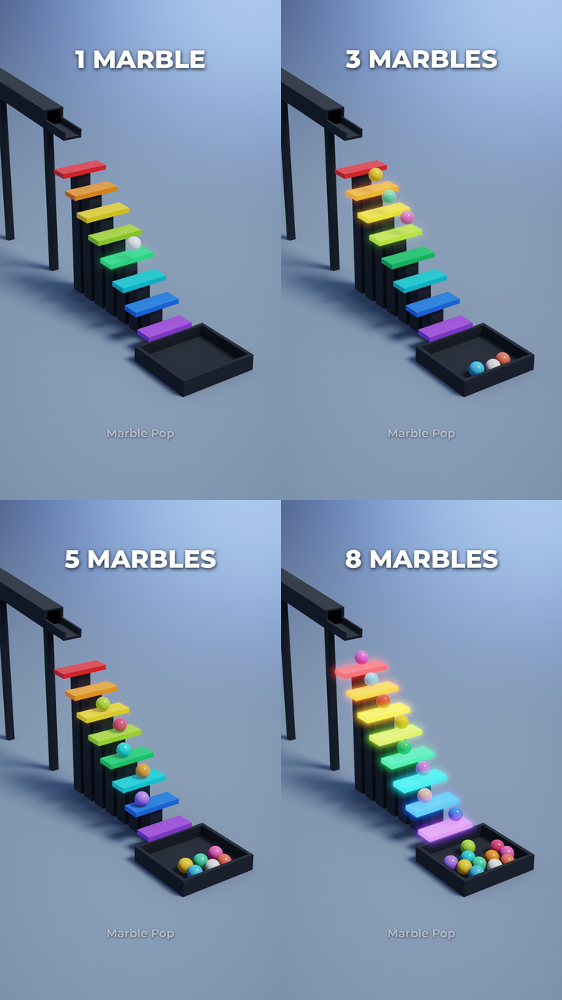

# marble-stairs-song (game template)

One command for a rainbow-staircase marble music Short, in the "Satisfying 3D Sims" format. Marbles roll out of a chute and hop down 8 glowing tiles, one tile per beat, and every hit plays the next note of the song. Rounds of 1, 2, 3, 5 and 8 marbles make the music fuller each time. Built on `../marble-raytrace-kit`.



**Used in:** the two staircase Shorts on Marble Pop (Nov 2026, uploaded as Fun House 67). The first, *Twinkle Twinkle Little Star*, broke the channel's view record (11.6k views within days, when no earlier Short had passed 1.3k); *Jingle Bells* followed. Both were rebuilt from this folder with `SPLIT=even WATERMARK="Fun House 67"`, and the default build ran from a fresh clone:
- `jingle-bells`:
  - The finished mp4's video and audio streams are bit-identical to the upload (same stream MD5).
  - Along the way, stills 600 and 920 matched the original renders pixel for pixel, the timeline and marble paths matched exactly, and `music.wav` matched byte for byte.
- `twinkle`:
  - The video stream is bit-identical to the upload.
  - The soundtrack is not. The upload used an earlier, shorter bell voice whose code wasn't kept, so the template plays the song with the later bell voice from the Jingle Bells video.
  - The notes, chords and timing are the upload's. They were read back from its audio by pitch tracking, and the G-vs-G7 choices by checking for D4 vs F4.
- Thumbnails: with `--thumb-title`, the automatically picked frames (769 and 897) match the uploads' clean thumbnails to within JPEG noise (43–44 dB PSNR). The default thumbnail is the same picture without the title, because the channel's thumbnails have no text unless GJ asks for it.

Three more songs were added in Nov 2026 and rendered from this folder with the default settings on a 2-core cloud session:
- `mary-lamb`: *Mary Had a Little Lamb*, two verses at 112.5 bpm (37.6 s, 1128 frames).
- `old-macdonald`: *Old MacDonald Had a Farm*, the verse three times without the "moo" part, then an 8-note run up to C7, at 120 bpm (31.27 s, 938 frames).
- `frere-jacques`: *Frère Jacques*, the whole round once, then its second half again, at 112.5 bpm (33.37 s, 1001 frames).

So that they don't look like the shipped videos or like each other, each new song has its own marble spacing in the early rounds, its own studio colour and its own marble colour order (`hue`, `sat`, `bright` and `marble_shift` in `songs.py`): Mary is rose pink, Old MacDonald sage green, and Frère Jacques a dark indigo night where the lit tiles stand out. For these three, `music.py`'s per-beat log was checked against `songs.py` (beat by beat, the melody voice is the written note), stills of the busiest beats were looked at before the full renders, and each mp4 measured −13.0 LUFS. `check_song.py` passes for all five songs. With the look settings left at their defaults, `twinkle`'s stills 600 and 920, timeline and marble paths are identical to those from the code before them.

`joy-to-the-world` (*Joy to the World*, Nov 2026) was added the same way: the verse with one syllable per beat at 112.5 bpm (35.47 s, 1064 frames), so round 1's lone marble plays the famous descending C6–C5 scale one stair per note. Its look is a Christmas red studio (`hue` 130, `sat` 1.7, `bright` 0.45) with a mint first marble (`marble_shift` 4). Verified on a 2-core cloud session: `check_song.py joy-to-the-world` passes all 60 beats, stills 75, 560, 860 and 1010 were looked at before the full render, the full build took 5.3 minutes (the stills run had already traced the main camera's set for the new look; the thumbnail camera's set is included), the mp4 measures −13.0 LUFS, and the automatic thumbnail is frame 865 with all 8 marbles on the stairs.

## Files
| file | what |
|---|---|
| `make_video.py` | the whole pipeline: static set → choreography → music → frames (2 workers) → mp4 at −13 LUFS → thumbnail |
| `songs.py` | the songs: melody (one note per beat), chords, rounds and when each marble leaves the chute, plus an optional look (studio colour, marble colour order) |
| `check_song.py` | checks a song's soundtrack against `songs.py` beat by beat (melody, holds, rests, bass and chord tones), without listening |
| `preview_look.py` | a 540×960 preview of a studio colour (`hue`, `sat`, `bright`) without marbles, in a few seconds |
| `scene.py` | the set: 8 tiles, pillars, chute with feeder tube, tray; hop physics from the BPM; main and thumbnail cameras |
| `timeline.py` | exact hops (a parabola per beat) + tray physics at 1/1200 s; hits, impacts, round titles, finale |
| `music.py` | hits → melody, bass, chord tones and sparkles; tray clacks; finale chord and sparkle run |
| `style.json` | every value: videos, set, cameras, colors, physics, music rules, text |
| `preview.png` | four moments of `twinkle`: rounds of 1, 3, 5 and 8 marbles |

## Reuse
```bash
./setup.sh ball-sims                       # or: pip install numpy scipy pillow && python3 ../marble-raytrace-kit/get_fonts.py
python3 make_video.py twinkle              # -> build/twinkle/Marble_Staircase_Twinkle.mp4 + thumbnail.png
python3 make_video.py jingle-bells         # -> build/jingle-bells/Marble_Staircase_Jingle_Bells.mp4 + thumbnail.png
python3 make_video.py mary-lamb            # also: old-macdonald, frere-jacques, joy-to-the-world
python3 check_song.py mary-lamb            # every beat's voices vs songs.py (~4 s a song)
python3 preview_look.py 100 0.9            # or a song name: its studio colour -> build/look_previews/*.png
python3 make_video.py twinkle --stills 300,650,900    # PNG stills only, to check a change
python3 make_video.py twinkle --thumb-only --thumb-title --thumb-frame 769
```
On a 2-core cloud session, *Jingle Bells* takes 5.4 minutes once the static sets are cached, nearly all of it rendering frames. The first run adds about 3 minutes to path-trace the set and the thumbnail camera's set; both are cached afterwards. `SPLIT=even WATERMARK="Fun House 67"` rebuilds the uploads exactly. By default the frames are split by estimated cost, which keeps both workers busy, and the watermark says Marble Pop.

**A new song:**
1. Add an entry to `SONGS` in `songs.py`:
   - `melody`: one MIDI note per beat. A negative number holds the previous note, and 0 is a rest.
   - `chords`: one chord per beat, from `VOICING`: C, F, G or G7.
   - `rounds`, and per round the beat `offsets` at which its marbles leave the chute.
   - Optionally `hue`, `sat`, `bright` and `marble_shift`, so the video doesn't look like the others: they recolour the studio (`../marble-raytrace-kit/look.py`'s `set_hue`) and pick the first marble's colour. The rainbow tiles keep their colours.
2. The rounds play `sum(last offset + 8)` beats back to back. `make_video.py` warns if the melody is shorter than that. Run `check_song.py <song>` to confirm every beat plays what you wrote, and `preview_look.py` to try studio colours.
3. Render a few `--stills` first, then the full video.
4. Write the title and description by the channel's copy rules in the repo's `CLAUDE.md`. The default thumbnail is the busiest beat of the last round, with no text.

## Gotchas
- **The melody is per beat, not per note.** A long note is the note followed by negative copies of it. A marble that hits on a beat with no melody note left plays a high C.
- **One marble per beat from the chute.** Offsets in a round must all differ; two on the same beat would overlap on every tile.
- **The voices add up from the top tile down:** melody, bass, then 3 chord tones, then sparkles. Rounds with more marbles automatically sound fuller, so keep the important note on the marble highest up the stairs.
- **`MARBLE_BPM`** (default: the song's `bpm`) changes the hop physics: gravity is solved so each hop lasts exactly one beat. The hop's shape doesn't depend on the tempo, so the chute stays where it is and a new tempo reuses the cached static set (checked: 90, 112.5 and 120 bpm write the same scene file).
- **Same last round, same thumbnail.** In every song but `jingle-bells`, the last round is 8 marbles on consecutive beats (offsets 0–7). Its busiest beat, and so the automatic thumbnail, has a marble on every lit tile. Without its own `hue` and `marble_shift`, a song's thumbnail looks like Twinkle's except for the tray. To show a different moment, pass `--thumb-frame`.
- **The thumbnail camera** (`MARBLE_CAM=thumb`, closer, from more to the side) has its own static set in `build/thumb_g_*`. `make_video.py` runs it in a second process.
- Marble colors cycle after 19 marbles. The tray is sized for the 19 marbles of the shipped videos, so many more will crowd it.
- **Each look renders its own static sets.** A song with a new `hue`/`sat`/`bright` path-traces the set again for both cameras (about 1.5 min each, cached per look as `build/g_hue…` and `build/thumb_g_hue…`).
- Don't commit `build/`: it holds the G-buffers (about 450 MB per camera and look), the WAVs and the mp4s.

## What it can't do
- The staircase always has 8 tiles. The tile pans, the voicing order and the camera framing assume 8.
- There's no pause between rounds, no tempo change within a video, and no camera move.
- Only C-major voicings are defined (C, F, G, G7). Other keys need new `VOICING` entries.
- All marbles drop from the same chute. For two staircases, use `../marble-twin-stairs`; for a round (canon), use `../marble-spiral-round`.
- It can't play back the Twinkle upload's original bell sound (see **Used in**).

## Dependencies (tested)
- Python 3.13.18, numpy 2.5.3, scipy 1.18.1, Pillow 12.3.0
- gcc 13.3.0 with OpenMP
- ffmpeg 6.1.1 with libx264 and the built-in AAC encoder
- `../marble-raytrace-kit`, including its Montserrat font (`get_fonts.py`)
- Linux x86-64, 2 cores
