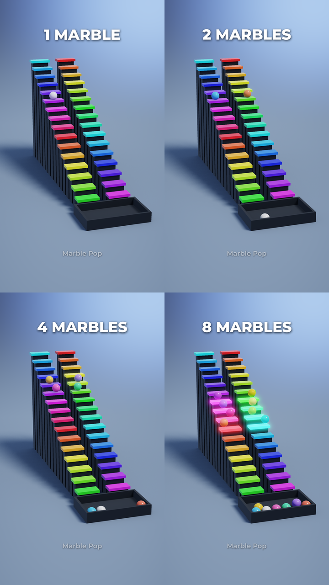

# marble-twin-stairs (game template)

One command for a twin-staircase marble music Short: two rainbow staircases of 16 tiles side by side. Marbles on the front staircase play the melody and those on the back one play the harmony, one tile per beat. There are rounds of 1, 2, 4 and 8 marbles, then everything lands in one tray. Built on `../marble-raytrace-kit`.



**Used in:** the twin-stairs Short *Ode to Joy* on Marble Pop (Nov 2026, uploaded as Fun House 67; 38.0 s, 1140 frames). It was rebuilt from this folder, and the default build ran from a fresh clone:
- The scene file and all 6 G-buffer files are byte-identical to the originals, and so are the timeline and the marble paths.
- Stills 40, 300, 840, 1062 and 1139 are pixel-identical to the original renders, and `music.wav` is byte-identical.
- With `SPLIT=even WATERMARK="Fun House 67"`, the finished mp4's video and audio streams are bit-identical to the upload (same stream MD5).
- The default thumbnail (frame 916) is the upload's thumbnail picture. With `--thumb-title` it matches it to within JPEG noise (41 dB PSNR); the default leaves the title off, because the channel's thumbnails have no text unless GJ asks.
- **16:9 versions** for the full-screen long-form (`../longform-compilation`, Nov 2026): `ode-to-joy`, `london-bridge`, `fur-elise`, `happy-birthday`, `good-king` and `frere-jacques`, rendered with `MARBLE_RES=1920x1080 MARBLE_CAM=wide BUILD_DIR=build_wide WATERMARK=""`. Each came out 1920×1080 with video and audio the same length (1140 frames; 1200 for `frere-jacques`), and the rounds were checked by eye in the long-form's segments. The five new songs were written from the public-domain tunes, not pitch-tracked. Their back lanes come from the chords through `harmonize()`, except *Frère Jacques*, whose back lane sings the round itself, 8 beats behind and an octave down. The close 16:9 camera (`MARBLE_CAM=widethumb`) made the long-form's twin-stairs thumbnail.

## Files
| file | what |
|---|---|
| `make_video.py` | the whole pipeline: static set → choreography → music → frames (2 workers) → mp4 at −13 LUFS → thumbnail |
| `songs.py` | the songs: melody and harmony (one note per beat), chords, and per round which lane each marble drops on and when; `harmonize()` derives a harmony line from the chords |
| `scene.py` | the set: 2 × 16 tiles in two rainbows, pillars, tray; hop physics from the BPM; the camera, plus 16:9 `wide` and `widethumb` |
| `timeline.py` | drop-in, exact hops (a parabola per beat), tray physics at 1/1200 s; hits, impacts, round titles, finale |
| `music.py` | front-lane hits → melody and sparkles, back-lane hits → harmony, bass and chord tones; clacks; finale |
| `style.json` | every value: video facts, set, colors, camera, physics, music rules, text |
| `preview.png` | four moments: 1 marble, a melody + harmony pair, 4 marbles, 8 marbles |

## Reuse
```bash
./setup.sh ball-sims                        # or: pip install numpy scipy pillow && python3 ../marble-raytrace-kit/get_fonts.py
python3 make_video.py ode-to-joy            # -> build/ode-to-joy/Marble_Twin_Stairs_Ode_to_Joy.mp4 + thumbnail.png
python3 make_video.py ode-to-joy --stills 300,840     # PNG stills only
python3 make_video.py ode-to-joy --thumb-only --thumb-title
# 16:9 (also: london-bridge, fur-elise, happy-birthday, good-king, frere-jacques)
MARBLE_RES=1920x1080 MARBLE_CAM=wide BUILD_DIR=build_wide WATERMARK= python3 make_video.py london-bridge --no-thumb
MARBLE_RES=1920x1080 MARBLE_CAM=widethumb BUILD_DIR=build_thumb python3 make_video.py ode-to-joy --thumb-only   # close camera
```
At 16:9 a song took about 3 minutes once the set was cached.
On a 2-core cloud session, *Ode to Joy* takes 3.9 minutes once the static set is cached; the first run adds about 2.5 minutes to path-trace it. `SPLIT=even WATERMARK="Fun House 67"` rebuilds the upload exactly. The defaults split the frames by estimated cost and use the Marble Pop watermark.

**A new song:**
1. Add an entry to `SONGS` in `songs.py`:
   - `melody` and `harmony`: one MIDI note per beat each. A negative number holds the previous note.
   - `chords`: one chord per beat from `VOICING`: C, F, G, G7, Am or E (add more there and in `CHORD_PCS`). `harmonize(melody, chords)` makes a harmony line: under each melody note, the highest chord tone 3 to 9 semitones below.
   - `rounds`: a list of (lane, beat offset) per round. `MEL_LANE` is the front lane.
2. The rounds play `sum(max offset + 16)` beats back to back. `make_video.py` warns if the melody is shorter than that.
3. Render a few `--stills` first, then the full video.

## Gotchas
- **The two lines must fit 16-beat phrases.** A marble crosses one staircase in 16 beats, so a round with one marble per lane plays exactly 16 beats of melody and harmony together.
- **Several marbles on the same lane and beat** stack voices: octave sparkles on the melody lane, bass and chord tones on the harmony lane. Keep the line itself on the marble highest up the stairs.
- **`MARBLE_BPM`** (default: the song's `bpm`) changes the hop physics: gravity is solved so each hop lasts exactly one beat. A new tempo means a new static render.
- The thumbnail uses the video camera. By default it's the busiest beat of the last round, with no text.
- **16:9:** `MARBLE_RES=1920x1080` (read by `../marble-raytrace-kit/look.py`) with `MARBLE_CAM=wide` frames both staircases for landscape; `MARBLE_CAM=widethumb` is a closer 16:9 camera for thumbnails. `WIDE_FOVY`, `WIDE_AZ`, `WIDE_EL`, `WIDE_DIST` and `WIDE_TARGET` override either one. The set is cached per folder by scene hash and there's one set per folder, so give each camera its own `BUILD_DIR`.
- Don't commit `build/`: it holds the G-buffer (about 450 MB), the WAV and the mp4.

## What it can't do
- Exactly 2 lanes of 16 tiles. The camera, tray and pans are set up for that.
- There's no pause between rounds, no tempo change and no camera move.
- Only C and G voicings are defined.
- The lane colors are two fixed rainbows (the back lane starts at red, the front lane half way round the color wheel).

## Dependencies (tested)
- Python 3.13.18, numpy 2.5.3, scipy 1.18.1, Pillow 12.3.0
- gcc 13.3.0 with OpenMP
- ffmpeg 6.1.1 with libx264 and the built-in AAC encoder
- `../marble-raytrace-kit`, including its Montserrat font (`get_fonts.py`)
- Linux x86-64, 2 cores
