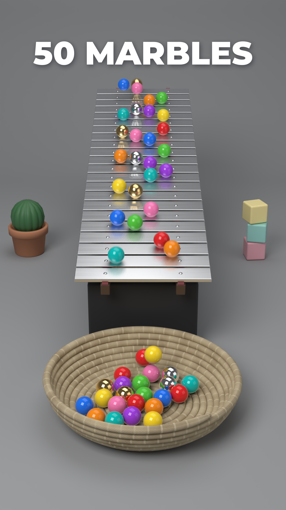

# thumbnail-title

Turns a rendered frame into a 1080×1920 Shorts thumbnail with title text, in one of two looks:
- **rainbow-outline**: big Archivo Black letters with a rainbow (or white) fill, a dark outline and a shadow, plus a darkened top. Used for the 40 marbles thumbnail.
- **clean-white**: plain white Montserrat with a soft shadow, the same feel as the "1 MARBLE" labels. Used for the Twinkle thumbnails.

The `no-text` preset just zooms in slightly on the marbles.

**Used in:** the thumbnails for both marble xylophone Shorts. All four presets below reproduce those files exactly.



## Reuse
Render a frame with `../marble-plate-compositor/render_frame.py ... --ns 16` first. Then:
```bash
python3 make_thumbnail.py ../marble-plate-compositor/preview.png preview.png --preset fifty-marbles
python3 make_thumbnail.py FRAME.png thumb.jpg --preset forty-marbles     # 40 MARBLES / vs XYLOPHONE (rainbow-outline)
python3 make_thumbnail.py FRAME.png thumb.jpg --preset no-text
```
To use new text or positions, add an entry to `PRESETS` at the top of `make_thumbnail.py`. Each line takes a text, a pixel size, a center `y`, and either `rainbow` (outline look) or a `weight` plus optional `emoji` (clean look).

## Fonts
No font files are included. Download them from Google Fonts (all SIL Open Font License) and put them in a `fonts/` folder next to the script, in `shared/fonts/` at the repo root, or install them system-wide. Keep font files out of git.
- Archivo Black: `ArchivoBlack-Regular.ttf`, https://fonts.google.com/specimen/Archivo+Black
- Montserrat variable: `Montserrat[wght].ttf`, https://fonts.google.com/specimen/Montserrat
- Noto Color Emoji: `NotoColorEmoji.ttf`, https://fonts.google.com/noto/specimen/Noto+Color+Emoji (only for the ⭐ preset)

## Dependencies
- numpy 2.5.3
- Pillow 12.3.0 (needs FreeType with variable-font support, standard in the PyPI wheels)
- matplotlib 3.11.2 (only to find system fonts)
