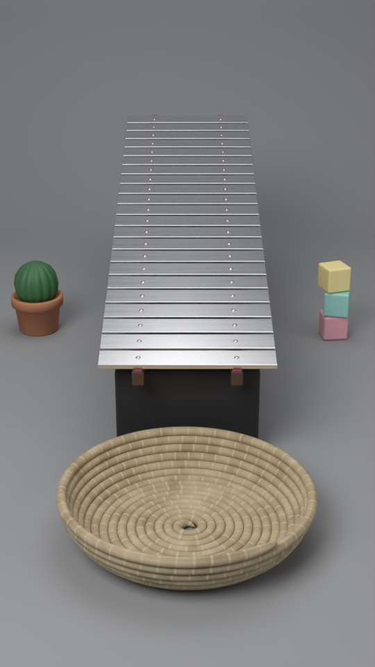

# xylophone-ramp

The 3D set from the marble xylophone Shorts: a 22-bar aluminum glockenspiel ramp on red felt and wooden rails, a black stand, a coiled seagrass basket that catches the marbles, a gray studio sweep, a small cactus and three pastel toy blocks, three soft area lights and the 9:16 camera. Everything is procedural, so there are no texture files.

**Used in:** both marble xylophone Shorts made for Marble Pop in Nov 2026:
- the "40 marbles" video: rounds of 1, 2, 3 and 4 marbles, then a 40-marble pour, with the ×1…×40! counter
- the "Twinkle Twinkle" video: 50 marbles that play *Twinkle Twinkle Little Star*, with no text



## Files
- `params.py` holds the shared settings: ramp geometry, bar tuning (`SCALE`, `TOP_MIDI`), marble size, basket shape, timing, and the lighting-probe positions. `marble-drop-sim`, `marble-plate-compositor` and `xylophone-song-template` all read this file, so change things here once.
- `build_set.py` builds the scene. Its looks are at the top: material colors, side-prop positions, lights, camera.
- `xylophone-ramp.blend` is the scene built by `build_set.py`.
- `xylophone-ramp.glb` is a glTF export (see the limits below).
- `render_preview.py` renders `preview.png`.

## Reuse
```bash
python3 build_set.py          # writes the .blend, the .glb, build/scene_meta.json and build/basket_tube.npz
python3 render_preview.py     # writes preview.png at 540x960, 64 samples (about 1 min on 2 cores)
```
With desktop Blender, run `blender --background --python build_set.py` instead.

The other props need `build/scene_meta.json` (camera and light matrices, stand heights) and `build/basket_tube.npz` (the basket rope mesh, which the physics uses as its collider). Both are generated, so don't commit `build/`; just run `build_set.py` after cloning.

Common edits:
- Add more bars: change `NB` in `params.py`. Keep `BAR_GAP < 2*MARBLE_R*sin(THETA)`, otherwise slow marbles can get stuck in a gap.
- Retune the bars: change `SCALE` and `TOP_MIDI`. Bar 0 is the far, highest bar.
- Restyle: change the colors, `KEY_LIGHT`, or `CAMERA_*` at the top of `build_set.py`. After a camera, light or geometry change, re-render the plates in `marble-plate-compositor` and re-run `marble-drop-sim/calibrate.py`.

## Limits of the .glb
glTF can't hold Blender's procedural shaders or area lights. The .glb has the meshes (bevels applied), flat material colors and the camera. The basket weave, brushed-metal roughness, paper bump and the three area lights exist only in the .blend.

## Dependencies
- Blender 5.3.0: `pip install bpy==5.3.0` on Python 3.13 (tested), or Blender 5.3 desktop
- numpy 2.5.3
- Pillow 12.3.0 (only for `render_preview.py`)
