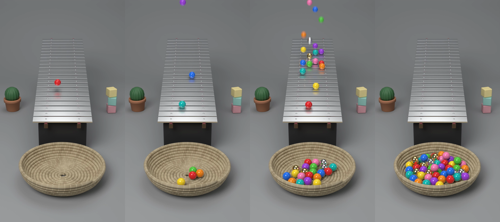

# xylophone-song-template

One command for a whole marble-xylophone Short. It chains every xylophone prop in `ball-sims/` to produce a finished 1080×1920 mp4 with sound, plus a thumbnail.

```
xylophone-ramp           3D set (Blender)                       -> build/scene_meta.json, basket collider
marble-plate-compositor  Cycles plates + lighting probes        -> build/plate, build/probes_proc.npz   (once)
marble-drop-sim          drop schedule -> physics -> hit events -> sim.npz, events.npz
glockenspiel-sounds      events -> soundtrack                   -> .wav
marble-plate-compositor  marbles painted on the plates          -> frames -> .mp4
marble-counter           optional ×1 … ×40! overlay
thumbnail-title          thumbnail from a 16-sample frame       -> _thumbnail.jpg
```

**Used in:** both marble xylophone Shorts. `twinkle` is the 50-marble *Twinkle Twinkle Little Star* video with no text. `forty-marbles` is the rounds-then-pour video with the counter.



## Reuse
```bash
python3 make_video.py twinkle            # -> build/twinkle.mp4, build/twinkle_thumbnail.jpg, build/twinkle_strip.png
python3 make_video.py forty-marbles      # -> build/forty-marbles.mp4 (+ thumbnail)
python3 make_video.py twinkle --frames 0:60   # quick partial render to check a change
```
Steps whose outputs already exist are skipped. The first run spends about 20 minutes on the Cycles plates; after that, a new song takes about 10 minutes on 2 cores. Add `--force` to redo everything, for example after editing the set or the camera.

To make a new song video:
1. Copy `marble-drop-sim/melody.py`, or edit it: change `MELODY` (note names on the ramp, beat numbers), `BEAT`, colors and `DURATION`.
2. Add an entry to `VIDEOS` at the top of `make_video.py`: `duration` (video length), the thumbnail time and preset, and `split` (the frame where the second render worker starts, about 70% in, since the busy finale renders slowest).
3. Run it. `check.py` stops the run if a marble misses its bar or escapes the basket.

Outputs go to `build/`. Don't commit them; upload the mp4 to YouTube instead. Use `twinkle_strip.png` to check the result at a glance.

## Dependencies
Everything the chained props need:
- Python 3.13
- Blender 5.3.0 (`pip install bpy==5.3.0`)
- numpy 2.5.3, scipy 1.18.1, opencv-python 5.0.0.93, Pillow 12.3.0, matplotlib 3.11.2
- ffmpeg 6.1
- the fonts listed in `marble-counter` and `thumbnail-title`
