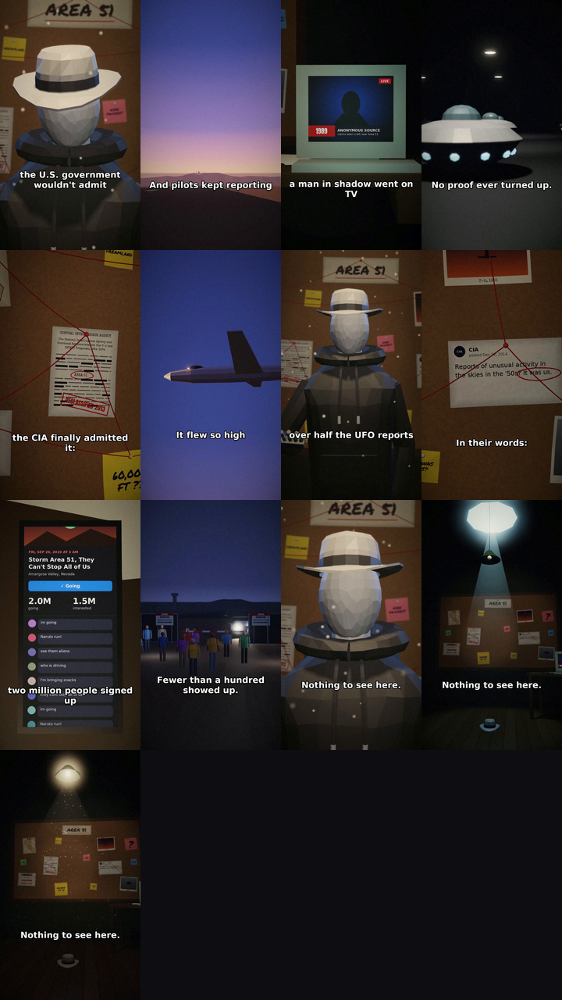

# area-51

The complete code behind "Area 51 Was Real… The Aliens Weren't" (Story Time with Kenji, Nov 2026; 65.99 s, 1,979 frames, 1080×1920, 30 fps). It's a 3D low-poly conspiracy Short about Area 51, the second episode in the format of `../dead-internet-theory`.
- **Story:** the faceless hooded man in the fedora explains the theory in his evidence-board room. It cuts to a desert airbase at dusk, a 1989 TV interview, a hangar of nine saucers, the CIA's 2013 papers, the U-2 glinting above a dark runway, the "Storm Area 51" event page and the gate at night.
- **Twist ending:** after "Nothing to see here." a beam pulls him up through the ceiling. His hat floats down to the floor, the room light flickers back on, and the hat is all that's left.
- **3D throughout:** rendered with `../../shared/lowpoly-gl` on a CPU. The new set pieces (terrain, mountains, planes, saucers, truck, fence, protesters) come from `../lowpoly-sets`.
- **The channel's sound and text:** the voice is `../storytime-narrator` (am_michael), the music is `../storytime-music` in D minor, and the captions come from `../storytime-kit`.



**Used in:** Area 51, Story Time with Kenji, Nov 2026 (delivered as `area_51.mp4`).
- **Render time:** 28.7 min for the 1,980 frames (0.87 s a frame) on a 2-core cloud session, then about 2 min for the final encode (116 MB at CRF 21, −14.5 LUFS).
- **Verified from this folder:** the delivered video was built here, end to end:
  - `build_all.py` (114 mesh parts, 42,412 triangles, 18 textures)
  - `make_video.py narrate`, then `make_audio.py`
  - `make_video.py render` (all 11 scenes)
  - `final`, `preview` and `thumb.py`

## Files
- `story.py`: the 34 caption lines, as (scene, caption[, spoken text]).
- `layout.py`: where everything sits. The room is at the origin; the desert (with the gate) and the hangar are 3 km away. It also holds the board items, pins and strings, the lamp and the desk.
- `textures.py`: the board papers (Nevada map, the CIA's 2013 document, the U-2 photo, the "It was us" post, the Storm Area 51 printout, sticky notes), the 1989 TV interview, the event page on the phone, the warning sign and the chain-link fence, all drawn with Pillow.
- `build_sets.py`: the room, the desert (smooth dusk and night sky domes, terrain, ridges, runway, hangars, tower, airliner, U-2, the gate with its fence, barrier arm and signs, the guard truck, 24 protesters), the saucer hangar and the beam cone.
- `build_all.py`: textures, then `../hooded-man`, then the sets, into `build/assets.npz` (needs bpy).
- `shots.py`: one function per scene (11 scenes), plus the room lights and dust. `s_end` holds the beam-up, the floating hat and the flicker back on.
- `make_video.py`:
  - `narrate`, `stills t…`, `render [scene…]`, `final`, `all`, `preview`
  - The settings at the top hold `TAIL_EXTRA` (2.4 s of silence after the last line, for the beam-up), `REMAP`, the cut dip, the end fade and the encoder.
- `make_audio.py`: the D minor organ, the effect cues and six synthesized effects (a passing airliner, a CRT switching on, breaker clunks, a crowd, the tractor beam, the hat landing), mixed at −14 LUFS.
- `thumb.py`: three no-text thumbnail candidates; the man in the beam (`a`) is the pick.
- `get_fonts.py`: Special Elite, Permanent Marker and Anton from google/fonts at a pinned commit, SHA-256 checked.
- `paths.py`: puts the sibling props on `sys.path`.
- `style.json`: the episode's facts: timing, scenes, lights, music, cues and sources.

## Reuse
```bash
./setup.sh kids-songs --bpy                 # from the repo root
cd kids-songs/area-51
python3 get_fonts.py
python3 build_all.py                        # textures + meshes -> build/assets.npz
python3 make_video.py narrate               # build/voice/, about 2.3 min
python3 make_video.py stills 6.6 37.5 63.6  # full-size stills -> build/stills/, build/stills_sheet.png
python3 make_audio.py                       # build/mix.wav
python3 make_video.py render                # build/scenes/s00.mp4 ... s10.mp4
python3 make_video.py final                 # build/area_51.mp4 (BT.709, tagged, CRF 21)
python3 make_video.py preview               # redraws preview.png from the finished video
python3 thumb.py                            # build/thumb_a.png, thumb_b.png, thumb_c.png
```
- **A new episode in this format:** copy the folder (or `../birds-arent-real`, which has a daytime street), then:
  - rewrite `story.py`, keeping pieces of 2–7 words
  - re-map lines to shots in `REMAP`
  - redraw the board items in `textures.py` and place them in `layout.py`
  - rewrite the scene functions in `shots.py` and the cues in `make_audio.py`
- **Re-rendering:** `render end` or `render 10` renders one scene again. A plain `render` skips scene files that exist.
- **The ending in another episode:** `s_end` only needs the room and the man. The hat comes off as its own three parts, `hat_crown`, `hat_band` and `hat_brim`, with the head's matrix at the moment it slips. It then rotates back upright with `rot_slerp` while it drifts down.

## Gotchas
- **A black square in the beam:** moderngl 5.13's `Context` has no `depth_mask`, so the renderer's additive pass used to write depth, and the lamp's (switched-off) glow sprite hid the beam behind it. It's fixed in `../../shared/lowpoly-gl` by setting the mask on the framebuffer.
- **The U-2 line:** the camera first tilted down from the plane, and the plane's wings filled the frame as grey slabs. "After the ground had gone dark" now cuts to the runway, looking up at a small sunlit U-2 over runway lights.
- **The gate:** the first fence was off-frame, so the crowd stood at a yellow line. The gate is now 5.5 m wide, with a striped barrier arm and two warning signs beside it, and the camera ends 21 m back. The desert's noise made a mound there until `flats` flattened it.
- **Mountains** were first a row of spikes; `../lowpoly-sets` now makes one continuous ridge.
- **Skies:** per-face sky colours showed facets in the dusk gradient. `add_smooth_sky` writes a per-vertex gradient instead (material mode 5).
- **The end fade** would have darkened the empty-room reveal, so `END_FADE` is 0.7 s and the tail is 2.4 s.
- **Facts** were checked on Nov 28, 2026 (see `style.json`). "Fewer than a hundred showed up" means the gate (AP: about 75; NPR, citing Nevada authorities: about 40). About 1,500 went to the festivals nearby.
- **Names:** the 1989 interview was Bob Lazar on KLAS-TV, but the video calls him "a man in shadow" and the TV shows only a silhouette. No real outlet or logo is drawn.

## What it can't do
- No lip sync (he has no face) and no walking.
- Each set is far from the others, so there are no camera moves between them, only cuts.
- No reflections or global illumination. The planes are lit by a narrow spot standing in for the low sun.

## Dependencies (tested)
- Python 3.13.18, bpy 5.3.0 (assets only), moderngl 5.13.0 on Mesa 25.2.8 llvmpipe, numpy 2.5.3, opencv-python-headless 5.0.0.93, pillow 12.3.0, skia-python 144.1, scipy 1.18.1, soundfile 0.14.0, kokoro-onnx 0.6.1 with onnxruntime 1.29.0
- ffmpeg 6.1.1 with libx264 and the `loudnorm` filter
- Fonts from `get_fonts.py` (Apache 2.0 and SIL OFL 1.1), plus DejaVu from `../storytime-kit/get_fonts.py`
