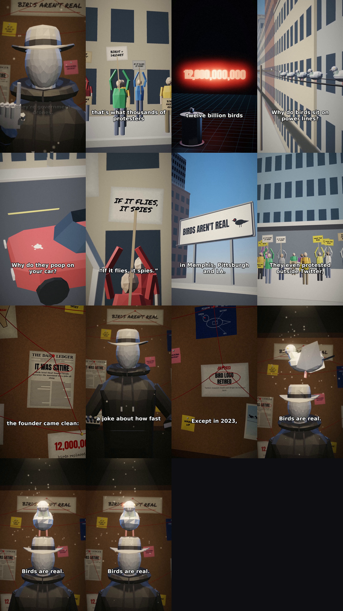

# birds-arent-real

The complete code behind "Birds Aren't Real… Supposedly" (Story Time with Kenji, Nov 2026; 55.5 s, 1,665 frames, 1080×1920, 30 fps). It's a 3D low-poly Short about the satirical "Birds Aren't Real" movement, the third episode in the format of `../dead-internet-theory`.
- **Story:** the faceless hooded man in the fedora tells it from his evidence-board room. It cuts to a street rally with placards, a pigeon specimen under a glowing "12,000,000,000", pigeons charging on a power line, a car getting "tagged", the billboard and the protest outside an HQ. Then come the 2021 confession and the 2023 logo change.
- **Twist ending:** on "Birds are real." a pigeon flies in and lands on his hat, turns to the camera, and its eye lights up red.
- **Daytime 3D:** the street is lit by a low sun over a smooth sky dome. Building windows come from `../../shared/lowpoly-gl` material mode 1, scaled to real storeys with `wsc` and tinted with `wcol`. The pigeons, car, poles, billboard and crowds come from `../lowpoly-sets`.
- **The channel's sound and text:** the voice is `../storytime-narrator` (am_michael), the music is `../storytime-music` in G minor, and the captions come from `../storytime-kit`.



**Used in:** Birds Aren't Real, Story Time with Kenji, Nov 2026 (delivered as `birds_arent_real.mp4`).
- **Render time:** 25.9 min for the 1,665 frames (0.93 s a frame) on a 2-core cloud session, then about 2 min for the final encode (81 MB at CRF 21, −14.6 LUFS).
- **Verified from this folder:** VERIFIED

## Files
- `story.py`: the 31 caption lines, as (scene, caption[, spoken text]).
- `layout.py`: where everything sits. The room is at the origin; the street and the specimen stage are 3 km away. It also holds the power line (`wire_z`), car, billboard, rally and HQ positions, the board items, pins and strings, the lamp and the desk.
- `textures.py`: the board papers (the US billboard map, the "IT WAS SATIRE" clipping under an invented masthead, the drone blueprint, the "BIRD LOGO RETIRED" clipping, the HQ flyer, the "12,000,000,000" card, sticky notes), five placards, the billboard, the CRT news screen and the phone feed, all drawn with Pillow.
- `build_sets.py`: the room, the street (road, sidewalks, buildings, the glass HQ and its plaza, poles with three sagging wires per span, the parked car, the billboard, the day sky, 28 protesters, placards), the pigeon (and its metal "robot" body, the LED, the splat) and the specimen stage with the 3D number in Anton.
- `build_all.py`: textures, then `../hooded-man`, then the sets, into `build/assets.npz` (needs bpy).
- `shots.py`: one function per scene (12 scenes), plus `pigeon_items` (flapping wings, LED), `crowd_items` (placards held overhead or at the chest, chanting bob) and the room lights.
- `make_video.py`:
  - `narrate`, `stills t…`, `render [scene…]`, `final`, `all`, `preview`
  - The settings at the top hold `TAIL_EXTRA` (1.6 s after the last line, for the pigeon), `REMAP`, the cut dip, the end fade and the encoder.
- `make_audio.py`: the G minor organ, the effect cues and nine synthesized effects (a chanting crowd, a coo, wing flaps, a splat, beeps, a scan sweep, power-line charging, a servo whir, a record scratch), mixed at −14 LUFS.
- `thumb.py`: three no-text thumbnail candidates; the pigeon on his hat (`a`) is the pick.
- `get_fonts.py`: Special Elite, Permanent Marker and Anton from google/fonts at a pinned commit, SHA-256 checked.
- `paths.py`: puts the sibling props on `sys.path`.
- `style.json`: the episode's facts: timing, scenes, lights, music, cues and sources.

## Reuse
```bash
./setup.sh kids-songs --bpy                 # from the repo root
cd kids-songs/birds-arent-real
python3 get_fonts.py
python3 build_all.py                        # textures + meshes -> build/assets.npz
python3 make_video.py narrate               # build/voice/, about 2 min
python3 make_video.py stills 12 18.6 54.2   # full-size stills -> build/stills/, build/stills_sheet.png
python3 make_audio.py                       # build/mix.wav
python3 make_video.py render                # build/scenes/s00.mp4 ... s11.mp4
python3 make_video.py final                 # build/birds_arent_real.mp4 (BT.709, tagged, CRF 21)
python3 make_video.py preview               # redraws preview.png from the finished video
python3 thumb.py                            # build/thumb_a.png, thumb_b.png, thumb_c.png
```
- **A new episode in this format:** copy the folder (or `../area-51` for a desert at dusk and night), then:
  - rewrite `story.py`, keeping pieces of 2–7 words
  - re-map lines to shots in `REMAP`
  - redraw the board items in `textures.py` and place them in `layout.py`
  - rewrite the scene functions in `shots.py` and the cues in `make_audio.py`
- **A crowd with signs anywhere:** `crowd_layout(seed, rows, width)` and `crowd_items(origin, layout, gt, signs)`. Every third person holds the placard at the chest; the rest hold it overhead and pump it.
- **A pigeon anywhere:** `pigeon_items(M, flap=angle_or_None, led=0..1, led_col, robot)`. `flap_angle(t)` beats 7 times a second; `None` folds the wings away.

## Gotchas
- **Daylight exposure:** the first street frames were near-white. The sky colours are linear values (a mid blue is about 0.1–0.5, not 0.8), the sun is a 1.35-energy directional light and the ambient is about 0.15.
- **Windows:** mode 1's cells were 0.9×1.1 m, which turned façades into graph paper. `wsc=(2.2, 3.0)` makes storey-sized windows and `wcol` makes them dark glass.
- **The portrait frame is narrow:** a wide billboard only fits when seen at an angle, a flying bird crosses the frame in about 0.6 s, and the protest camera stands on the plaza so the crowd isn't a strip at the bottom.
- **Pigeons on the wire** sit at `layout.wire_z(u)`, the same curve the wire meshes use, so their feet touch it.
- **The splat** drops from 1.6 m. At 2.5 m the bird was above the top of the frame.
- **Dust:** after the renderer's depth-mask fix, motes inside the lamp's cone show, so the dust is at 0.45 of its old brightness.
- **No logos:** the HQ has no sign and the placards say "DROP THE BIRD". The newspaper masthead is invented ("The Daily Ledger"), and the founder isn't named.
- **Facts** were checked on Nov 28, 2026 (see `style.json`). The lore (12 billion birds, charging on power lines, droppings as trackers) is the movement's own joke and is told as their story.

## What it can't do
- No lip sync (he has no face) and no walking; the protesters only bob and pump their signs.
- The pigeon's head can't turn on its own; the whole bird turns.
- No reflections or global illumination, so the glass HQ is only a tinted window grid.

## Dependencies (tested)
- Python 3.13.18, bpy 5.3.0 (assets only), moderngl 5.13.0 on Mesa 25.2.8 llvmpipe, numpy 2.5.3, opencv-python-headless 5.0.0.93, pillow 12.3.0, skia-python 144.1, scipy 1.18.1, soundfile 0.14.0, kokoro-onnx 0.6.1 with onnxruntime 1.29.0
- ffmpeg 6.1.1 with libx264 and the `loudnorm` filter
- Fonts from `get_fonts.py` (Apache 2.0 and SIL OFL 1.1), plus DejaVu from `../storytime-kit/get_fonts.py`
